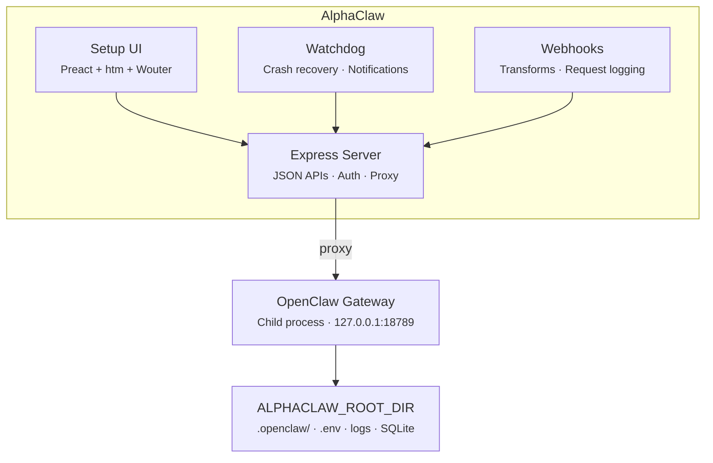

<p align="center">
  
</p>
<h1 align="center">AlphaClaw</h1>
<p align="center">
  <strong>The ultimate OpenClaw harness. Deploy in minutes. Stay running for months.</strong><br>
  <strong>Observability. Reliability. Agent discipline. Zero SSH rescue missions.</strong>
</p>

<p align="center">
  <a href="https://github.com/chrysb/alphaclaw/actions/workflows/ci.yml"></a>
  <a href="https://www.npmjs.com/package/@chrysb/alphaclaw"></a>
  <a href="LICENSE"></a>
</p>

<p align="center">AlphaClaw wraps <a href="https://github.com/openclaw/openclaw">OpenClaw</a> with a convenient setup wizard, self-healing watchdog, Git-backed rollback, and full browser-based observability. Ships with anti-drift prompt hardening to keep your agent disciplined, and simplifies integrations (e.g. Google Workspace, Google Pub/Sub, Telegram Topics, Slack, Discord) so you can manage multiple agents from one UI instead of config files.</p>

<p align="center"><em>First deploy to first message in under five minutes.</em></p>

<p align="center">
  <a href="https://render.com/templates/alphaclaw"></a>
  <a href="https://railway.com/deploy/openclaw-fast-start?referralCode=jcFhp_&utm_medium=integration&utm_source=template&utm_campaign=generic"></a>
  <a href="https://updates.alphaclaw.md/desktop/prod/alphaclaw-mac-latest.dmg"></a>
</p>

<p align="center"><strong>Render sponsors AlphaClaw.</strong> Redeem $50 in Render credits with code <code>RENDER-ALPHACLAW</code>.</p>

> **Platform:** AlphaClaw currently targets Docker/Linux deployments. macOS local development is not yet supported.

## Features

- **Setup UI:** Password-protected web dashboard for onboarding, configuration, and day-to-day management.
- **Guided Onboarding:** Step-by-step setup wizard — model selection, provider credentials, GitHub repo, channel pairing.
- **Multi-Agent Management:** Sidebar-driven agent navigation with create, rename, and delete flows. Per-agent overview cards, channel bindings, and URL-driven agent selection.
- **Agent Chat:** Chat with any agent session right from the sidebar. Sends queue durably and survive page reloads. Safe retries reconcile the original message ID against durable submission evidence; uncertain sends stay visible for review, and an explicit “Send again” creates a new ID. Stop reports honestly, interruptions show up inline in the transcript, and the connection reconnects on its own with keepalives on both the browser and gateway sockets.
- **Team Access (beta):** Share one AlphaClaw with named teammates. Each person signs in with their own email and password, OpenClaw attributes messages per person, and a who's-online roster shows presence. Admins invite members with expiring single-use links, assign roles, and disable or remove accounts; members can chat and view status while updates, secrets, terminals, agents, and team management stay admin-only. Requires the OpenClaw 2026.8.1-beta line.
- **Gateway Manager:** Spawns, monitors, restarts, and proxies the OpenClaw gateway as a managed child process. Restart is one click: AlphaClaw asks OpenClaw to restart itself (the agent finishes its turn, up to 30 s; an ask whose reply is lost while the gateway is already draining is waited out, not forced), forces it if it will not stop, starts a fresh gateway and only says Running once the new one answers `/readyz`. The card shows one progress line with the server's timer, and on failure one sentence naming which half failed with Try again and View logs. Repair (Doctor) keeps its confirmation. A blocker (another operation, a hold, AlphaClaw still booting) shows its cause instead of a disabled button.
- **Watchdog:** Crash detection, crash-loop recovery, auto-repair (`openclaw doctor --fix`), memory-leak detection that can warn hours before the gateway hits its limit (with strictly opt-in pre-OOM auto-restart), Telegram/Discord/Slack/WhatsApp notifications, and a live interactive terminal for monitoring gateway output directly from the browser.
- **Resource Autotune:** Sizes resource-dependent settings to the container's real capacity (default ON) — gateway heap, agent concurrency, request body limits and SQLite caches — with a persisted detected → derived → applied ledger, live resize detection, and OOM classification. Opt out per deployment from the Watchdog tab or with the `ALPHACLAW_AUTOTUNE_DISABLED=1` kill-switch.
- **Channel Orchestration:** Telegram, Discord, Slack, ClickClack, and Buzz bot pairing with per-agent channel bindings, credential sync, and a guided wizard for splitting Telegram into multi-threaded topic groups as your usage grows. ClickClack sets up from a single pasted setup code or URL; Buzz installs through a resumable plugin wizard (both need the OpenClaw beta line for their guided flows).
- **Google Workspace:** OAuth integration for Gmail, Calendar, Drive, Docs, Sheets, Tasks, Contacts, and Meet, plus guided Gmail watch setup with Google Pub/Sub topic, subscription, and push endpoint handling. Start, Stop, renewal and disconnect share one account operation: the latest intent wins, Stop records disabled intent immediately, and unfinished remote cancellation remains visible with Retry after reload. Failed disconnect keeps the account disabled so cleanup can be retried.
- **Cron Jobs:** Dedicated cron tab with job management, an interactive rolling calendar, run-history drilldowns, trend analytics, and per-run usage breakdowns.
- **Nodes:** Guided local-node setup for VPS deployments with per-node browser attach checks, reconnect commands, and routing/pairing controls.
- **Webhooks:** Named webhook endpoints with per-hook transform modules, request logging, payload inspection, editable delivery destinations, and OAuth callback support for third-party auth flows.
- **File Explorer:** Browser-based workspace explorer with file visibility, inline edits, diff view, and Git-aware sync for quick fixes without SSH.
- **Prompt Hardening:** Ships anti-drift bootstrap rules as a single merged `hooks/bootstrap/AGENTS.md` injected into your agent's system prompt on every message — enforcing safe practices, commit discipline, and change summaries out of the box on every supported OpenClaw version (existing installs migrate automatically, and the General tab shows whether the rules are actually reaching the agent — a compact status badge, escalating to an actionable card naming the affected file, the true cause, and the fix when hardening is dropped, truncated, or blocked, with a one-click jump into the Doctor's context meter).
- **Git Sync:** Automatic hourly commits of your OpenClaw workspace to GitHub with configurable cron schedule. Combined with prompt hardening, every agent action is version-controlled and auditable.
- **Version Management:** In-place updates for both AlphaClaw and OpenClaw with in-app release notes, changelog review, and one-click apply.
- **Agent Administration:** Optional (off by default) mode that lets the OpenClaw agent drive the same dashboard API the web UI uses through an `alphaclaw admin` CLI, with tiered guardrails, confirm codes for dangerous operations, a rotatable bearer token, and full Watchdog audit logging.
- **Codex OAuth:** Built-in PKCE flow for OpenAI Codex CLI model access.

## Why AlphaClaw

- **Zero to production in one deploy:** Render/Railway templates ship a complete stack — no manual gateway setup.
- **Self-healing:** Watchdog detects crashes, enters repair mode, relaunches the gateway, and notifies you.
- **Everything in the browser:** No SSH, no config files to hand-edit, no CLI required after first deploy.
- **Stays out of the way:** AlphaClaw manages infrastructure; OpenClaw handles the AI.

## No Lock-in. Eject Anytime.

AlphaClaw simply wraps OpenClaw, it's not a dependency. Remove AlphaClaw and your agent keeps running. Nothing proprietary, nothing to migrate.

## Quick Start

### Deploy on Render (recommended)

[](https://render.com/templates/alphaclaw)

Render sponsors AlphaClaw. Use code **`RENDER-ALPHACLAW`** to redeem **$50 in Render credits**. The deployment is maintained in Render's [official AlphaClaw template repository](https://github.com/render-examples/openclaw-render-template).

> **Render sizing:** one AlphaClaw container runs the admin server, the OpenClaw gateway (a second Node.js runtime), up to five `gog` Google Workspace daemons, an hourly git-sync cron, and periodic `npm`/`pnpm` installs during updates. We recommend **at least 2 GB RAM / 1 CPU** (Render `standard` or larger). The `starter` tier (512 MB / 0.5 CPU) can OOM under normal operation and makes every update slower.
>
> **Per-process heap budgets:** if you cap the Node heap, set it on the admin process only (e.g. `node --max-old-space-size=768 bin/alphaclaw.js start` in your start command) rather than via a blanket `NODE_OPTIONS` env var — children would inherit it. AlphaClaw strips memory flags from the gateway's environment so the two processes keep separate budgets (and logs what it stripped). With **resource autotune** (default ON) the gateway's heap is sized automatically from the container's real memory limit, and `GET /api/autotune` reports a recommended admin-process cap for your box (omitted on very small containers, where the honest recommendation is a bigger box). To pin the **gateway's** heap by hand instead, set `ALPHACLAW_GATEWAY_MAX_OLD_SPACE_SIZE=<MB>` (e.g. `8192`) — it applies to the long-running gateway daemon only, never to short-lived `openclaw` CLI calls, and wins over autotune's derived value (the autotune ledger marks that row operator-set). With autotune off and no cap, Node sizes the gateway heap from host RAM (~40% — nearly 50 GB on a 123 GB box).
>
> **Resource autotune runbook:** the Watchdog tab's Autotune card (and `GET /api/autotune`) shows what was detected on this container, what was derived, and what's applied — each row says whether a **gateway** restart or an **AlphaClaw** restart (redeploy from your host dashboard) finishes applying it. Pin a single setting with an override (`alphaclaw admin PUT /api/autotune/settings --data '{"overrides":{"gatewayHeapMb":2048}}'`; `null` clears a key), re-probe after a platform resize with `POST /api/autotune/reapply`, turn it off with the card toggle, or — even mid-crash-loop — set `ALPHACLAW_AUTOTUNE_DISABLED=1` in your platform's environment settings. Disabling restores the built-in (pre-autotune) defaults — a gateway restart (and, for body limits and database caches, an AlphaClaw restart) finishes the revert.
>
> **Health checks:** point your platform health check at `/health` (always 200 while the admin server can serve — a wedged gateway is healed by the watchdog, not container restarts). Operators who want strict gateway readiness gating can point it at `/health/ready` instead (503 while the gateway is down; be aware this restarts the container during gateway recovery, and a **fresh, not-yet-onboarded instance also reports 503** — only switch to `/health/ready` after onboarding completes or the container will restart-loop before you can finish setup). Ops signal: if `eventLoop.p99Ms` in `/api/watchdog/resources` stays above 500ms, check recent gateway restarts and workspace size.

### Other deployment options

[](https://railway.com/deploy/openclaw-fast-start?referralCode=jcFhp_&utm_medium=integration&utm_source=template&utm_campaign=generic)

Set `SETUP_PASSWORD` at deploy time and visit your deployment URL. The welcome wizard handles the rest.

> **Railway users:** after deploying, upgrade to the **Hobby plan** and redeploy to ensure your service has at least **8 GB of RAM**. The Trial plan's memory limit can cause out-of-memory crashes during normal operation.

### Local / Docker

```bash
npm install @chrysb/alphaclaw
npx alphaclaw start
```

On a Debian/Ubuntu host also run `command -v lsof || apt-get install -y lsof`: the pinned OpenClaw CLI finds the running gateway through `lsof`, and without it the graceful restart ask (`openclaw gateway restart --wait`) refuses with "No verified gateway process is listening" and every restart goes straight to SIGTERM (AlphaClaw ships a `/proc`-backed shim for the ask when `lsof` is missing, see `ALPHACLAW_LSOF_SHIM` below).

Or with Docker:

```dockerfile
FROM node:24-slim
RUN apt-get update && apt-get install -y --no-install-recommends git curl procps cron tini tmux lsof ca-certificates && rm -rf /var/lib/apt/lists/*
# Optional but recommended: the local Claude Code rescue session needs tmux
# (above) and the claude CLI. Keep this pin in step with the reference
# Dockerfile; without this layer the launcher reports not_installed and
# falls back to the cloud routine.
RUN npm install -g @anthropic-ai/claude-code@2.1.251
WORKDIR /app
COPY package.json ./
RUN npm install --omit=dev
# Fail the build, not the first boot, if the floating base tag resolved to a
# Node below AlphaClaw's floor (>=24.22.1 since v0.10.48, the OpenClaw 2026.10.6 pin).
RUN node -e "require('@chrysb/alphaclaw/lib/node-runtime').assertSupportedNodeVersion()"
ENV PATH="/app/node_modules/.bin:$PATH"
ENV ALPHACLAW_ROOT_DIR=/data
EXPOSE 3000
ENTRYPOINT ["/usr/bin/tini", "--"]
CMD ["alphaclaw", "start"]
```

The reference [`Dockerfile`](Dockerfile) is this recipe with two additions:
it installs AlphaClaw from an `npm pack` tarball of the checkout (so
`npm run test:container` can build and boot the local tree) instead of from a
`package.json` pin, and it bakes in the toolchain for the
[local rescue session](#local-rescue-session-preferred-when-set-up) — tmux plus
a pinned `@anthropic-ai/claude-code`. Everything else — tini as PID 1,
`ALPHACLAW_ROOT_DIR=/data`, port 3000, `alphaclaw start` — is identical, and
the container E2E runs against an image built from it (docker required).

### Running as a normal user

`alphaclaw start` provides three binaries: the git auth shim (`git`), a `systemctl` shim when the machine has none, and the `gog` Google Workspace CLI when it is missing. As root (the Docker images) they go to `/usr/local/bin`, as before. As any other user they go to `<ALPHACLAW_ROOT_DIR>/bin`, which AlphaClaw puts first on `PATH` for itself and everything it starts (the gateway, Doctor, `openclaw` and `alphaclaw` CLI calls), so a normal-user install never writes `/usr/local/bin` or shadows the machine's git. `ALPHACLAW_GIT_SHIM_PATH` still overrides the git shim's path. A git shim an earlier version left at `/usr/local/bin/git` for this same install is removed at boot; any other file there is left alone. The operator-shell wrapper and `/etc/profile.d` snippet are still root-only (or written to `ALPHACLAW_OPENCLAW_WRAPPER_PATH` / `ALPHACLAW_PROFILE_SNIPPET_PATH`), and as a normal user they also put `<ALPHACLAW_ROOT_DIR>/bin` first on `PATH`. The scheduled sync's `/etc/cron.d` entry needs root as before, and it does not need these binaries: `alphaclaw git-sync` runs the real git with its own askpass.

## Setup UI

| Tab           | What it manages                                                                                                          |
| ------------- | ------------------------------------------------------------------------------------------------------------------------ |
| **General**   | Gateway status, channel health, pending pairings, Google Workspace, repo sync schedule, prompt-hardening status (compact badge, actionable card in problem states), one-click OpenClaw dashboard (opens signed in) |
| **Browse**    | File explorer for workspace visibility, inline edits, diff review, and Git-backed sync                                   |
| **Usage**     | Token summaries, per-session and per-agent cost and token breakdown with source/agent dimension comparisons              |
| **Cron**      | Cron job management, interactive rolling calendar, run-history drilldowns, trend analytics, and per-run usage breakdowns |
| **Doctor**    | Drift Doctor workspace health review — LLM scan plus deterministic environment checks, model-drift checks (outdated model bindings, invalid model codings, context-limit drift, and skills still steering the agent toward old models), and bridged `openclaw doctor` findings, a context-budget meter against OpenClaw's real injection budget with self-explaining Blocked/Dropped/Truncated chips, opt-in scheduled scans, configurable scan limits, and queued fixes you can dispatch to your agent in the chat you pick |
| **Nodes**     | Guided local-node setup for VPS deployments, per-node browser attach, reconnect commands, and routing/pairing controls   |
| **Team**      | Member accounts, invites, roles, and a who's-online roster (beta) — enable wizard applies the gateway change and verifies login end to end |
| **Watchdog**  | Health monitoring, live status narrative, incident history, optional AI incident overseer, resource autotune card, gateway memory trend + leak-detection settings, auto-repair toggle, notifications, event log, live log tail, interactive terminal |
| **Models**    | AI provider credentials (Anthropic, OpenAI, Gemini, Mistral, Voyage, Groq, Deepgram) and model selection                 |
| **Envars**    | Environment variables — view, edit, add — with gateway restart prompts                                                   |
| **Webhooks**  | Webhook endpoints, transform modules, request history, payload inspection, OAuth callbacks, Gmail watch delivery flows   |

## Open Claude Code Launcher

The Monitoring section of the sidebar has an **Open Claude Code** item. Out of the box it opens [claude.ai/code](https://claude.ai/code) in a new tab. Configure it and one click starts a Claude Code session and lands you directly in it — a **local rescue session on the box itself** once you've done its one-time login (see below), or a fresh cloud session via a claude.ai routine.

Routine setup (one time, on your claude.ai account — requires a Pro/Max/Team/Enterprise plan):

1. Create a routine at [claude.ai/code/routines](https://claude.ai/code/routines). Keep its prompt minimal — something like "Await instructions." — because every fire runs the routine's saved prompt as an **autonomous session** (shell access, no approval prompts) that consumes your claude.ai subscription usage.
2. Edit the routine → **Add another trigger** → **API** → **Generate token**, then copy the fire URL and the token (shown once).
3. Paste them into Envars as `CLAUDE_CODE_ROUTINE_URL` (the full URL or just the `trig_…` id) and `CLAUDE_CODE_ROUTINE_TOKEN`. Changes apply immediately — no restart.

Behavior and guardrails:

- The first fire asks for a one-time confirmation; after that it's one click. Cmd/ctrl-click always opens plain claude.ai/code without firing (the escape hatch).
- A small accent dot on the sidebar item shows when the launcher is armed to fire rather than just link out.
- The server enforces the confirmation, a single-flight guard, and a short cooldown (longer after a timeout: the fire API has **no idempotency key**, so a timed-out fire may still have created a billed session — check claude.ai/code before retrying).
- The launcher never sends the token to the browser (status checks are presence-only), the token is excluded from the OpenClaw gateway's child environment, and the fire endpoint is denied to the agent-admin actor. Like every secret in `~/.alphaclaw/.env`, admins can view it in the Envars editor, and a same-host process that can read that file can read it too — environment inheritance itself was closed in v0.9.63 (`lib/server/gateway-env-policy.js` allowlists what reaches the gateway child and denies every `CLAUDE_CODE_ROUTINE_*` / `CLAUDE_CODE_LOCAL_*` key by prefix; see CHANGELOG), so the remaining exposure is same-uid disk access to that file, not the child environment.
- Routines belong to one claude.ai account: in multi-admin installs, every admin's click fires (and bills) the token owner's account, and the session URL only opens for someone logged into that account.
- `CLAUDE_CODE_ROUTINE_TOKEN` is **not** the same as `ANTHROPIC_TOKEN` (the `claude setup-token`), despite the shared `sk-ant-oat01-` prefix — it is a per-routine trigger credential from the claude.ai UI.

### Local rescue session (preferred when set up)

The launcher's local path opens a Claude Code instance running **on the box itself**: a `claude remote-control` session hosted in detached tmux, reached through its Remote Control URL. Once its login is done, the button prefers this path (the routine stays as the fallback), so you can debug AlphaClaw/OpenClaw from claude.ai/code — or your phone — with hands on the actual machine, even while OpenClaw is down.

- **One-time login.** The Watchdog page's rescue-session card walks you through `claude auth login` in the browser (claude.ai subscription OAuth — Remote Control refuses API keys). Credentials live in `<root>/claude-code-local/home/`, deliberately **outside backups**: after restoring a backup, run the login again.
- **Revocable link.** The card, QR code, launcher, and notifications hand out an AlphaClaw-owned capability link — `<your-alphaclaw>/rescue/<token>` — that redirects to the live session. **Links AlphaClaw distributed stop working on Stop; each new session start mints a new one** (Start on an already-running session returns the existing link — stop first to rotate). An AlphaClaw restart with a still-live session keeps the same link. Honest boundaries: the guarantee does not cover fallback notifications sent with no public base URL configured (those carry the raw claude.ai URL — set `ALPHACLAW_SETUP_URL`), the underlying claude.ai URL disclosed to someone who already followed the redirect remains valid on Anthropic's side (claude.ai-account-gated), and a reverse proxy in front of AlphaClaw may access-log capability paths (inherent to capability URLs — revocation is the mitigation). The link needs the AlphaClaw server up; the card's `tmux … attach` hint is the out-of-band fallback. **Upgrading from a release before v0.9.66: links distributed before the upgrade are raw claude.ai URLs — stop + start the rescue session once to cut over to revocable links.**
- **Survives AlphaClaw restarts.** The tmux session outlives the AlphaClaw process; the card shows the rescue link (with a QR code for your phone), a copyable `tmux … attach` hint for shell access, one-click Stop, and a sanitized terminal tail when a spawn fails. Optionally warm a session at boot, or automatically when the watchdog opens an incident — the incident notification carries the link when the session is already running. Each use of the link is recorded as a watchdog operation event (IP + user agent); after an *unexpected* pane death the link dies on the next liveness poll, and a click also triggers a check — that click may still receive the stale redirect to the already-dead session, subsequent clicks 404 (explicit Stop revokes immediately; tmux hosting only — script-hosted sessions detect death instantly on process exit). Both GET and HEAD redirect (HEAD skips the liveness check); a malformed link gets a plain 400. Behind a reverse proxy, set `ALPHACLAW_SETUP_URL` so links and QR codes are built from the validated public origin instead of request headers (origins/subdomains only — path-prefixed proxy deployments like `https://host/alphaclaw` are not supported for rescue links).
- **Permissions.** Sessions default to `acceptEdits`; `bypassPermissions` is opt-in and only ever applies to sessions you start by clicking through the mode-named confirmation — unattended spawns (autostart, incidents) always clamp to `acceptEdits`. Note the session can read box content, including untrusted logs (a prompt-injection surface), and transmits selected content to Anthropic as part of operating Claude Code.
- **Settings.** Five `CLAUDE_CODE_LOCAL_*` keys on the Envars page — enable/kill switch, autostart, permission mode, working directory, incident auto-spawn — all hot-reloaded, no restart. Disabling never kills a live session; stop it from the Watchdog card.

#### State runbook (`local.state` on the status endpoint / Watchdog card)

`<root>` below is `ALPHACLAW_ROOT_DIR` (`/data` in the container, `~/.alphaclaw` otherwise).

| State | Meaning → fix |
| ----- | ------------- |
| `probing` | First background probe hasn't finished (just after boot) → re-check in a few seconds. |
| `disabled` | `CLAUDE_CODE_LOCAL_ENABLED` is 0/false → re-enable in Envars (hot-reload). Disabling never kills a live session — it only blocks new spawns/logins, and a still-live session is re-adopted (read-only, nothing spawned) after an AlphaClaw restart so the card keeps showing it with Stop and a working rescue link; stop it from the Watchdog card. |
| `not_installed` | The `claude` CLI is missing → `npm install -g @anthropic-ai/claude-code` (the Docker image ships a pinned copy, so this means a non-Docker install). |
| `needs_login` | No OAuth credential under the rescue HOME → one-time login from the Watchdog card. Credentials live OUTSIDE backups at `<root>/claude-code-local/home/` — after restoring a backup, re-run the login. |
| `login_in_progress` | The guided login is running (10-minute TTL) → finish or cancel it from the card; sessions cannot start meanwhile. |
| `ready` | Installed and logged in, no session → the sidebar button (or Start on the card) spawns one. |
| `starting` | Spawned; waiting up to 60s for the Remote Control URL. |
| `running` | Live; revocable `/rescue/<token>` link (and QR) on the card — dead links mean the session was stopped or replaced (start a new one). Shell attach, last resort when claude.ai is unreachable: `tmux -S <root>/claude-code-local/tmux.sock attach -t alphaclaw-rescue`. |
| `error` | `local.error` carries code + message → view the sanitized tail on the card; Stop clears it, and the next start kills any leftover failed session before spawning fresh. |
| `stopping` | A stop is in flight → transient. |

Post-rollback cleanup: after rolling the feature back (env kill switch or code revert), a live tmux session deliberately survives — clean it up with `tmux -S <root>/claude-code-local/tmux.sock kill-server`. The credentials dir is harmless to leave; the card's Logout removes it beforehand if wanted.

## OpenClaw Version

AlphaClaw runs exactly the OpenClaw version pinned in its `package.json`. The pin moves only with an AlphaClaw release: each release is tested against its pin, and there is no in-app version switching. To run a newer OpenClaw, deploy the AlphaClaw release that pins it.

- **First boot of a new pin runs OpenClaw's own migration.** Before the gateway starts, AlphaClaw runs `openclaw doctor --fix` once per pinned version (upstream's documented step after replacing OpenClaw) and records the version it completed for in `.alphaclaw/openclaw-boot-migration.json`. If doctor fails, you get a notification and the gateway starts anyway; a config the new build rejects is then handled by the watchdog and the startup medic.
- **Back up now.** The General tab's Backups card runs OpenClaw's own `openclaw backup create --verify` into `<root>/backups/openclaw` and shows the archive path and size (`POST /api/openclaw/backup` starts one, `GET /api/openclaw/backup` reports progress and the last result). The gateway keeps running. Restoring an archive is OpenClaw's own procedure.
- **Boxes that used the removed in-app version switch.** Releases up to v0.9.98 had an Upgrade tab that could run beta or dev builds on top of the pin. On the first boot of a newer release, AlphaClaw retires that state: it removes the overlay shim, moves `.alphaclaw/openclaw-channel-state.json` aside, and, when the box ran a build newer than the pin (any beta/dev pick, or a newer stable), sends one notice naming it. OpenClaw databases a newer beta/dev build migrated may not open on the pinned build; recover by deploying an AlphaClaw release that pins a build at least that new, or by restoring a backup taken before the switch.
- **Gateway startup medic (on by default).** If the gateway dies at startup with a fatal configuration error, AlphaClaw fixes it instead of staying down: it removes the config keys the gateway itself rejected (best-effort backup taken first), or runs OpenClaw's `doctor --fix`, then restarts — and for unfamiliar failures it asks the smartest frontier model you have an API key for (Anthropic, OpenAI, or Gemini; evidence is secret-redacted first) to diagnose and choose from a fixed menu of safe remedies. At most two attempts per incident, every action is announced, and you can turn it off in the Watchdog tab's settings.
- **Notifications you can route.** Watchdog and maintenance events go through a durable outbox (retried, re-delivered after restarts) and can be routed to specific admin chats with a preferred channel and fallbacks, instead of broadcasting to every paired conversation. Overseer notices expire sixty minutes after first handling, including through retries and restarts; expired notices retain their history without paging later. Other notices keep the existing 48-hour retry policy.
- **Every boot is recorded.** Each boot writes `boot-report.json` (what the bin phase saw, what the server phase found, a `verdict[]`) and stamps `alphaclaw-version.json`, including the declared pin and the installed OpenClaw version; an install that does not match the pin is reported there and in `alphaclaw diagnose`.
- **Managed AlphaClaw deployments stay identifiable.** An accepted or uncertain provider request remains visible across reloads, restarts and version changes. It blocks another submission until a human admin verifies the provider has finished or cancelled the deployment and resolves that exact attempt. See [managed deployment recovery](docs/upgrade-troubleshooting.md#managed-deployment-accepted-or-unknown).
- **Recovery explains its wait.** Crash recovery survives temporary maintenance contention. Watchdog shows its age and blocker; repair cleanup that cannot confirm writer termination shows **Repair cleanup needs attention** and retains ownership. See [pending recovery and cleanup](docs/upgrade-troubleshooting.md#pending-recovery-or-cleanup_blocked).

## Agent Administration

Off by default. When you enable `features.agentAdmin` (Setup UI -> General tab, "Agent Administration" panel, or `PUT /api/alphaclaw/config/features/agent-admin`), the OpenClaw agent can administer the deployment on behalf of admin users. It works through an `alphaclaw admin <METHOD> /api/path` CLI that drives the same dashboard HTTP API the web UI uses, so the server owns all validation and side effects. With the flag off, nothing observable changes.

Enabling it regenerates an `alphaclaw-admin` skill into the agent's workspace (rebuilt at boot, effective on the agent's next session) and appends an "AlphaClaw Administration" pointer stanza to the merged `hooks/bootstrap/AGENTS.md` prompt-hardening file in every agent workspace (written when you enable the flag and re-rendered at every boot; it appears only once the skill is actually installed). Nothing is written to a `TOOLS.md` — OpenClaw 2026.8.1+ no longer accepts it as a bootstrap file, and any legacy AlphaClaw-owned `hooks/bootstrap/TOOLS.md` is removed on sync. Operations are tiered: **safe** reads run freely, **write** operations mutate immediately, **restart** operations apply but need a gateway restart, **dangerous** operations require a one-time confirm code delivered to a configured admin channel, and **denied** operations stay operator-only. Every agent mutation is written to the Watchdog event log, and admins are notified of restart-level and dangerous changes. A bearer token (mode `0600`, kept in the managed state dir, never git-synced) authenticates the CLI; rotate it from the panel.

The CLI takes the request body inline or from stdin, plus optional flags for confirm codes, a compact summary, and JSON output:

```bash
# safe: reads run freely
alphaclaw admin GET /api/openclaw/backup --json

# write: applies immediately, body from stdin
echo '{"autoRepair":true}' | alphaclaw admin PUT /api/watchdog/settings --data-stdin

# dangerous: one-time confirm code, delivered to your admin channel
alphaclaw admin DELETE /api/agents/legacy-bot --confirm ABCD-EFGH
```

**Honest framing (same convention as team mode).** This is not a hard security boundary against the agent. Since v0.9.63 the gateway child no longer inherits AlphaClaw's secrets (`SETUP_PASSWORD` and the internal credentials are withheld by the allowlist in `lib/server/gateway-env-policy.js`), but the agent still runs as AlphaClaw's own uid with `HOME` under the data root, so an unsandboxed exec can read `.env` and the state dir from disk. Agent Administration exists to keep secrets out of chat transcripts, attribute actions for audit, enable revocation, and add tiered guardrails and structured errors.
## Team Access (beta)

The **Team** tab turns a single-password AlphaClaw into a multi-member workspace. It needs the OpenClaw 2026.8.1-beta line (on older builds the tab explains that it needs a newer OpenClaw).

How it works:

- **Real member accounts.** Each teammate signs in with their own email and password. OpenClaw sees who's who — messages are attributed per person, everyone gets their own profile, and the roster shows who's online.
- **Trusted-proxy identity.** With team access on, the gateway switches from shared-token to trusted-proxy auth: AlphaClaw injects the signed-in member's email on every gateway request (HTTP, WebSocket, and webhook paths) and strips client-supplied forwarding headers so identity can't be spoofed.
- **Invites and roles.** Admins invite members with expiring single-use links, set roles, and disable or remove accounts — sessions and gateway authority end together, and the last admin can never be demoted. Invite acceptance is transactional (a failed signup doesn't burn the link).
- **Permission boundary.** Members can chat and view status. Updates, secrets, terminals, agents, webhooks, and team management stay admin-only — enforced on every API route, WebSocket, and OAuth callback, with a role-aware nav that hides admin pages.
- **Safe enable + rollback.** The enable wizard explains the security boundary up front, applies the gateway change, restarts, and verifies the login handshake end to end. If the check fails, it attempts to restore the previous setup and verifies the restored login before reporting recovery. A gateway hold or expired lifecycle lease can defer the restart; the result distinguishes saved auth settings from verified gateway recovery. Optional lockdown turns off shared-password login once your own account works (a break-glass env var is included).
- **Deferred member sync is explicit.** Member changes can save while a gateway blocker prevents syncing the authentication roster. After clearing the blocker, an administrator must save the member settings again; restarting alone does not sync the roster.
- **Off means off.** Turning team access off fully ends member access: member sessions and logins stop, and existing shared-password sessions end the moment shared-password login is disabled.
- **Fail closed on a broken config.** If `alphaclaw.json` exists but cannot be parsed, sign-in answers `503 config_unreadable` and every existing session (shared-password and member) is refused until the file is fixed or restored — a corrupt file never silently re-enables shared-password login. `ALPHACLAW_ALLOW_LEGACY_LOGIN=1` on the server is the emergency hatch for shared-password access meanwhile.

Team endpoints live under `/api/team` (`enable`, `disable`, `invites`, `members`, `presence`); all mutations are admin-only.

## CLI

| Command                                                    | Description                                   |
| ---------------------------------------------------------- | --------------------------------------------- |
| `alphaclaw start`                                          | Start the server (Setup UI + gateway manager) |
| `alphaclaw git-sync -m "message"`                          | Commit, integrate and push the OpenClaw workspace without rewriting the working tree (see [Git sync with other writers](#git-sync-with-other-writers)) |
| `alphaclaw doctor finding complete`                        | Mark a queued Doctor finding fixed after verification |
| `alphaclaw telegram topic add --thread <id> --name <text>` | Register a Telegram topic mapping             |
| `alphaclaw telegram topic create --group <id> --name <text>` | Create a Telegram forum topic and register it |
| `alphaclaw telegram topics list`                           | List registered, discovered, and stale topics |
| `alphaclaw diagnose [--json]`                              | Read-only diagnostic bundle from the data volume (boot reports, declared pin vs installed OpenClaw, boot migration, pidfile verdict, state DB schema, incidents, backups, log tail); markdown by default, one JSON line with `--json`. Works with the server down; the same bundle is served live at `GET /api/diagnose`. |
| `alphaclaw admin <METHOD> /api/path`                       | Agent-admin CLI: drive the dashboard API (needs `features.agentAdmin`) |
| `alphaclaw admin manifest`                                 | Print the agent-admin operation catalog       |
| `alphaclaw version`                                        | Print version                                 |
| `alphaclaw help`                                           | Show help                                     |

### Git sync with other writers

The scheduled sync (`/etc/cron.d/openclaw-hourly-sync` → `alphaclaw git-sync --trigger scheduled`) shares the `.openclaw` checkout with the agent, cron scripts and hooks, so it never rewrites the live working tree:

- **Shared writer lock.** Every sync holds an exclusive `flock` on `<git common dir>/alphaclaw-writer.lock` (normally `.openclaw/.git/alphaclaw-writer.lock`) from preflight to the final fast-forward, waiting up to 120 s for the scheduled run (15 s for syncs triggered by onboarding and settings saves; `--lock-wait` or `ALPHACLAW_GIT_LOCK_TIMEOUT_SECONDS`). The path is fixed. Scripts that write the repo can queue on it:

  ```bash
  LOCK="$(cd "$OPENCLAW_STATE_DIR" && cd "$(git rev-parse --git-common-dir)" && pwd)/alphaclaw-writer.lock"
  # Inside AlphaClaw's own commit (a git hook), the lock is already held: don't wait for it.
  if [ "${ALPHACLAW_GIT_LOCK_HELD:-}" = "$LOCK" ]; then my-commit-push; else flock -o -x -w 120 "$LOCK" my-commit-push; fi
  ```

  `-o` keeps a backgrounded child from holding the lock after your command exits. A wrapper that already holds the lock on fd N and calls `alphaclaw git-sync` exports `ALPHACLAW_GIT_LOCK_FD=N`; the CLI only trusts a fd that really is the lock file.
- **No pull, rebase or stash.** The sync commits first, fetches, and when the remote has moved computes the merge with `git merge-tree` (no working tree, no index, no `MERGE_HEAD`), pushes the merge commit, then fast-forwards the live tree with `git merge --ff-only`. A real conflict refuses with nothing pushed and nothing left in the tree. If a locally modified file blocks the fast-forward, the push still lands and the next run catches up. Diverged histories need git 2.38+ (`node:24-slim` ships 2.39).
- **Only changed paths are committed.** The sync commits files with working-tree changes (and new untracked files the `.gitignore` whitelist allows). Entries another writer staged but has not touched since stay staged. Set `ALPHACLAW_GIT_SYNC_PATHS` (comma-separated, for example `openclaw.json,cron/,workspace/`) to limit the commit further. The scan never leaves the managed directory, even when `.openclaw` sits inside a larger repository (git's paths are resolved from that repository's top level). Paths travel to git byte for byte as literal pathspecs, so names that are not valid UTF-8, start with a dash or contain glob characters commit like any other. A deleted file whose path is now a folder is left out with a log line instead of failing the whole commit (the folder's new files still commit). A file that disappears while the sync runs makes it read the tree once more.
- **Never committed, whatever `.gitignore` says:** OpenClaw's copies of the state directory (`*.update-captures`, `.openclaw.package-backup-*`, `.openclaw.shim-backup-*`) and the managed directory's `.env`, `.alphaclaw/`, `credentials/`, `identity/`, `devices/` and `agents/`. A new untracked file or folder over 50 MB (`ALPHACLAW_GIT_SYNC_MAX_NEW_MB`) is held back: everything else is pushed, and the held-back paths are reported like a failure (one notification, a watchdog event, a Doctor card, a daily reminder, and a line when they are gone).
- **Nested git repositories are never staged and always reported.** OpenClaw `git init`s every new agent workspace, so a folder with its own `.git` is common. An untracked one (`?? workspace-x/`) is a separate repository: none of its content or history is backed up. A gitlink (mode 160000) backs up a pointer only, and the sync never stages a changed pointer. Both are reported the same way as held-back files (code `nested_repo`, a warning: one notification, a watchdog event, a Doctor card, a daily reminder, and a line when they are gone). The sync never touches a nested `.git`. Files the outer repository already tracks under a folder that later got its own `.git` are ordinary paths to git and keep syncing without a warning.
- **Busy git lock files** (`index.lock`, ref locks) are retried with backoff for up to 60 s.
- **Off the top of the hour.** New installs schedule the sync at a per-install minute (derived from the repo and the managed path; never `:00` or another quarter hour), so it does not collide with the box's other cron jobs. The General tab's Auto-sync select offers Every 30 min, Hourly and Daily at that minute; an existing schedule is never rewritten (a legacy `:00` choice shows as `Hourly · :00`, anything else as `Custom · <expr>`).
- **One engine for every caller.** The Sync button in the Browse sidebar and the models, Telegram and webhook saves all run `alphaclaw git-sync --json`, so they share the lock, the scoped commit and the status file. A busy lock defers the push to the next scheduled run instead of failing the save.
- **Loud refusals.** Every run writes `.openclaw/.alphaclaw/git-sync-status.json`, and the General tab's repo card shows the last run ("Last synced 5 minutes ago", or the blocking reason and how long it has lasted). A blocked sync (a stranded rebase or merge, conflicts, a detached HEAD, a lock file that never clears) sends one notification per episode and opens a Doctor card naming the stale state's age and whether a git process still owns it; transient failures (lock busy, push or network errors) notify after 3 runs in a row, and any failure that has lasted a day notifies even if the count is lower (a Daily schedule). While the episode lasts, a reminder and another event follow every 24 hours. The notification, the `git_sync_refused` watchdog event, the Doctor card and the General tab name git's error in one plain sentence (for example `Git could not match "workspace/a.md", a path the sync asked it to commit.`). A recovery line and a `git_sync_recovered` event follow the first successful run.

Exit codes: `0` synced (possibly with a warning), `1` refused or failed, `2` usage, `75` skipped because the lock stayed busy or the run ran out of time.

`--json` prints one `{"gitSync":{"outcome":…,"code":…,"message":…,"action":…,"shortHash":…,"committed":…,"pushed":…,"integration":…,"paths":[…]}}` line on stdout and sends every log line to stderr.

## Architecture



## Watchdog

The built-in watchdog monitors gateway health and recovers from failures automatically.

| Capability               | Details                                                                |
| ------------------------ | ---------------------------------------------------------------------- |
| **Health checks**        | Periodic HTTP probes of the gateway's `/health` and `/readyz` (120s cadence; degraded retries back off 5s→10s→20s→30s). Readiness is OpenClaw's own verdict: only a `/readyz` that says `ready: false` or names failing components degrades the gateway; its event-loop pressure diagnostic is telemetry (`event_loop_pressure` rows, `eventLoopDegraded` on status), never an incident. A `starting`/`draining` answer is transitional (no incident, bounded by the ready budget), an unreadable `/readyz` while not ready holds recovery instead of assuming it, and only the newest completed probe writes a verdict — a slow older probe never overwrites a newer result (`readinessProbe` / `readinessStatus` on `/api/watchdog/status` say how the last read went) |
| **Crash detection**      | Gateway exit events plus an always-on 10s TCP port watcher, with immediate re-checks after every restart/repair |
| **Crash-loop detection** | Threshold-based (default: 3 crashes in 300s)                           |
| **Auto-repair**          | After `WATCHDOG_DEGRADED_REPAIR_THRESHOLD` consecutive failed liveness probes (default 3; a proven-dead gateway process skips straight to a relaunch) runs `openclaw doctor --fix --yes`, then replaces a still-unhealthy gateway through the verified relaunch path — a gateway that answers healthy after Doctor is kept, never cold-restarted (see *Verified relaunches* below). Refused (`409 gateway_held`) during a gateway hold. Migration holds direct you to migration recovery; structural holds direct you to recorded-build reactivation and diagnostics. Each admitted automatic Doctor execution consumes one attempt, including when its later replacement fails; exhausting Doctor attempts preserves ordinary crash-relaunch backoff |
| **Restart handoff**      | OpenClaw-requested restarts (config writes, `/restart`, plugin changes) are consumed as a verified handoff and relaunched promptly without crash accounting — rate-braked at 5 handoff relaunches per hour, after which the normal crash flow takes over (OpenClaw 2026.8.1-beta) |
| **Live narration**       | Plain-language "what is happening / why / what happens next" with live countdowns (backoff, grace windows, the next degraded retry) and honest suppression chips |
| **Incident history**     | Persisted, grouped incidents (open → resolved/abandoned) with humanized event timelines, plus the raw SQLite event feed |
| **Incident overseer**    | Optional (default off): a local Claude Code read of what is happening — "Review current situation" works in any watchdog state (current status, the live incident, recent logs with their real coverage, doctor output) and each settled incident is reviewed automatically; advisory verdict + suggested next action, deterministic recovery stays in charge. When enabled, redacted incident evidence and recent logs are sent to the Anthropic API |
| **Resize & OOM awareness** | Detects live container resizes on the watchdog tick (event + notification + retune) and classifies gateway heap-OOM vs container-OOM exits as distinct events with machine-derived remediation |
| **Memory-growth detection** | Default on: samples the gateway worker's own RSS once a minute (the whole process group only when the worker cannot be proven from `/proc`, and then it alerts without restarting), lists the tool processes the gateway started separately so a large exec child can never trigger a gateway restart, separately tracks container pressure on non-reclaimable memory (usage minus page cache plus shmem), latching only while the kernel shows reclaim pressure (PSI or rising `memory.events` counters); the owner is told once per incident which process is using how much against the limit, a tool child or the largest process anywhere in the container, with its growth rate and the time to the limit, and what happens at the limit: the kernel kills a process only where `memory.events` shows it has, otherwise the whole container restarts (Render, likely Railway and Fly.io). After a restart at the limit the next boot records `container_restarted_at_limit` and tells the owner. The watchdog never kills a process or restarts the gateway for container pressure, and explains available child/heap/external growth evidence. Resources separates process RSS from the container bar; Doctor preserves the explanation after restart. Missing or stale measurements remain unknown. [Measurement contract](docs/designs/gateway-memory.md) |
| **Pre-OOM auto-restart** | Strictly opt-in (default off): when confirmed growth of the gateway worker meets critical pressure, attempts a graceful gateway restart before the crash. OpenClaw gets a drain sized to the headroom (half the projected time to exhaustion, measured against both the memory budget and the container limit, minus the SIGTERM and SIGKILL steps, between 30 s and OpenClaw's own 300 s), re-derived from a fresh sample right before the ask, so an agent turn in flight can finish. Only an imminent OOM (≤ 2 min left, or the container at ≥ 97%) uses the short 30 s ask. The restart notice, the `mitigation_restart` event and the `gateway_restart` record carry the budget and why it was chosen. Restarts run — through the same lifecycle lock and interlocks as a manual restart, never during an update's stabilization window, capped at `maxRestartsPerDay` restarts per 24 hours (default 2, spaced at least min(6h, 24h ÷ 2×budget) apart). When the new worker is back at 90% of the memory that triggered the restart within an hour, the restart did not help: memory restarts pause for 24 hours (and the rest of that episode), and the owner is told once. With auto-restart off, a critical that would have restarted logs one `restart_would_have_run` event per episode (no notification), so the policy can be judged before arming it. Arming it via the agent-admin CLI requires an operator confirm |
| **Memory budget** | Optional `watchdog.memory.budgetMb`: the memory budget for the measured gateway (the worker, or the group when the worker is unproven), above its current RSS. Without it the budget is 75% of the smaller of the container limit and host memory; a budget above that share is honored. Actual container pressure is measured independently; a policy crossing does not establish V8 exhaustion. Set from Watchdog → Settings or `PUT /api/watchdog/memory`, whose answer (like the GET) carries `effectiveCap`: the cap the next evaluation uses, its source and why a stored budget is not enforced. Agent writes require confirmation |
| **Notifications**        | Telegram, Discord, Slack, and WhatsApp alerts for crashes, repairs, recovery, automatic fixes, and memory-growth warnings (one per episode, plus a distinct critical alert), with links to the Watchdog page (the optional overseer's verdict notification deep-links to the exact incident) — plus a Verbose/Important-only toggle that mutes informational notices without hiding problems |
| **Event log**            | SQLite-backed incident + event history with API and UI access          |
| **Diagnostic bundle**    | `alphaclaw diagnose` (server up or down) and `GET /api/diagnose` (`?format=text` for the markdown; agent-admin op `watchdog.diagnose`, tier safe) return one secret-redacted evidence bundle — boot reports and verdicts, AlphaClaw version stamp, channel state, pidfile decision, state DB schema vs supported, recent incidents with cause, update runs, backups debris and the boot-spine log tail — each section stamped live / disk / unavailable so a corrupt file never hides the rest |
| **Cause-keyed repair**   | An unexpected gateway exit is classified from its stderr (`state_schema_too_new`, `legacy_exec_approvals`, `plugin_api_too_old`, `port_in_use`, `oom`, …) and the cause is corroborated against the disk before it steers anything. A corroborated version-family cause never relaunches the same binary: the watchdog re-activates the recorded build, renames the stray file, or picks a local build that can read the database, then relaunches and proves health (`repair/structural/*` events). When every rung fails it pauses itself — a scoped, persisted pause (`auto-repair-pause.json`) that clears on a version change, a gateway that stays healthy through the acceptance hold, or one explicit resume (`POST /api/watchdog/repair {"force": true}`) — and the notice names the cause, running vs expected version, the DB schema and the last plan. `GET /api/watchdog/status` exposes `versionMismatch`, `autoRepairPaused` and `lastExit.cause`. |
| **Honest restarts**      | One stop ladder, one launch, one proof. A restart asks OpenClaw to restart itself (`gateway restart --wait 30000ms`: admission closes, the agent's turn compacts, work drains ≤ 30 s, the gateway exits 0), then SIGTERMs the gateway's whole process group (25 s), then SIGKILLs it (5 s). A non-zero exit of the ask CLI is not a refusal: `/readyz` probes decide whether the gateway is draining. A memory-mitigation restart asks for a longer drain sized to the memory headroom (see Pre-OOM auto-restart). Nothing is signalled unless the process behind the port is proven to be the gateway (`stop_refused` otherwise), and success is reported only when every old pid is gone and `/readyz` answers from the new `gateway run` child's tree. Failures are one of `stop_refused`, `stop_failed`, `launch_failed`, `ready_timeout`, `aborted`, each a plain sentence on the card and in the important notification; the restart-required banner stays up until a new gateway is ready. There is no `gateway --force` and no CLI `gateway stop` any more: since OpenClaw 2026.9.8 both are refused on an AlphaClaw box. |
| **Safety-gated restarts** | Restart has no confirmation dialog; the server's admission gate is the safety: another lifecycle operation, a hold or AlphaClaw still booting answers `409` with a code and hint the card renders as "Can't restart right now: …". A repeated request for the same active restart attaches to its progress (second tab, reload). Repair keeps its confirmation because Doctor edits configuration; "Resume repair once" requests one admitted attempt without re-enabling automatic repair. Restart does not resume paused channels. See [the recovery runbook](docs/upgrade-troubleshooting.md#database-verification-held). |
| **Verified relaunches & adopted incumbents** | Automatic relaunches (repair, crash restart, medic, config retry) book `requested` and are recorded `ok` only once a healthy + ready probe observes the NEW gateway's identity — an unchanged child, a spawn that never becomes ready, or the old gateway still answering `/health` never counts as success (`replacement_not_ready` / `replacement_exited` are recorded instead). Repair after sustained degradation replaces a wedged incumbent through the verified cold-restart path rather than adopting it; a green `/health` over a failing `/readyz` is "up but not ready" (degraded, incident open, no acceptance credit). A gateway that was already running when AlphaClaw started is adopted (serving pid discovered from `/proc`, health and memory monitored, card labelled "adopted"), and a lease-expired repair or relaunch launches nothing. Auto-repair waits for `WATCHDOG_DEGRADED_REPAIR_THRESHOLD` consecutive liveness failures (default 3); a proven-dead process relaunches immediately without Doctor. See [docs/upgrade-troubleshooting.md](docs/upgrade-troubleshooting.md#gateway-is-up-but-not-ready) |
| **Post-relaunch wedge sweep** | After every gateway relaunch (restart, crash or OOM relaunch, boot), once the gateway is ready + 90 s, checks the sessions that were running before the restart through OpenClaw's `sessions.list`. An idle one goes to `sessions.recover` (OpenClaw decides whether it qualifies; the turn resumes in the same session); one whose interrupted turn was not resumed, or whose recovery gave up, is alerted once to the admin targets. Never resets a session. See [docs/upgrade-troubleshooting.md](docs/upgrade-troubleshooting.md#a-session-may-be-stuck-after-the-gateway-restarted) |

### Gateway prelaunch hook

Opt-in: `ALPHACLAW_GATEWAY_PRELAUNCH_HOOK=/absolute/path/to/executable` (deployment environment only — never honored from `.env`). When set, AlphaClaw runs the hook and waits for it to exit **before every gateway launch** — the boot start, manual/API restarts, watchdog relaunches and repairs — strictly before the plugin preflight or the gateway child import the OpenClaw bundle. Use case: containers whose image cannot bake in a change — restore a runtime patch to the installed OpenClaw, start a sidecar the gateway needs, re-apply a file the platform resets on redeploy.

Requirements (all enforced, any miss aborts the launch):

- **Root-owned, out-of-tree, executable regular file.** The path must be absolute and canonical (a symlink, or a path with a symlinked component, is refused before it is resolved); its realpath must lie outside the AlphaClaw root (`ALPHACLAW_ROOT_DIR`) and the OpenClaw state dir; it must be owned by `uid 0`, have an execute bit, and must not be group- or world-writable; symlinks are refused (`O_NOFOLLOW`). Why root and out-of-tree: the deployed agent runs as AlphaClaw's own uid and can write anywhere under the tree, so "owned by the AlphaClaw user" proves nothing — only a file the operator (or the image build) installed as root, outside the agent-writable tree, is a trustworthy pre-launch step. Install it in your Dockerfile (`COPY --chown=0:0 --chmod=0755 hooks/pre-gateway-launch /opt/alphaclaw/hooks/`) or as root on the host.
- **Inode-pinned execution.** AlphaClaw opens the file, inspects the open descriptor, and on Linux executes that exact inode by descriptor (`/proc/<pid>/fd/<fd>`), so a file swapped between the check and the exec never runs; elsewhere the path is re-checked against the inspected inode.
- **Minimal environment.** The hook receives only `PATH`, `HOME`, `OPENCLAW_STATE_DIR`, `OPENCLAW_CONFIG_PATH`, and `ALPHACLAW_ROOT_DIR` — never the gateway's environment (no tokens, passwords, or API keys). `PATH` is a fixed system path (`/usr/local/sbin:/usr/local/bin:/usr/sbin:/usr/bin:/sbin:/bin`, like sudo's `secure_path`), never AlphaClaw's own, so a `#!/usr/bin/env …` shebang cannot resolve to a planted interpreter.
- **Budget:** 120 s, enforced as a hard deadline: the hook runs in its own process group, and 5 s after the budget the whole group is killed, so a hook that traps signals or leaves a child holding its output still fails the launch closed instead of hanging it. Its stdout/stderr are logged to the AlphaClaw process log with token-, key- and signed-URL-shaped values redacted.

Failure semantics: a refused check (wrong owner/mode/location, symlink, missing) or a failed run (non-zero exit, timeout, cannot execute) is a named error (`GatewayPrelaunchHookError`, with a machine code such as `not_root_owned`, `in_tree`, `symlink`, `nonzero_exit`, `timeout`). The launch is **aborted, fail-closed**: a manual restart fails with that error before anything is stopped (the running gateway keeps serving), a boot or watchdog relaunch starts no gateway, and the outcome (`ran` / `refused` / `failed`) is reported to the watchdog. Unset the variable to turn the hook off; there is no in-tree fallback path.

## Environment Variables

**Deployment-only settings:** `ALPHACLAW_ALLOW_LEGACY_LOGIN` and every public-origin alias (`ALPHACLAW_SETUP_URL`, `ALPHACLAW_BASE_URL`, `RENDER_EXTERNAL_URL`, `URL`, `RAILWAY_PUBLIC_DOMAIN`, `RAILWAY_STATIC_URL`) must come from the hosting platform or service's environment, not AlphaClaw's editable `.env`. Envars rejects edits and onboarding imports skip these keys. Boot and reload ignore existing file values without replacing genuine deployment values. If a setting exists only in `.env`, AlphaClaw logs a migration notice once per key per process, without its value. Review and configure the intended value in the deployment environment, then restart AlphaClaw; old file values are never promoted automatically.

| Variable                          | Required | Description                                        |
| --------------------------------- | -------- | -------------------------------------------------- |
| `SETUP_PASSWORD`                  | Yes      | Password for the Setup UI                          |
| `WEBHOOK_TOKEN`                   | Auto     | Shared secret for OpenClaw webhook ingress (`/hooks/<name>`, including Gmail push). Callers send `Authorization: Bearer <WEBHOOK_TOKEN>` (or an `x-openclaw-token` header, or `?token=`); `/oauth/<id>` callbacks are rewritten onto the hook with the token injected server-side, so the OAuth provider never sends it. Referenced from `openclaw.json` as `hooks.token: "${WEBHOOK_TOKEN}"` and passed to the gateway child; generated and written to `.env` when a Gmail watch is started, if absent. Managed by AlphaClaw — not editable from the Envars page |
| `OPENCLAW_GATEWAY_PASSWORD`       | Optional | Gateway credential when `gateway.auth.mode` is `password` or `trusted-proxy` (team access on): an explicit value wins over the password stored in `openclaw.json` and over the `OPENCLAW_GATEWAY_TOKEN` fallback that enabling team access derives it from. Normally left unset — in team mode AlphaClaw derives it, records a `${OPENCLAW_GATEWAY_PASSWORD}` reference in `openclaw.json`, and injects the value into the gateway child and CLI env itself |
| `OPENCLAW_GATEWAY_TOKEN`          | Auto     | Gateway auth token (auto-generated if unset)       |
| `GITHUB_TOKEN`                    | Yes      | GitHub PAT for workspace repo |
| `GITHUB_WORKSPACE_REPO`           | Yes      | GitHub repo for workspace sync (e.g. `owner/repo`) |
| `ALPHACLAW_TOPIC_DISCOVERY`       | Optional | Kill switch for Telegram topic discovery (the 15-minute sweep that learns forum topics from agent replies, plus label-path upserts and name enrichment). On by default; `false`/`0`/`off`/`no`/`disabled` turns it off |
| `TELEGRAM_BOT_TOKEN`              | Optional | Telegram bot token                                 |
| `DISCORD_BOT_TOKEN`               | Optional | Discord bot token                                  |
| `SLACK_BOT_TOKEN`                 | Optional | Slack bot token (Socket Mode)                      |
| `WATCHDOG_AUTO_REPAIR`            | Optional | Enable auto-repair on crash (`true`/`false`)       |
| `CLAUDE_CODE_ROUTINE_URL`         | Optional | Claude Code routine fire URL (or `trig_…` id) from claude.ai/code/routines — powers the sidebar launcher |
| `CLAUDE_CODE_LOCAL_SPAWN_ON_INCIDENT` | Optional | On unless set to `0`/`false`/`no`/`off`: when the watchdog opens an incident (and the one-time login is done) it warms the local rescue session, and the incident notification carries the rescue link when the session is already running. Hot-reloaded, no restart |
| `CLAUDE_CODE_LOCAL_CWD`           | Optional | Absolute path the local rescue session opens in (default: a managed empty directory under `<root>/claude-code-local/workspace`). A relative value is ignored with a warning. That directory's `.claude/` settings and hooks load into rescue sessions, so point it at a project dir deliberately. Editable on the Envars page; hot-reloaded, applies on next session start |
| `CLAUDE_CODE_LOCAL_PERMISSION_MODE` | Optional | Permission mode for the local rescue Claude Code session: `default`, `acceptEdits` (the default) or `bypassPermissions`. Only applies to sessions you start by clicking; autostart/incident sessions always clamp to `acceptEdits`. An invalid value falls back to `acceptEdits` with a warning. Hot-reloaded from Envars/`.env`; applies on the next session start |
| `CLAUDE_CODE_LOCAL_ENABLED`       | Optional | On unless set to `0`/`false`/`no`/`off` — kill switch for the local rescue session (the sidebar launcher prefers a `claude remote-control` session on this box once its one-time login is done). Disabling never kills a live session; stop it from the Watchdog card. Hot-reloaded from Envars |
| `CLAUDE_CODE_LOCAL_AUTOSTART`     | Optional | `1`/`true` starts a warm rescue session at boot once login is done (about 200 MB while running; skipped when under 500 MB of memory is available). Boot-time only — toggling it later takes effect on the next AlphaClaw start. Unattended spawns always run as `acceptEdits` |
| `CLAUDE_CODE_ROUTINE_TOKEN`       | Optional | Per-routine API-trigger token (`sk-ant-oat01-…`); the launcher keeps it server-side and out of the gateway child env |
| `WATCHDOG_NOTIFICATIONS_DISABLED` | Optional | Disable watchdog notifications (`true`/`false`). Deliberate exemptions that still deliver: the settings-card Test button, agent-admin audit notices, and the boot webhook |
| `WATCHDOG_NOTIFICATIONS_QUIET`    | Optional | Important-only notifications (`true` = suppress informational/green notices; absent = verbose ON). Note: a platform-level env var applies only until the first dashboard save writes the key into `.env` — from then on (including after restarts) the `.env` value wins for all watchdog toggles |
| `ALPHACLAW_NOTIFY_WEBHOOK_URL`    | Optional | Extra out-of-band notification channel: watchdog/upgrade alerts are also POSTed here as `{"text": ...}` JSON — delivered even straight from the boot process when no server is up |
| `ALPHACLAW_ALLOW_LEGACY_LOGIN`    | Optional | `1` re-admits shared-password login while team lockdown is on or `alphaclaw.json` is unreadable (emergency hatch). Deployment env only |
| `PORT`                            | Optional | Server port (default `3000`)                       |
| `ALPHACLAW_BASE_URL`              | Optional | Legacy alias for `ALPHACLAW_SETUP_URL`, consulted only when that is unset or empty (and ahead of the platform-provided `RENDER_EXTERNAL_URL` / `URL` / Railway domain variables). Prefer `ALPHACLAW_SETUP_URL`. Deployment env only |
| `ALPHACLAW_SETUP_URL`             | Optional | The canonical public origin of this dashboard (`https://claw.example.com`). When set it is the ONLY source for every URL AlphaClaw persists or hands out — OAuth `redirect_uri`, the Gmail push endpoint, webhook callback URLs, `gateway.controlUi.allowedOrigins`, invite and rescue links. Unset, AlphaClaw tries the lower-precedence alias `ALPHACLAW_BASE_URL`, then the platform-provided `RENDER_EXTERNAL_URL`, `URL` and `RAILWAY_PUBLIC_DOMAIN`/`RAILWAY_STATIC_URL`; only when none of these is set do URLs derive from the request through Express's trust-proxy view (forwarded headers count only from a trusted hop). A set-but-malformed value falls back to `http://localhost:<PORT>` with a logged warning, never to the request. Deployment env only |
| `RENDER_EXTERNAL_URL`             | Optional | Render-provided HTTP(S) public URL. Checked after `ALPHACLAW_SETUP_URL` and `ALPHACLAW_BASE_URL`, before `URL` and the Railway aliases. Deployment env only: boot/reload ignore `.env` values, Envars rejects edits, and onboarding imports skip it |
| `URL`                             | Optional | Generic HTTP(S) public URL fallback, checked after `ALPHACLAW_SETUP_URL`, `ALPHACLAW_BASE_URL` and `RENDER_EXTERNAL_URL`, before the Railway aliases. Deployment env only: boot/reload ignore `.env` values, Envars rejects edits, and onboarding imports skip it |
| `RAILWAY_PUBLIC_DOMAIN`           | Optional | Railway public hostname without a scheme (for example `app.up.railway.app`); AlphaClaw prepends `https://`. Checked after the four explicit URL aliases and ahead of `RAILWAY_STATIC_URL`. Deployment env only: boot/reload ignore `.env` values, Envars rejects edits, and onboarding imports skip it |
| `RAILWAY_STATIC_URL`              | Optional | Legacy Railway HTTP(S) public URL fallback, used after the four explicit URL aliases when `RAILWAY_PUBLIC_DOMAIN` is empty. Deployment env only: boot/reload ignore `.env` values, Envars rejects edits, and onboarding imports skip it |
| `ALPHACLAW_ROOT_DIR`              | Optional | Data directory (default `~/.alphaclaw`; the Docker image sets `/data`). A second `alphaclaw start` against a root a live server already owns refuses to start (exit 1) instead of touching its databases |
| `ALPHACLAW_SKIP_PROFILE_ENV`      | Optional | Set `1` (exactly) to skip installing the operator-shell `openclaw` environment at boot — the `/usr/local/bin/openclaw` wrapper (catches every `openclaw` invocation that resolves via `PATH`, `docker exec` included) and the `/etc/profile.d/alphaclaw-openclaw.sh` login-shell snippet, both of which export the managed `OPENCLAW_STATE_DIR`/`OPENCLAW_CONFIG_PATH`/`OPENCLAW_HOME`/`ALPHACLAW_ROOT_DIR`. Skipped automatically when not running as root |
| `ALPHACLAW_SKIP_SYSTEM_CRON_INSTALL` | Optional | Skip writes to `/etc/cron.d` while keeping cron config (`true`/`false`); the managed hourly script still exits when sync is disabled |
| `GOG_KEYRING_PASSWORD`            | Optional | Password for the `gog` CLI's file-backend credential keyring (Google OAuth tokens under `<root>/.openclaw/gogcli`; default `alphaclaw`). Read at process start from the deployment environment or a hand-edited `.env` (restart AlphaClaw to change); the Envars page refuses to edit it, and it is never passed to the gateway child — AlphaClaw re-injects it only into its own `gog` spawns |
| `GOG_VERSION`                     | Optional | gog CLI release to install at boot when `gog` is missing (default `0.11.0`). Must be a plain version (`1.2.3`); anything else falls back to the default with a boot-log note. The download is verified against the release `checksums.txt` when one is published, otherwise recorded as unsigned |
| `ALPHACLAW_GIT_SYNC_PATHS`        | Optional | Comma- or newline-separated paths (inside `.openclaw`, no pathspec magic) that `alphaclaw git-sync` may commit; unset commits every changed path the `.gitignore` whitelist allows. Set it in the Envars tab: the scheduled sync only sees `.env` |
| `ALPHACLAW_GIT_SYNC_MAX_NEW_MB`   | Optional | Largest new untracked file or folder, in MB, that `alphaclaw git-sync` commits (default 50); larger ones are held back and reported. Set it in the Envars tab: the scheduled sync only sees `.env` |
| `ALPHACLAW_GIT_LOCK_TIMEOUT_SECONDS` | Optional | Seconds `alphaclaw git-sync` waits for `alphaclaw-writer.lock` (1–900; default 120 for the scheduled run, 15 otherwise) |
| `ALPHACLAW_GIT_LOCK_FD`           | Optional | Set by a wrapper that already holds `alphaclaw-writer.lock` on that fd before calling `alphaclaw git-sync`; the CLI uses it only when the fd is the lock file itself. Process environment only (ignored from `.env`) |
| `ALPHACLAW_GIT_SHIM_PATH`         | Optional | Install the managed git auth shim at this path and prepend its directory to runtime `PATH`. Default: `/usr/local/bin/git` when AlphaClaw runs as root (the Docker images), `<ALPHACLAW_ROOT_DIR>/bin/git` otherwise (see [Running as a normal user](#running-as-a-normal-user)) |
| `ALPHACLAW_GIT_ASKPASS_PATH`      | Optional | Write the boot-time git askpass helper to this exact path instead of the default, a fresh private `mkdtemp` (`0700`) directory under `$TMPDIR` with an unpredictable name (there is deliberately no fixed shared-`/tmp` filename any more). Any existing file or symlink at the path is removed first and the helper is then created `0700` with an exclusive (`wx`) write, so a symlink re-planted in between makes the git-shim install step fail (logged as `git auth shim skipped`, boot continues) instead of redirecting the helper |
| `ALPHACLAW_DEBUG`                 | Optional | `1`/`true`/`yes`/`on` (or the generic `DEBUG`) sets the `debugEnabled` flag that `GET /api/telegram/workspace` returns, which makes the Telegram workspace management view show a **Reset onboarding** button. Nothing else reads it today |
| `ALPHACLAW_GATEWAY_MAX_OLD_SPACE_SIZE` | Optional | Pin the OpenClaw gateway daemon's Node heap, in MB (e.g. `8192`): appended as `--max-old-space-size` to the gateway child's `NODE_OPTIONS` only — never to short-lived `openclaw` CLI calls — and wins over autotune's derived heap (the autotune ledger marks that row `manual`). Non-positive or non-numeric values are ignored. Applies on the next gateway launch; see the **Per-process heap budgets** note above |
| `ALPHACLAW_AUTOTUNE_DISABLED`     | Optional | Kill-switch: set `1` to disable resource autotune and restore built-in defaults — works mid-crash-loop from your platform's environment settings |
| `ALPHACLAW_GATEWAY_ENV_PASSTHROUGH` | Optional | Extra env keys (or `PREFIX*` globs, comma/space separated) to pass to the OpenClaw gateway/CLI children beyond the built-in allowlist. Internal secrets (`SETUP_PASSWORD`, etc.) can never be passed this way — the deny list always wins. Read from the deployment environment only. |
| `ALPHACLAW_GATEWAY_ENV_UNRESTRICTED` | Optional | Break-glass: set `1` to restore the legacy full-`process.env` spread to the gateway child (minus the absolute deny list). Deprecated; deployment env only. Use only if a needed var is being withheld and the passthrough list is impractical, then report it. |
| `ALPHACLAW_GATEWAY_PRELAUNCH_HOOK` | Optional | Absolute path of a root-owned, out-of-tree executable run (and awaited, 120 s budget) before every gateway launch with a minimal env — see [Gateway prelaunch hook](#gateway-prelaunch-hook). Any check or run failure aborts the launch. Deployment env only — never honored from `.env`. |
| `ALPHACLAW_LSOF_SHIM`             | Optional | Default on: when no `lsof` binary resolves (`/usr/bin/lsof`, `/usr/sbin/lsof`, `PATH`), the one `openclaw gateway restart --wait` ask in the restart ladder runs with AlphaClaw's `/proc`-backed `lsof` shim appended to its `PATH`, so the pinned CLI can find the listener and ask the gateway to drain instead of refusing ("No verified gateway process is listening"). Set `0` to disable the shim (the ask then refuses on a box without `lsof` and the ladder moves on to SIGTERM). The shim never reaches the gateway's own environment or any other CLI call. Deployment env only |
| `ALPHACLAW_GATEWAY_STOP_ASK`      | Optional | Set `0` to skip the graceful ask step of the restart ladder (`openclaw gateway restart --wait 30000ms`) and go straight to SIGTERM of the gateway's process group; the restart then interrupts an agent turn instead of letting it drain (≤ 30 s). Default on. Deployment env only |
| `GATEWAY_RESTART_READY_TIMEOUT`   | Optional | Seconds a gateway restart waits for the port to answer before failing (default `300`, clamped `30`–`480`). Raise on slow boxes with many plugins — the wait returns the instant the gateway is up, so a generous value costs nothing on healthy restarts. Read at process start (restart AlphaClaw to change); deployment env only — never honored from `.env`. |
| `ALPHACLAW_GATEWAY_RESTART_GRACE_SECONDS` | Optional | Seconds a routine restart (Restart button, Retry upgrade, channel or team change) lets OpenClaw finish its active work before stopping it (default `180`, clamped `30`–`300`). The restart card offers **Restart now** to cut the wait short. Watchdog repairs keep 30 s and the memory mitigation derives its own. Read at process start (restart AlphaClaw to change); deployment env only — never honored from `.env`. See [docs/upgrade-troubleshooting.md](docs/upgrade-troubleshooting.md#why-a-restart-waits-before-stopping-openclaw-restart-classes) |
| `WATCHDOG_CHECK_INTERVAL`         | Optional | Seconds between regular gateway health probes (default `120`, clamped `30`–`3600`). Read at process start (restart AlphaClaw to change); deployment env only — never honored from `.env`. |
| `WATCHDOG_DEGRADED_CHECK_INTERVAL` | Optional | First degraded retry delay in seconds; each further retry doubles it (default `5`, clamped `2`–`120`). Read at process start (restart AlphaClaw to change); deployment env only — never honored from `.env`. |
| `WATCHDOG_LOG_RETENTION_DAYS`     | Optional | Days of watchdog event and incident history kept in the watchdog database before older rows are pruned (default `30`; a non-positive or non-numeric value silently falls back to the default). Read at process start (restart AlphaClaw to change). |
| `WATCHDOG_CRASH_LOOP_WINDOW`      | Optional | Rolling window in seconds over which unexpected gateway exits are counted toward crash-loop detection (default `300`; a non-positive or non-numeric value falls back to the default, no upper clamp). Read at process start (restart AlphaClaw to change); unlike the cadence knobs above, a value in `.env` is honored at the next boot |
| `WATCHDOG_CRASH_LOOP_THRESHOLD`   | Optional | Gateway exits within `WATCHDOG_CRASH_LOOP_WINDOW` that flip the lifecycle to `crash_loop`, and open a recovery incident (default `3`). Read at process start (restart AlphaClaw to change). Not yet deployment-only: a `.env` value is honored at boot |
| `WATCHDOG_MAX_REPAIR_ATTEMPTS`    | Optional | Admitted Doctor attempts after which the watchdog stops running Doctor automatically (default `2`; a non-positive or non-numeric value falls back to the default). Each execution consumes one attempt, including a successful Doctor whose replacement later fails. Past the cap `runRepair` skips every automatic source with `repair/<source>/skipped {reason: "repair_attempts_exhausted", attempts, limit}`, one `🔴 Auto-repair attempts exhausted (n/limit)` notice is sent, and the gateway card's `down` reason says automatic Doctor repair has stopped. Crash-backoff relaunches (`restartAfterCrash`) continue, a manual Repair (`POST /api/watchdog/repair`, always forced) still runs Doctor, and verified healthy recovery resets the counter only when no newer Doctor attempt or replacement superseded that observation. Read once at process start (restart AlphaClaw to change) |
| `WATCHDOG_STARTUP_FAILURE_THRESHOLD` | Optional | Failed health probes in a row a freshly launched gateway (health still `unknown`, after the fixed 30 s startup grace) needs before the watchdog marks it degraded (default `3`: the first two failures are logged as skipped, the third counts). Positive integer, no upper bound; anything else silently falls back to the default. Read at process start (restart AlphaClaw to change); set it in the deployment environment — a `.env` value never reaches it, because the constant is snapshotted before the boot `.env` load (the key is not on the deployment-only deny list). |
| `WATCHDOG_DEGRADED_CHECK_MAX_INTERVAL` | Optional | Cap for the degraded retry delay in seconds (default `30`, clamped `5`–`120`, never below `WATCHDOG_DEGRADED_CHECK_INTERVAL`). Read at process start (restart AlphaClaw to change); deployment env only — never honored from `.env`. |
| `ALPHACLAW_GATEWAY_MEMORY_TELEMETRY` | Optional | Set `off` to disable gateway heap/GC instrumentation. RSS and container pressure protection continue. Instrumentation starts on the next normal gateway launch; [measurement and trust contract](docs/designs/gateway-memory.md) |
| `OPENCLAW_SUPERVISOR_MODE`        | Optional | AlphaClaw sets `external` on the gateway child (OpenClaw targets restarts at the running process and refuses native service mutation and self-update) together with `OPENCLAW_SERVICE_REPAIR_POLICY=external`. Set `off` or `none` to withhold both — the escape hatch back to OpenClaw's own supervision without a rebuild. Any other value is passed through as given |
| `WATCHDOG_DEGRADED_REPAIR_THRESHOLD` | Optional | Consecutive failed liveness probes on an established gateway before auto-repair (`doctor --fix` + verified relaunch) runs (default `3`, clamped `1`–`20`). Set `1` to restore the pre-0.9.75 repair-on-first-failure behaviour; readiness-only degradation never counts. Read at process start (restart AlphaClaw to change); deployment env only — never honored from `.env`. |
| `UV_THREADPOOL_SIZE`              | Optional | An operator-set value wins over autotune's derived I/O thread-pool size; the autotune ledger marks that row `manual` |
| `OPENCLAW_CRASH_CAUSE_LADDER`     | Optional | Set `off` to disable cause-keyed structural repair and the pause that ladder creates when its rungs fail. Crash classification and fingerprinting still record. Read from the process environment on every use (no restart needed); deployment env only — never honored from `.env`. |
| `ALPHACLAW_PROXY_TIMEOUT_MS`      | Optional | Milliseconds the Setup-UI gateway proxy (`/openclaw`, `/assets`, gateway-bound `/api/*`, A2A and WebSocket upgrades) waits for the OpenClaw gateway to start answering a proxied request before returning `504 Gateway timed out` (default `30000`); once response headers arrive the idle bound relaxes to 15 minutes for slow streams. Does not apply to the OpenAI-compatible `/v1` proxy, which has no timeout. Raise it for slow gateways. Read at process start (restart AlphaClaw to change) |
| `ALPHACLAW_CHANNEL_CMD_TIMEOUT_MS` | Optional | Milliseconds each channel-account OpenClaw CLI (`channels add`, `agents bind`, `channels remove`, including the ClickClack guided add) may run before AlphaClaw stops its whole process group and rolls the operation back (default `180000`). Raise it when state-DB CLIs are slow, e.g. while a plugin state migration is pending. Read per operation (no restart needed) |
| `ALPHACLAW_CONTROL_UI_MOUNT`      | Optional | Control UI mount mode. Default `basepath`: the OpenClaw gateway serves its Control UI at `/openclaw` (AlphaClaw writes `gateway.controlUi.basePath: "/openclaw"` into `openclaw.json` at boot) and AlphaClaw forwards `/openclaw*` to it verbatim. Set `legacy` to restore the pre-0.9.83 prefix-strip mount — boot removes the managed `gateway.controlUi.basePath` and the gateway restarts. Deployment env only — never honored from `.env`; read at process start (restart AlphaClaw to change) |
| `TRUST_PROXY_HOPS`                | Optional | Number of reverse-proxy hops in front of AlphaClaw to trust for client IPs and forwarded headers (Express `trust proxy`, also used by the watchdog terminal websocket; default `1`). Read at process start (restart AlphaClaw to change) |
| `REMOTE_MCP_URL`                  | Optional | Upstream remote MCP server URL. When set together with `REMOTE_MCP_API_TOKEN`, AlphaClaw writes a managed `mcp.servers.<name>` entry to `openclaw.json` on every gateway start. |
| `REMOTE_MCP_API_TOKEN`            | Optional | Bearer token for the remote MCP server. Persisted in `openclaw.json` as the `${REMOTE_MCP_API_TOKEN}` reference, never as plaintext. |
| `REMOTE_MCP_NAME`                 | Optional | Key under `mcp.servers.<name>`. Defaults to `remote`. Set it to label the entry (e.g. `sure`, `notion`). |
| `REMOTE_MCP_PROXY_URL`            | Optional | When set, OpenClaw connects here instead of `REMOTE_MCP_URL`. Intended for a same-host scanning proxy (e.g. `pipelock mcp proxy --listen <REMOTE_MCP_PROXY_URL> --upstream <REMOTE_MCP_URL>`). Implementation is proxy-agnostic. |

## OpenAI-compatible `/v1` proxy

AlphaClaw can expose an OpenAI-compatible API surface on the same public port as the Setup UI. It is disabled by default. Enable it from the Setup UI under General -> Features -> API; the setting is persisted in `alphaclaw.json` in the OpenClaw repo so workspace sync can commit the change.

| Path                            | Method  | Notes                                                              |
| ------------------------------- | ------- | ------------------------------------------------------------------ |
| `/v1/chat/completions`          | POST    | Streams when `stream: true`. Use `model: "openclaw/default"` or `openclaw/<agentId>`. |
| `/v1/responses`                 | POST    | OpenClaw's `/v1/responses` surface (enabled together with chat completions). |
| `/v1/embeddings`                | POST    | Routes to OpenClaw's embeddings endpoint.                          |
| `/v1/models`, `/v1/models/<id>` | GET     | Lists OpenClaw agent targets.                                      |

When enabled, the proxy forwards requests to the loopback OpenClaw gateway. AlphaClaw requires `Authorization: Bearer <OPENCLAW_GATEWAY_TOKEN>` and rejects requests when the gateway token is missing or does not match before forwarding to OpenClaw. Failed bearer-token attempts are rate-limited before proxying. The setup-UI cookie is stripped before forwarding, hop-by-hop response headers are not passed through, and `/v1` JSON request bodies are accepted up to a machine-derived limit: 20 MB on small containers, scaling with resource autotune to 32/48/64 MB on medium/large/xl tiers (overridable via `openAiCompatBodyLimitMb`, clamped to ~10% of container memory — parsing a large body can transiently need several times its size in heap). When disabled or missing from `alphaclaw.json`, `/v1` requests return 404.

**Security boundary (important).** OpenClaw treats `/v1/chat/completions` as a full operator-access surface. A caller with a valid `OPENCLAW_GATEWAY_TOKEN` can run any tool the configured agent profile allows. Treat this token like an owner credential:

- Use this surface only for trusted server-to-server callers (for example, a self-hosted app that needs OpenClaw as its external assistant).
- Do not hand the gateway token to end-user clients.
- If your front door is public (Render, Fly, fly-style PaaS), make sure `SETUP_PASSWORD` is strong and that the gateway token is held by exactly one trusted backend.

When `REMOTE_MCP_URL` + `REMOTE_MCP_API_TOKEN` are set, AlphaClaw also registers an `mcp.servers.<REMOTE_MCP_NAME>` block (default key `remote`) in `openclaw.json` so the agent can call back into that remote MCP server. Set `REMOTE_MCP_PROXY_URL` to route those callbacks through a same-host scanning proxy (for example a Pipelock MCP reverse proxy running in the same container).

## A2A peers through AlphaClaw

An enabled OpenClaw A2A channel is reachable on AlphaClaw's public port. You do not need to publish the loopback gateway port or enable the OpenAI-compatible API feature.

| Path | Method | Authentication |
| --- | --- | --- |
| `/.well-known/agent-card.json` | GET | Public discovery. |
| `/.well-known/agent.json` | GET | Public compatibility alias for the same card. |
| `/a2a/v1` | POST | A configured A2A peer's Bearer token, validated by OpenClaw. |

Only these exact paths and methods are forwarded for A2A. A setup cookie or `OPENCLAW_GATEWAY_TOKEN` is not a substitute for a peer credential. AlphaClaw passes the peer's Authorization header and body bytes unchanged, strips setup cookies and client-supplied identity/forwarding headers, and never injects browser/operator identity into these requests. The proxy's 50 MiB streamed-body cap still applies; OpenClaw 2026.9.5 enforces a stricter 1 MiB A2A request limit.

Configure the channel in `openclaw.json`, with a separate high-entropy token for each peer:

```json
{
  "channels": {
    "a2a": {
      "enabled": true,
      "advertisedUrl": "https://your-alphaclaw.example.com",
      "exposeAgents": ["main"],
      "peers": { "trusted-peer": { "token": "${A2A_PEER_TOKEN}" } }
    }
  }
}
```

Set `A2A_PEER_TOKEN` in the gateway environment and restart the gateway. Set `advertisedUrl` to the externally reachable HTTPS origin of AlphaClaw, without `/openclaw` or `/a2a/v1`; the card appends `/a2a/v1`. AlphaClaw does not fill or overwrite this operator setting, including from `ALPHACLAW_SETUP_URL`. If omitted, OpenClaw derives the origin from the proxied request and can advertise its internal loopback address instead. Verify the card's `supportedInterfaces[].url` from the peer's network before connecting.

Discovery exposes the instance description and exposed agent IDs without login. Use `exposeAgents` to limit disclosure and HTTPS on untrusted networks. Peer tasks retain the routed agent's tool permissions; approve peers accordingly. See the bundled OpenClaw `docs/channels/a2a.md` for JSON-RPC examples and peer configuration.

For long tasks, use `SendMessage` with `params.configuration.returnImmediately: true` and poll `GetTask`, or size `ALPHACLAW_PROXY_TIMEOUT_MS` for the gateway's blocking reply wait. The proxy defaults to a 30-second wait for response headers; a proxy timeout does not cancel the upstream task.

The real pinned-gateway regression runs with `OPENCLAW_LIVE_E2E=1 npm test -- tests/live/proxy-a2a.e2e.test.js --no-file-parallelism`. It exercises the full AlphaClaw HTTP proxy and real A2A auth/task lifecycle with a local deterministic model endpoint, without external model credentials.

## Security Notes

AlphaClaw is a convenience wrapper — it intentionally trades some of OpenClaw's default hardening for ease of setup. You should understand what's different:

| Area                    | What AlphaClaw does                                                                                                                   | Trade-off                                                                                              |
| ----------------------- | ------------------------------------------------------------------------------------------------------------------------------------- | ------------------------------------------------------------------------------------------------------ |
| **Setup password**      | Browser gateway access is gated behind setup authentication. Legacy shared-password login uses `SETUP_PASSWORD` with exponential backoff lockout. A2A uses peer credentials instead, with public card discovery. | Simpler than OpenClaw's pairing code flow, but the password must be strong.                            |
| **One-click pairing**   | Channel pairings (Telegram/Discord/Slack) can be approved from the Setup UI instead of the CLI.                                       | No terminal access required, but anyone with the setup password can approve pairings.                  |
| **Auto CLI approval**   | The first CLI device pairing is auto-approved so you can connect without a second screen. Subsequent requests appear in the UI.       | Removes the manual pairing step for the initial CLI connection.                                        |
| **Query-string tokens** | Webhook URLs support `?token=<WEBHOOK_TOKEN>` for providers that don't support `Authorization` headers. Warnings are shown in the UI. | Tokens may appear in server logs and referrer headers. Use header auth when your provider supports it. |
| **Gateway token**       | `OPENCLAW_GATEWAY_TOKEN` is auto-generated and injected into the environment so the proxy can authenticate with the gateway.          | The token lives in the `.env` file on the server — standard for managed deployments but worth noting.  |
| **Webhook ingress**     | `/hooks/<name>` is unauthenticated by design (providers call it). The hook name is validated as a single slug segment and the gateway path is rebuilt from it — dot segments, encoded slashes or extra segments never reach the gateway; every hook auth header is redacted from the stored request log. | A provider that needs a nested hook path gets at most three validated segments. |

If you need OpenClaw's full security posture (manual pairing codes, no query-string tokens, no auto-approval), use OpenClaw directly without AlphaClaw.

## Development

Release history lives in [CHANGELOG.md](CHANGELOG.md); contributor setup and
test tiers are in [CONTRIBUTING.md](CONTRIBUTING.md); open work is tracked in
[TODOS.md](TODOS.md); design documents (Agent Administration, chat reliability, gateway state
model, the OpenClaw context contract, Telegram topics discovery, and
[reliability ownership](docs/designs/reliability-ownership.md)) live in
[docs/designs/](docs/designs/);
the operator runbook for gateway failure states after a deploy or pin bump
(the removed beta/dev channel, Back up now, incumbent gateways, a gateway that
is up but not ready, state-directory ownership conflicts, expired repair
leases, the prelaunch hook, `alphaclaw diagnose`, auto-repair pauses) is
[docs/upgrade-troubleshooting.md](docs/upgrade-troubleshooting.md);
architecture notes and conventions for coding agents are in
[AGENTS.md](AGENTS.md).

```bash
npm install
npm run build:ui        # Generate Setup UI bundle, Tailwind CSS, and vendor CSS (required for local runs from a git checkout)
npm test                # Full suite (hermetic — no network)
npm run test:watchdog   # Watchdog-focused suite
npm run test:watch      # Watch mode
npm run test:coverage   # Coverage report

# Live e2e tiers (opt-in; drive the REAL pinned OpenClaw in node_modules and
# catch the dist-coupled contracts a pin bump can break):
npm run test:live       # gateway boot, memory-leak terminal stage, CLI and
                        # gateway-stop contracts, Doctor fix dispatch, Back up
                        # now through `openclaw backup create`, the Control UI
                        # behind /openclaw, and the autotune container smoke
                        # (needs Docker). Needs a supported Node FIRST on PATH.
                        # After an interrupted run: `rm -rf /tmp/alphaclaw-live-*`
npm run test:container  # production-container journeys: boot durability (fresh
                        # boot, docker restart, legacy pidfile thread-ID
                        # collision) and AlphaClaw self-upgrade from v0.9.76,
                        # whose first boot retires the old version-switch
                        # overlay and runs the pin. Needs docker + network; CI
                        # allows 110 minutes.
npm run test:ui:reliability # Chromium recovery, deployment and Gmail journeys
                        # against local fixtures; needs build:ui and
                        # npx playwright install chromium. Reports/screenshots:
                        # .context/wave-browser/ (WAVE_BROWSER_ARTIFACTS overrides)
npm run test:ui:time    # Browser smoke of UI time formatting: real server +
                        # headless Chromium asserting rendered timestamps against
                        # expectations the browser itself computes with the same
                        # Intl presets, so it passes in any locale/timezone
                        # (opt-in; self-skips without a browse CLI — set BROWSE_BIN)
npm run test:ui:claude-code   # Browser smoke of the Open Claude Code launcher
                        # (opt-in; same real-server + Chromium harness)
npm run test:live:claude-code # Fires the REAL configured routine end-to-end —
                        # BILLS one claude.ai session; needs CLAUDE_CODE_ROUTINE_URL
                        # / CLAUDE_CODE_ROUTINE_TOKEN + CLAUDE_CODE_LIVE_FIRE=1
```

The live tier also runs nightly in CI (`.github/workflows/live-e2e.yml`, or
manually via `workflow_dispatch`). A live-tier failure usually means the pinned
OpenClaw behaves differently than AlphaClaw encodes (CLI flags, JSON envelopes,
dist layout) — not that this repo regressed.

Container journeys run in `.github/workflows/container-e2e.yml`. An enabled
container tier fails if Docker is unavailable; a skipped invocation is not
evidence. Cloud sandboxes may lack Docker, and a threaded cgroup
topology can prevent memory-limited containers from starting. Verify an actual
limited container and follow the tested setup in the [cloud testing runbook](docs/cloud-testing.md).
CI or a Docker Desktop/Colima host can also run these checks. The immutable
two-image journey must pass before considering self-upgrade risk covered.

**Requirements:** Node.js ≥ 24.22.1 on Node 24, or ≥ 26.12.1 on Node 26 (OpenClaw 2026.10.6 refuses to start a gateway on anything older — the October 2026 Node.js security releases; Node 22 and 25 have been unsupported since 2026.9.3)

CI (`.github/workflows/ci.yml`) runs the hermetic suite on Node 24 and Node 26. The `main` ruleset requires `test (24)` plus the container-e2e `gate` aggregator; `test (26)` is an early-warning lane (`continue-on-error`) whose failures are reported but do not block a merge until the ruleset lists it as required.


## Official Website

[alphaclaw.md](https://alphaclaw.md) is the official AlphaClaw website.

## License

MIT
