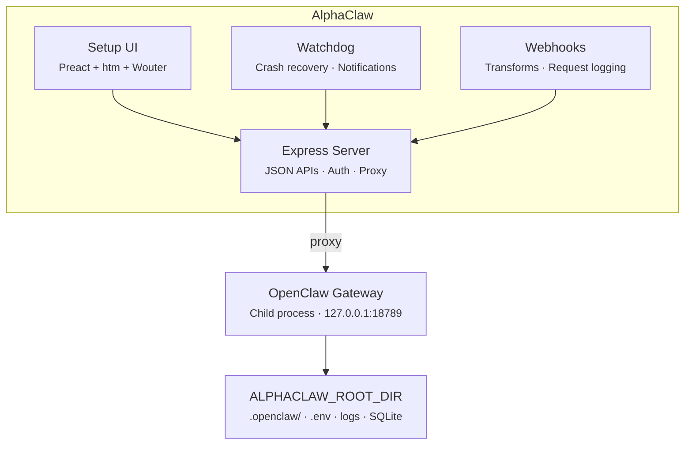

<p align="center">
  
</p>
<h1 align="center">AlphaClaw</h1>
<p align="center">
  <strong>The ultimate OpenClaw harness. Deploy in minutes. Stay running for months.</strong><br>
  <strong>Observability. Reliability. Agent discipline. Zero SSH rescue missions.</strong>
</p>

<p align="center">
  <a href="https://github.com/chrysb/alphaclaw/actions/workflows/ci.yml"></a>
  <a href="https://www.npmjs.com/package/@chrysb/alphaclaw"></a>
  <a href="LICENSE"></a>
</p>

<p align="center">AlphaClaw wraps <a href="https://github.com/openclaw/openclaw">OpenClaw</a> with a convenient setup wizard, self-healing watchdog, Git-backed rollback, and full browser-based observability. Ships with anti-drift prompt hardening to keep your agent disciplined, and simplifies integrations (e.g. Google Workspace, Google Pub/Sub, Telegram Topics, Slack, Discord) so you can manage multiple agents from one UI instead of config files.</p>

<p align="center"><em>First deploy to first message in under five minutes.</em></p>

<p align="center">
  <a href="https://render.com/templates/alphaclaw"></a>
  <a href="https://railway.com/deploy/openclaw-fast-start?referralCode=jcFhp_&utm_medium=integration&utm_source=template&utm_campaign=generic"></a>
  <a href="https://updates.alphaclaw.md/desktop/prod/alphaclaw-mac-latest.dmg"></a>
</p>

<p align="center"><strong>Render sponsors AlphaClaw.</strong> Redeem $50 in Render credits with code <code>RENDER-ALPHACLAW</code>.</p>

> **Platform:** AlphaClaw currently targets Docker/Linux deployments. macOS local development is not yet supported.

## Features

- **Setup UI:** Password-protected web dashboard for onboarding, configuration, and day-to-day management.
- **Guided Onboarding:** Step-by-step setup wizard — model selection, provider credentials, GitHub repo, channel pairing.
- **Multi-Agent Management:** Sidebar-driven agent navigation with create, rename, and delete flows. Per-agent overview cards, channel bindings, and URL-driven agent selection.
- **Agent Chat:** Chat with any agent session right from the sidebar. Sends queue durably and survive page reloads. Safe retries reconcile the original message ID against durable submission evidence; uncertain sends stay visible for review, and an explicit “Send again” creates a new ID. Stop reports honestly, interruptions show up inline in the transcript, and the connection reconnects on its own with keepalives on both the browser and gateway sockets.
- **Team Access (beta):** Share one AlphaClaw with named teammates. Each person signs in with their own email and password, OpenClaw attributes messages per person, and a who's-online roster shows presence. Admins invite members with expiring single-use links, assign roles, and disable or remove accounts; members can chat and view status while updates, secrets, terminals, agents, and team management stay admin-only. Requires the OpenClaw 2026.8.1-beta line.
- **Gateway Manager:** Spawns, monitors, restarts, and proxies the OpenClaw gateway as a managed child process. Restart is one click: AlphaClaw asks OpenClaw to restart itself (the agent finishes its turn, up to 30 s; an ask whose reply is lost while the gateway is already draining is waited out, not forced), forces it if it will not stop, starts a fresh gateway and only says Running once the new one answers `/readyz`. The card shows one progress line with the server's timer, and on failure one sentence naming which half failed with Try again and View logs. Repair (Doctor) keeps its confirmation. A blocker (another operation, a hold, AlphaClaw still booting) shows its cause instead of a disabled button.
- **Watchdog:** Crash detection, crash-loop recovery, auto-repair (`openclaw doctor --fix`), memory-leak detection that can warn hours before the gateway hits its limit (with strictly opt-in pre-OOM auto-restart), Telegram/Discord/Slack/WhatsApp notifications, and a live interactive terminal for monitoring gateway output directly from the browser.
- **Resource Autotune:** Sizes resource-dependent settings to the container's real capacity (default ON) — gateway heap, agent concurrency, request body limits and SQLite caches — with a persisted detected → derived → applied ledger, live resize detection, and OOM classification. Opt out per deployment from the Health page or with the `ALPHACLAW_AUTOTUNE_DISABLED=1` kill-switch.
- **Channel Orchestration:** Telegram, Discord, Slack, ClickClack, and Buzz bot pairing with per-agent channel bindings, credential sync, and a guided wizard for splitting Telegram into multi-threaded topic groups as your usage grows. ClickClack sets up from a single pasted setup code or URL; Buzz installs through a resumable plugin wizard (both need the OpenClaw beta line for their guided flows).
- **Google Workspace:** OAuth integration for Gmail, Calendar, Drive, Docs, Sheets, Tasks, Contacts, and Meet, plus guided Gmail watch setup with Google Pub/Sub topic, subscription, and push endpoint handling. Start, Stop, renewal and disconnect share one account operation: the latest intent wins, Stop records disabled intent immediately, and unfinished remote cancellation remains visible with Retry after reload. Failed disconnect keeps the account disabled so cleanup can be retried.
- **Cron Jobs:** Dedicated cron tab with job management, an interactive rolling calendar, run-history drilldowns, trend analytics, and per-run usage breakdowns.
- **Nodes:** Guided local-node setup for VPS deployments with per-node browser attach checks, reconnect commands, and routing/pairing controls.
- **Webhooks:** Named webhook endpoints with per-hook transform modules, request logging, payload inspection, editable delivery destinations, and OAuth callback support for third-party auth flows.
- **File Explorer:** Browser-based workspace explorer with file visibility, inline edits, diff view, and Git-aware sync for quick fixes without SSH.
- **Prompt Hardening:** Ships anti-drift bootstrap rules as `hooks/bootstrap/AGENTS.md` (rules first, under 5,000 chars on a default install) plus `hooks/bootstrap/reference/AGENTS.md` (Google accounts and up to about 25 Telegram topics, the rest one `alphaclaw telegram topics list --agent <id>` away), injected into your agent's system prompt on every message, with the Setup UI tab map in `hooks/bootstrap/reference/setup-ui.md` for the agent to read when it needs it. You may take the reference file out of `bootstrap-extra-files` in `openclaw.json`: AlphaClaw records that and keeps it out (Drift Doctor says so; `POST /api/doctor/prompt-files/reference` with `{"enabled": true}` turns it back on), but it always puts the rules file back — enforcing safe practices, commit discipline, and change summaries out of the box on every supported OpenClaw version (existing installs migrate automatically, and the Home page shows whether the rules are actually reaching the agent — a one-word state in its This box card, escalating to an Attention row naming the affected file, the true cause, and the fix when hardening is dropped, truncated, or blocked, with a one-click jump into the Doctor's context meter).
- **Git Sync:** Automatic hourly commits of your OpenClaw workspace to GitHub with configurable cron schedule. Combined with prompt hardening, every agent action is version-controlled and auditable.
- **Version Management:** In-place updates for both AlphaClaw and OpenClaw with in-app release notes, changelog review, and one-click apply.
- **Agent Administration:** Optional (off by default) mode that lets the OpenClaw agent drive the same dashboard API the web UI uses through an `alphaclaw admin` CLI, with tiered guardrails, confirm codes for dangerous operations, a rotatable bearer token, and full Watchdog audit logging.
- **Codex OAuth:** Built-in PKCE flow for OpenAI Codex CLI model access.

## Why AlphaClaw

- **Zero to production in one deploy:** Render/Railway templates ship a complete stack — no manual gateway setup.
- **Self-healing:** Watchdog detects crashes, enters repair mode, relaunches the gateway, and notifies you.
- **Everything in the browser:** No SSH, no config files to hand-edit, no CLI required after first deploy.
- **Stays out of the way:** AlphaClaw manages infrastructure; OpenClaw handles the AI.

## No Lock-in. Eject Anytime.

AlphaClaw simply wraps OpenClaw, it's not a dependency. Remove AlphaClaw and your agent keeps running. Nothing proprietary, nothing to migrate.

## Quick Start

### Deploy on Render (recommended)

[](https://render.com/templates/alphaclaw)

Render sponsors AlphaClaw. Use code **`RENDER-ALPHACLAW`** to redeem **$50 in Render credits**. The deployment is maintained in Render's [official AlphaClaw template repository](https://github.com/render-examples/openclaw-render-template).

> **Render sizing:** one AlphaClaw container runs the admin server, the OpenClaw gateway (a second Node.js runtime), up to five `gog` Google Workspace daemons, an hourly git-sync cron, and periodic `npm`/`pnpm` installs during updates. We recommend **at least 2 GB RAM / 1 CPU** (Render `standard` or larger). The `starter` tier (512 MB / 0.5 CPU) can OOM under normal operation and makes every update slower.
>
> **Per-process heap budgets:** if you cap the Node heap, set it on the admin process only (e.g. `node --max-old-space-size=768 bin/alphaclaw.js start` in your start command) rather than via a blanket `NODE_OPTIONS` env var — children would inherit it. AlphaClaw strips memory flags from the gateway's environment so the two processes keep separate budgets (and logs what it stripped). With **resource autotune** (default ON) the gateway's heap is sized automatically from the container's real memory limit, and `GET /api/autotune` reports a recommended admin-process cap for your box (omitted on very small containers, where the honest recommendation is a bigger box). To pin the **gateway's** heap by hand instead, set `ALPHACLAW_GATEWAY_MAX_OLD_SPACE_SIZE=<MB>` (e.g. `8192`) — it applies to the long-running gateway daemon only, never to short-lived `openclaw` CLI calls, and wins over autotune's derived value (the autotune ledger marks that row operator-set). With autotune off and no cap, Node sizes the gateway heap from host RAM (~40% — nearly 50 GB on a 123 GB box).
>
> **Resource autotune runbook:** the Health page's Autotune card (and `GET /api/autotune`) shows what was detected on this container, what was derived, and what's applied — each row says whether a **gateway** restart or an **AlphaClaw** restart (redeploy from your host dashboard) finishes applying it. Pin a single setting with an override (`alphaclaw admin PUT /api/autotune/settings --data '{"overrides":{"gatewayHeapMb":2048}}'`; `null` clears a key), re-probe after a platform resize with `POST /api/autotune/reapply`, turn it off with the card toggle, or — even mid-crash-loop — set `ALPHACLAW_AUTOTUNE_DISABLED=1` in your platform's environment settings. Disabling restores the built-in (pre-autotune) defaults — a gateway restart (and, for body limits and database caches, an AlphaClaw restart) finishes the revert.
>
> **Health checks:** point your platform health check at `/health` (always 200 while the admin server can serve — a wedged gateway is healed by the watchdog, not container restarts). Operators who want strict gateway readiness gating can point it at `/health/ready` instead (503 while the gateway is down; be aware this restarts the container during gateway recovery, and a **fresh, not-yet-onboarded instance also reports 503** — only switch to `/health/ready` after onboarding completes or the container will restart-loop before you can finish setup). Ops signal: if `eventLoop.p99Ms` in `/api/watchdog/resources` stays above 500ms, check recent gateway restarts and workspace size.

### Other deployment options

[](https://railway.com/deploy/openclaw-fast-start?referralCode=jcFhp_&utm_medium=integration&utm_source=template&utm_campaign=generic)

Set `SETUP_PASSWORD` at deploy time and visit your deployment URL. The welcome wizard handles the rest.

> **Railway users:** after deploying, upgrade to the **Hobby plan** and redeploy to ensure your service has at least **8 GB of RAM**. The Trial plan's memory limit can cause out-of-memory crashes during normal operation.

### Local / Docker

```bash
npm install @chrysb/alphaclaw
npx alphaclaw start
```

On a Debian/Ubuntu host also run `command -v lsof || apt-get install -y lsof`: the pinned OpenClaw CLI finds the running gateway through `lsof`, and without it the graceful restart ask (`openclaw gateway restart --wait`) refuses with "No verified gateway process is listening" and every restart goes straight to SIGTERM (AlphaClaw ships a `/proc`-backed shim for the ask when `lsof` is missing, see `ALPHACLAW_LSOF_SHIM` below).

Or with Docker:

```dockerfile
FROM node:24-slim
RUN apt-get update && apt-get install -y --no-install-recommends git curl procps cron tini tmux lsof ca-certificates && rm -rf /var/lib/apt/lists/*
# Optional but recommended: the local Claude Code rescue session needs tmux
# (above) and the claude CLI. Keep this pin in step with the reference
# Dockerfile; without this layer the launcher reports not_installed and
# falls back to the cloud routine.
RUN npm install -g @anthropic-ai/claude-code@2.1.251
WORKDIR /app
COPY package.json ./
RUN npm install --omit=dev
# Fail the build, not the first boot, if the floating base tag resolved to a
# Node below AlphaClaw's floor (>=24.22.1 since v0.10.48, the OpenClaw 2026.10.6 pin).
RUN node -e "require('@chrysb/alphaclaw/lib/node-runtime').assertSupportedNodeVersion()"
ENV PATH="/app/node_modules/.bin:$PATH"
ENV ALPHACLAW_ROOT_DIR=/data
EXPOSE 3000
ENTRYPOINT ["/usr/bin/tini", "--"]
CMD ["alphaclaw", "start"]
```

The reference [`Dockerfile`](Dockerfile) is this recipe with two additions:
it installs AlphaClaw from an `npm pack` tarball of the checkout (so
`npm run test:container` can build and boot the local tree) instead of from a
`package.json` pin, and it bakes in the toolchain for the
[local rescue session](#local-rescue-session-preferred-when-set-up) — tmux plus
a pinned `@anthropic-ai/claude-code`. Everything else — tini as PID 1,
`ALPHACLAW_ROOT_DIR=/data`, port 3000, `alphaclaw start` — is identical, and
the container E2E runs against an image built from it (docker required).

If the container's port is published straight to the internet or your LAN
(`docker run -p 3000:3000` with no reverse proxy in front), set
`TRUST_PROXY_HOPS=0`. The default `1` assumes one proxy that writes
`X-Forwarded-For`; with no proxy that header comes from the client, which can
then pose as a new address. The sign-in limit ignores the header from a client
that connects directly, but other address-based features still believe it.
Behind one proxy (Caddy,
nginx, Traefik, a platform router) keep the default, and count every hop if
there are more.

### Running as a normal user

`alphaclaw start` provides three binaries: the git auth shim (`git`), a `systemctl` shim when the machine has none, and the `gog` Google Workspace CLI when it is missing. As root (the Docker images) they go to `/usr/local/bin`, as before. As any other user they go to `<ALPHACLAW_ROOT_DIR>/bin`, which AlphaClaw puts first on `PATH` for itself and everything it starts (the gateway, Doctor, `openclaw` and `alphaclaw` CLI calls), so a normal-user install never writes `/usr/local/bin` or shadows the machine's git. `ALPHACLAW_GIT_SHIM_PATH` still overrides the git shim's path. A git shim an earlier version left at `/usr/local/bin/git` for this same install is removed at boot; any other file there is left alone. The operator-shell wrapper and `/etc/profile.d` snippet are still root-only (or written to `ALPHACLAW_OPENCLAW_WRAPPER_PATH` / `ALPHACLAW_PROFILE_SNIPPET_PATH`), and as a normal user they also put `<ALPHACLAW_ROOT_DIR>/bin` first on `PATH`. The scheduled sync's `/etc/cron.d` entry needs root as before, and it does not need these binaries: `alphaclaw git-sync` runs the real git with its own askpass.

## Setup UI

The sidebar groups pages by task. Home and Chat come first, then your agents, **Operate** (Health, Doctor, Schedules, Usage, plus the Open Claude Code and Dashboards launchers, admins only), **Connect** (Channels, Groups, Integrations, Relay) and **Settings** (Models & keys, Environment, Team). The icon tabs at the top of the sidebar switch it between this menu, the Browse file tree and the Chat session list. Webhooks, Nodes and the Telegram workspace are opened from the pages that own them. Links to the old names (`#/general`, `#/watchdog`, `#/cron`, `#/envars`) still open the renamed pages, query included.

| Page          | What it manages                                                                                                          |
| ------------- | ------------------------------------------------------------------------------------------------------------------------ |
| **Home**      | Status and next steps: a one-line headline, a status strip (gateway, watchdog, incidents in 7 days, spend in 30 days), Attention (device approvals, data upgrade, Drift Doctor, prompt hardening, pin drift, sync off), Finish setting up, Coming up (next scheduled jobs), Agents, a Channels summary, and This box (versions and update, one-click OpenClaw dashboard that opens signed in, hardening state, Back up now, repo sync schedule) |
| **Chat**      | Talk to your agents from the browser: sessions per agent in the sidebar's Chat list, live run status, and relay conversations shown read-only |
| **Agents**    | One page per agent (listed in the sidebar): overview with its model and 7-day activity, tools, channel bindings and sessions; add, edit, set as default and delete |
| **Health**    | Health monitoring, live status narrative, incident history, optional AI incident overseer, resource autotune card, gateway memory trend + leak-detection settings, auto-repair toggle, notifications, event log, live log tail, interactive terminal |
| **Doctor**    | Drift Doctor workspace health review — LLM scan plus deterministic environment checks, model-drift checks (outdated model bindings, invalid model codings, context-limit drift, and skills still steering the agent toward old models), and bridged `openclaw doctor` findings, a context-budget meter against OpenClaw's real injection budget with self-explaining Blocked/Dropped/Truncated chips, opt-in scheduled scans, configurable scan limits, and queued fixes you can dispatch to your agent in the chat you pick |
| **Schedules** | Cron job management, interactive rolling calendar, run-history drilldowns, trend analytics, and per-run usage breakdowns |
| **Usage**     | Token summaries, per-session and per-agent cost and token breakdown with source/agent dimension comparisons              |
| **Open Claude Code** | (launcher, admins only) Opens a Claude Code session in a new tab: the local rescue session on the box when it is set up, otherwise a claude.ai routine or plain claude.ai/code (see [Open Claude Code Launcher](#open-claude-code-launcher)) |
| **Dashboards** | (launcher, admins only) Opens OpenClaw's session dashboards in a new tab, signed in                                     |
| **Channels**  | Channel accounts (add, edit, delete, WhatsApp QR linking), chat pairing approvals and device approvals |
| **Groups**    | Telegram groups your agent is in, sorted by rule (waiting for you, custom, approved, trusted people, silent, blocked): change a group's rule with a preview of the openclaw.json change, test who the agent would answer, and the people blocked in every group |
| **Integrations** | Google Workspace, feature health (memory embeddings, audio transcription), the OpenAI-compatible API and Agent Administration toggles, and links to Webhooks and Nodes |
| **Relay**     | The [Agent Relay](#agent-relay): its health, the agents on it, anything waiting on you or failed, the message log, and the approved remote connections |
| **Models & keys** | AI provider credentials (Anthropic, OpenAI, Gemini, Particle, Mistral, Voyage, Groq, Deepgram) and model selection       |
| **Environment** | Environment variables — view, edit, add — with gateway restart prompts                                                   |
| **Team**      | Member accounts, invites, roles, and a who's-online roster (beta) — enable wizard applies the gateway change and verifies login end to end |
| **Browse**    | (sidebar mode) File explorer for workspace visibility, inline edits, diff review, and Git-backed sync                   |
| **Webhooks**  | (from Integrations) Webhook endpoints, transform modules, request history, payload inspection, OAuth callbacks, Gmail watch delivery flows   |
| **Nodes**     | (from Integrations) Guided local-node setup for VPS deployments, per-node browser attach, reconnect commands, and routing/pairing controls   |
| **Telegram**  | (from Channels) Telegram workspace: forum topics, their agents and health, and the agent and subagent concurrency limits |

## Particle (particle-1)

[Particle](https://particle.ai)'s `particle-1` is available as `particle/particle-1` on every install. OpenClaw ships no Particle provider, so AlphaClaw configures it: set `PARTICLE_API_KEY` (Models & keys page, onboarding, Environment, or the deployment env; keys start with `pai-` and come from platform.particle.ai) and AlphaClaw writes this block into `openclaw.json` at boot, onboarding and every save that changes the key:

```json
"models": { "providers": { "particle": {
  "baseUrl": "https://api.particle.ai/v1",
  "api": "openai-completions",
  "apiKey": "${PARTICLE_API_KEY}",
  "models": [{
    "id": "particle-1", "name": "Particle-1", "reasoning": true, "input": ["text", "image"],
    "contextWindow": 1048576, "maxTokens": 131072,
    "cost": { "input": 0.25, "output": 1, "cacheRead": 0.03, "cacheWrite": 0 },
    "compat": {
      "supportsTools": true, "supportsUsageInStreaming": true, "supportsPromptCacheKey": true,
      "supportedReasoningEfforts": ["none", "low", "high", "max"],
      "reasoningEffortMap": { "off": "none" }
    }
  }]
} } }
```

- **The key never enters the file.** The block refers to the env var, which the gateway reads from its own environment, so setting or replacing the key needs a gateway restart (the restart banner says so). A key that is unset, blank or `placeholder` writes nothing, and AlphaClaw never removes the block.
- **AlphaClaw owns only what it writes** (`baseUrl`, `api`, `apiKey` and the `particle-1` row). Keys you add (a `timeoutSeconds`, more model rows) are kept. Change an owned key and the block becomes yours: AlphaClaw stops updating it and **Check models** says so, and names the host when `baseUrl` no longer points at `api.particle.ai`, because that host receives the key.
- **Thinking levels.** OpenClaw sends `reasoning_effort`: `/think off` is `none`, `minimal`/`low`/`medium` are `low`, `high` is `high`, `max` is `max`. Particle has no `adaptive`. AlphaClaw makes Particle think on `high` by default: at each gateway launch it sets `params.thinking: "high"` in the `agents.defaults.models["particle/particle-1"]` row (which choosing the model creates), unless that row already sets `thinking` or `agents.defaults.thinkingDefault` is set. Without it OpenClaw's default sends `low`. Set your own `params.thinking` there to change it; AlphaClaw never overwrites it and never creates the row.
- **No context cap.** OpenClaw compacts against the full 1M window. Particle caches repeated prompt prefixes (billed at $0.03/M), though a hit is not guaranteed.
- **Check models** probes Particle with thinking off and a 45 s timeout (Particle queues requests under load). An empty balance (402) is reported as a billing problem, 503/504 as a provider outage, and a probe that times out while the model list answers as a busy queue. Particle lists the model as `particle-ai/particle-1`, which the check counts as `particle-1`.
- **Model policy.** On a box whose `openclaw.json` has `agents.defaults.modelPolicy.allow` (or an agent's own list), OpenClaw refuses a model that list does not name, even one in the Models & keys page. AlphaClaw adds the models you pick to the list that governs them, but only at the next gateway launch: on OpenClaw 2026.10.8 and later (checked through 2026.10.9; GST-122) changing `modelPolicy` while the gateway runs interrupts running work (a background command's result never reaches the agent). Until the restart, the save says which models wait for it and the restart banner shows **Model policy update waits for a restart**.

## Open Claude Code Launcher

The Operate group of the sidebar has an **Open Claude Code** item (admins only). Out of the box it opens [claude.ai/code](https://claude.ai/code) in a new tab. Configure it and one click starts a Claude Code session and lands you directly in it — a **local rescue session on the box itself** once you've done its one-time login (see below), or a fresh cloud session via a claude.ai routine.

Routine setup (one time, on your claude.ai account — requires a Pro/Max/Team/Enterprise plan):

1. Create a routine at [claude.ai/code/routines](https://claude.ai/code/routines). Keep its prompt minimal — something like "Await instructions." — because every fire runs the routine's saved prompt as an **autonomous session** (shell access, no approval prompts) that consumes your claude.ai subscription usage.
2. Edit the routine → **Add another trigger** → **API** → **Generate token**, then copy the fire URL and the token (shown once).
3. Paste them into Environment as `CLAUDE_CODE_ROUTINE_URL` (the full URL or just the `trig_…` id) and `CLAUDE_CODE_ROUTINE_TOKEN`. Changes apply immediately — no restart.

Behavior and guardrails:

- The first fire asks for a one-time confirmation; after that it's one click. Cmd/ctrl-click always opens plain claude.ai/code without firing (the escape hatch).
- A small accent dot on the sidebar item shows when the launcher is armed to fire rather than just link out.
- The server enforces the confirmation, a single-flight guard, and a short cooldown (longer after a timeout: the fire API has **no idempotency key**, so a timed-out fire may still have created a billed session — check claude.ai/code before retrying).
- The launcher never sends the token to the browser (status checks are presence-only), the token is excluded from the OpenClaw gateway's child environment, and the fire endpoint is denied to the agent-admin actor. Like every secret in `~/.alphaclaw/.env`, admins can view it on the Environment page, and a same-host process that can read that file can read it too — environment inheritance itself was closed in v0.9.63 (`lib/server/gateway-env-policy.js` allowlists what reaches the gateway child and denies every `CLAUDE_CODE_ROUTINE_*` / `CLAUDE_CODE_LOCAL_*` key by prefix; see CHANGELOG), so the remaining exposure is same-uid disk access to that file, not the child environment.
- Routines belong to one claude.ai account: in multi-admin installs, every admin's click fires (and bills) the token owner's account, and the session URL only opens for someone logged into that account.
- `CLAUDE_CODE_ROUTINE_TOKEN` is **not** the same as `ANTHROPIC_TOKEN` (the `claude setup-token`), despite the shared `sk-ant-oat01-` prefix — it is a per-routine trigger credential from the claude.ai UI.

### Local rescue session (preferred when set up)

The launcher's local path opens a Claude Code instance running **on the box itself**: a `claude remote-control` session hosted in detached tmux, reached through its Remote Control URL. Once its login is done, the button prefers this path (the routine stays as the fallback), so you can debug AlphaClaw/OpenClaw from claude.ai/code — or your phone — with hands on the actual machine, even while OpenClaw is down.

- **One-time login.** The Health page's rescue-session card walks you through `claude auth login` in the browser (claude.ai subscription OAuth — Remote Control refuses API keys). Credentials live in `<root>/claude-code-local/home/`, deliberately **outside backups**: after restoring a backup, run the login again.
- **Revocable link.** The card, QR code, launcher, and notifications hand out an AlphaClaw-owned capability link — `<your-alphaclaw>/rescue/<token>` — that redirects to the live session. **Links AlphaClaw distributed stop working on Stop; each new session start mints a new one** (Start on an already-running session returns the existing link — stop first to rotate). An AlphaClaw restart with a still-live session keeps the same link. Honest boundaries: the guarantee does not cover fallback notifications sent with no public base URL configured (those carry the raw claude.ai URL — set `ALPHACLAW_SETUP_URL`), the underlying claude.ai URL disclosed to someone who already followed the redirect remains valid on Anthropic's side (claude.ai-account-gated), and a reverse proxy in front of AlphaClaw may access-log capability paths (inherent to capability URLs — revocation is the mitigation). The link needs the AlphaClaw server up; the card's `tmux … attach` hint is the out-of-band fallback. **Upgrading from a release before v0.9.66: links distributed before the upgrade are raw claude.ai URLs — stop + start the rescue session once to cut over to revocable links.**
- **Survives AlphaClaw restarts.** The tmux session outlives the AlphaClaw process; the card shows the rescue link (with a QR code for your phone), a copyable `tmux … attach` hint for shell access, one-click Stop, and a sanitized terminal tail when a spawn fails. Optionally warm a session at boot, or automatically when the watchdog opens an incident — the incident notification carries the link when the session is already running. Each use of the link is recorded as a watchdog operation event (IP + user agent); after an *unexpected* pane death the link dies on the next liveness poll, and a click also triggers a check — that click may still receive the stale redirect to the already-dead session, subsequent clicks 404 (explicit Stop revokes immediately; tmux hosting only — script-hosted sessions detect death instantly on process exit). Both GET and HEAD redirect (HEAD skips the liveness check); a malformed link gets a plain 400. Behind a reverse proxy, set `ALPHACLAW_SETUP_URL` so links and QR codes are built from the validated public origin instead of request headers (origins/subdomains only — path-prefixed proxy deployments like `https://host/alphaclaw` are not supported for rescue links).
- **Permissions.** Sessions default to `acceptEdits`; `bypassPermissions` is opt-in and only ever applies to sessions you start by clicking through the mode-named confirmation — unattended spawns (autostart, incidents) always clamp to `acceptEdits`. Note the session can read box content, including untrusted logs (a prompt-injection surface), and transmits selected content to Anthropic as part of operating Claude Code.
- **Settings.** Five `CLAUDE_CODE_LOCAL_*` keys on the Environment page — enable/kill switch, autostart, permission mode, working directory, incident auto-spawn — all hot-reloaded, no restart. Disabling never kills a live session; stop it from the Health page card.

#### State runbook (`local.state` on the status endpoint / Health page card)

`<root>` below is `ALPHACLAW_ROOT_DIR` (`/data` in the container, `~/.alphaclaw` otherwise).

| State | Meaning → fix |
| ----- | ------------- |
| `probing` | First background probe hasn't finished (just after boot) → re-check in a few seconds. |
| `disabled` | `CLAUDE_CODE_LOCAL_ENABLED` is 0/false → re-enable on the Environment page (hot-reload). Disabling never kills a live session — it only blocks new spawns/logins, and a still-live session is re-adopted (read-only, nothing spawned) after an AlphaClaw restart so the card keeps showing it with Stop and a working rescue link; stop it from the Health page card. |
| `not_installed` | The `claude` CLI is missing → `npm install -g @anthropic-ai/claude-code` (the Docker image ships a pinned copy, so this means a non-Docker install). |
| `needs_login` | No OAuth credential under the rescue HOME → one-time login from the Health page card. Credentials live OUTSIDE backups at `<root>/claude-code-local/home/` — after restoring a backup, re-run the login. |
| `login_in_progress` | The guided login is running (10-minute TTL) → finish or cancel it from the card; sessions cannot start meanwhile. |
| `ready` | Installed and logged in, no session → the sidebar button (or Start on the card) spawns one. |
| `starting` | Spawned; waiting up to 60s for the Remote Control URL. |
| `running` | Live; revocable `/rescue/<token>` link (and QR) on the card — dead links mean the session was stopped or replaced (start a new one). Shell attach, last resort when claude.ai is unreachable: `tmux -S <root>/claude-code-local/tmux.sock attach -t alphaclaw-rescue`. |
| `error` | `local.error` carries code + message → view the sanitized tail on the card; Stop clears it, and the next start kills any leftover failed session before spawning fresh. |
| `stopping` | A stop is in flight → transient. |

Post-rollback cleanup: after rolling the feature back (env kill switch or code revert), a live tmux session deliberately survives — clean it up with `tmux -S <root>/claude-code-local/tmux.sock kill-server`. The credentials dir is harmless to leave; the card's Logout removes it beforehand if wanted.

## OpenClaw Version

AlphaClaw runs exactly the OpenClaw version pinned in its `package.json`. The pin moves only with an AlphaClaw release: each release is tested against its pin, and there is no in-app version switching. To run a newer OpenClaw, deploy the AlphaClaw release that pins it.

- **First boot of a new pin runs OpenClaw's own migration.** Before the gateway starts, AlphaClaw runs `openclaw doctor --fix` once per pinned version (upstream's documented step after replacing OpenClaw) and records the version it completed for in `.alphaclaw/openclaw-boot-migration.json`. If doctor fails, you get a notification and the gateway starts anyway; a config the new build rejects is then handled by the watchdog and the startup medic. Every Doctor run (boot, Retry, repair, medic) logs one `[alphaclaw] doctor --fix summary …` line: each phase's time from OpenClaw's startup trace (the recovery copy and legacy-state migrations beside their parent phase), the time no phase accounts for, the five slowest checks, whether `openclaw.json` was rewritten, and how many changes Doctor reported. The same report is kept on the migration record's `lastOutcome.report`, shown to admins as `lastRun` in `GET /api/openclaw/upgrade-status`, and the boot's line goes into the boot report. Once the gateway serves, AlphaClaw adds the recovery copy's size and logs the agent databases registered in OpenClaw's state database that belong to no configured agent (the ones behind OpenClaw's "database is not a configured target" lines), with their sizes. It never deletes them.
- **OpenClaw 2026.11.2's migration is one-way.** Its first boot (the Doctor run above) moves the state database from schema 20 to 22 and each agent database from 25 to 27, and stamps `meta.lastTouchedVersion: "2026.11.2"` into `openclaw.json`. 2026.10.9 then refuses both: its Doctor exits 1 ("uses newer schema version 22; this build supports 20") and its gateway exits 1 ("this OpenClaw binary (2026.10.9) is older than the config last written by OpenClaw 2026.11.2"). There is no downgrade in place. Before deploying a release that pins 2026.11.2, press **Back up now** in Home's This box card (or run `openclaw backup create --verify`) and keep the archive. To go back to a 2026.10.9 release:
  1. Stop the box, or let the deploy stop it.
  2. Restore the state from that archive with OpenClaw's own restore procedure. Without the archive, put back each migrated database from the `*.pre-startup-migration-*.bak` copy OpenClaw wrote beside it (every agent's `openclaw-agent.sqlite` and `state/openclaw.sqlite`), deleting that database's `-wal` and `-shm` files first, and put back the `openclaw.json` from before the upgrade: AlphaClaw copies it to `.alphaclaw/openclaw.json.pre-2026.11.2` just before that Doctor runs, written atomically and checked against the sha256 on the migration record (the path is in the "upgrading OpenClaw's data" notice and on the migration record's `preUpgradeConfig`). Failing that, use git sync's history, or the `openclaw.json.bak*` copy whose `meta.lastTouchedVersion` is not 2026.11.2.
  3. Deploy the AlphaClaw release that pins 2026.10.9.
  Anything written after the upgrade (turns, cron runs, sign-ins) is lost on the way back. A shared auth store newer than schema 22 is refused with a 409 that names the version, the supported range and the fix (update AlphaClaw, do not downgrade OpenClaw); AlphaClaw never rewrites it.
- **2026.11.2's Doctor refuses leftover session files.** When a session that already lives in SQLite still has its legacy `<session>.jsonl` under `agents/<id>/sessions/`, 2026.11.2's `doctor --fix` can exit 1 (`active_sqlite_transcript_jsonl`, "legacy JSONL transcript awaiting verification"). AlphaClaw then starts the gateway anyway, and its sessions stay unavailable: `/readyz` never answers 200, and the watchdog marks the gateway degraded and keeps checking without restarting it. AlphaClaw runs the upgrade again on every start, and it stops the same way until the files are recovered. The failure has its own reason, `session_jsonl_pending`: the notice and the upgrade alert say how many sessions are affected and give OpenClaw's fix: stop AlphaClaw, run `openclaw doctor --session-sqlite recover` from a shell on the same data volume, start AlphaClaw again (the upgrade reruns as it starts; press **Retry upgrade** if the alert is still shown). AlphaClaw does not run the recover for you. Before a pin change's Doctor, the boot log counts the legacy `*.jsonl` files under `agents/*/sessions` (`[alphaclaw] before doctor --fix: N legacy session transcript file(s)`), read-only. Check for such files before upgrading a box whose sessions were imported from JSONL.
- **Back up now.** The Backups row in Home's This box card runs OpenClaw's own `openclaw backup create --verify` into `<root>/backups/openclaw` and shows the archive path and size (`POST /api/openclaw/backup` starts one, `GET /api/openclaw/backup` reports progress and the last result). The gateway keeps running. Restoring an archive is OpenClaw's own procedure.
- **Boxes that used the removed in-app version switch.** Releases up to v0.9.98 had an Upgrade tab that could run beta or dev builds on top of the pin. On the first boot of a newer release, AlphaClaw retires that state: it removes the overlay shim, moves `.alphaclaw/openclaw-channel-state.json` aside, and, when the box ran a build newer than the pin (any beta/dev pick, or a newer stable), sends one notice naming it. OpenClaw databases a newer beta/dev build migrated may not open on the pinned build; recover by deploying an AlphaClaw release that pins a build at least that new, or by restoring a backup taken before the switch.
- **Gateway startup medic (on by default).** If the gateway dies at startup with a fatal configuration error, AlphaClaw fixes it instead of staying down: it removes the config keys the gateway itself rejected (best-effort backup taken first), or runs OpenClaw's `doctor --fix`, then restarts — and for unfamiliar failures it asks the smartest frontier model you have an API key for (Anthropic, OpenAI, or Gemini; evidence is secret-redacted first) to diagnose and choose from a fixed menu of safe remedies. At most two attempts per incident, every action is announced, and you can turn it off in the Health page's settings.
- **Notifications you can route.** Watchdog and maintenance events go through a durable outbox (retried, re-delivered after restarts) and can be routed to specific admin chats with a preferred channel and fallbacks, instead of broadcasting to every paired conversation. Overseer notices expire sixty minutes after first handling, including through retries and restarts; expired notices retain their history without paging later. Other notices keep the existing 48-hour retry policy.
- **Every boot is recorded.** Each boot writes `boot-report.json` (what the bin phase saw, what the server phase found, a `verdict[]`) and stamps `alphaclaw-version.json`, including the declared pin and the installed OpenClaw version; an install that does not match the pin is reported there and in `alphaclaw diagnose`.
- **Managed AlphaClaw deployments stay identifiable.** An accepted or uncertain provider request remains visible across reloads, restarts and version changes. It blocks another submission until a human admin verifies the provider has finished or cancelled the deployment and resolves that exact attempt. See [managed deployment recovery](docs/upgrade-troubleshooting.md#managed-deployment-accepted-or-unknown).
- **Recovery explains its wait.** Crash recovery survives temporary maintenance contention. Watchdog shows its age and blocker; repair cleanup that cannot confirm writer termination shows **Repair cleanup needs attention** and retains ownership. See [pending recovery and cleanup](docs/upgrade-troubleshooting.md#pending-recovery-or-cleanup_blocked).

## Agent Administration

Off by default. When you enable `features.agentAdmin` (Setup UI -> Integrations page, "Agent Administration" panel, or `PUT /api/alphaclaw/config/features/agent-admin`), the OpenClaw agent can administer the deployment on behalf of admin users. It works through an `alphaclaw admin <METHOD> /api/path` CLI that drives the same dashboard HTTP API the web UI uses, so the server owns all validation and side effects. With the flag off, nothing observable changes.

Enabling it regenerates an `alphaclaw-admin` skill into the agent's workspace (a short `SKILL.md` index plus one `references/<domain>.md` file per domain that the agent opens when it needs it; rebuilt at boot, effective on the agent's next session) and appends an "AlphaClaw Administration" pointer stanza to the merged `hooks/bootstrap/AGENTS.md` prompt-hardening file in every agent workspace (written when you enable the flag and re-rendered at every boot; it appears only once the skill is actually installed). Nothing is written to a `TOOLS.md` — OpenClaw 2026.8.1+ no longer accepts it as a bootstrap file, and any legacy AlphaClaw-owned `hooks/bootstrap/TOOLS.md` is removed on sync. Operations are tiered: **safe** reads run freely, **write** operations mutate immediately, **restart** operations apply but need a gateway restart, **dangerous** operations require a one-time confirm code delivered to a configured admin channel, and **denied** operations stay operator-only. Every agent mutation is written to the Watchdog event log, and admins are notified of restart-level and dangerous changes. A bearer token (mode `0600`, kept in the managed state dir, never git-synced) authenticates the CLI; rotate it from the panel.

The CLI takes the request body inline or from stdin, plus optional flags for confirm codes, a compact summary, and JSON output:

```bash
# safe: reads run freely
alphaclaw admin GET /api/openclaw/backup --json

# write: applies immediately, body from stdin
echo '{"autoRepair":true}' | alphaclaw admin PUT /api/watchdog/settings --data-stdin

# dangerous: one-time confirm code, delivered to your admin channel
alphaclaw admin DELETE /api/agents/legacy-bot --confirm ABCD-EFGH
```

**Honest framing (same convention as team mode).** This is not a hard security boundary against the agent. Since v0.9.63 the gateway child no longer inherits AlphaClaw's secrets (`SETUP_PASSWORD` and the internal credentials are withheld by the allowlist in `lib/server/gateway-env-policy.js`), but the agent still runs as AlphaClaw's own uid with `HOME` under the data root, so an unsandboxed exec can read `.env` and the state dir from disk. Agent Administration exists to keep secrets out of chat transcripts, attribute actions for audit, enable revocation, and add tiered guardrails and structured errors.
### Secret drop: give the agent a key without pasting it in chat

When the agent needs a key, token or password, it asks AlphaClaw for a **secret drop** (`alphaclaw admin POST /api/secrets/requests --data '{"name":"GITHUB_TOKEN"}'`) and sends you the one-time link it gets back, for example in Telegram. Open it in a browser signed in to AlphaClaw as an admin (signed out, you sign in and come back to it), paste the value into the masked box and press Save. AlphaClaw writes the same value to its `.env`, through the same path as the Envars page, and to OpenClaw's secret store (`openclaw secrets store set`, value on stdin; a new name becomes a `secret` entry and an existing entry keeps its kind). The agent and your admin channel learn the key's name and where it is usable, never the value. Links work once and last 15 minutes, and only an admin's browser session can complete one: the agent's bearer, team members and anyone else who sees the link cannot. Reserved, deployment-only, locked (`ALPHACLAW_GATEWAY_LOCKED_ENV`) and Channels-managed names are refused when the link is requested and again on Save. A multi-line value (a PEM key) goes to OpenClaw's store only. If one store fails, the page says which one holds the value and the link stays open for a retry.

You can also ask for a link yourself: type `/secret NAME` (for example `/secret GITHUB_TOKEN`) to your agent in Telegram or any other paired chat, and AlphaClaw's `secret-drop` plugin answers with the one-time link at once. OpenClaw runs the command without the model, so the model does not run on that turn; it does see the line with your next message (below). Only the owner (`commands.ownerAllowFrom`) and admin gateway clients can use it; any other paired chat gets OpenClaw's "requires gateway scope: operator.admin" refusal. OpenClaw sends that refusal before AlphaClaw's plugin runs, so it carries none of the warnings below about a typed value. A name needs at least one `_` (so a pasted base32 seed is never taken for one); for a name without an `_`, use the Envars page. If you type a value after the name, or a value alone, the value is not saved and never reaches AlphaClaw, and every reply the plugin sends (the link, or one of its own refusals) says so. OpenClaw's scope refusal for a non-owner does not. But OpenClaw keeps the whole line, value included, in the session transcript on the box (`openclaw-agent.sqlite`), and the session sends it to the model provider with your next message. So the reply tells you to send `/new` first, which starts a new session without it, and to delete that message (in Telegram, long-press it and choose Delete). The plugin cannot delete it for you, because OpenClaw gives plugin commands neither the message id nor a delete call. Keeping it out of the transcript would need a `before_message_write` hook, and any such hook makes OpenClaw 2026.10.9 skip restart-safe admission for every chat turn, so AlphaClaw does not register one. Agents must never read or edit OpenClaw's SQLite files to scrub it. The command needs Agent Administration on (Integrations page), since the plugin asks AlphaClaw for the link with the agent's admin token. AlphaClaw writes the plugin's entry in `openclaw.json` (`plugins.entries["secret-drop"]`, holding only the state directory and AlphaClaw's port) and leaves an entry by that name it did not write alone; `ALPHACLAW_SECRET_DROP_COMMAND=off` in the deployment environment removes it.

The promise covers the hand-over: the value never passes through the chat, the model or a transcript on its way in. Once stored, programs on the box that read `.env` (including commands the agent runs) can use it, so the agent's skill tells it never to print or `cat` credential files. Keys the gateway takes from its environment are usable after its next restart, which AlphaClaw never triggers for a drop; the page and `GET /api/secrets/requests/<id>` say so per key.

AlphaClaw also sets `gateway.publicOrigin` from `ALPHACLAW_SETUP_URL` (once, when unset, and only for an https origin or a literal loopback one, which OpenClaw's schema requires), so OpenClaw's own links to channels, such as its credential prompt at `/openclaw/ask/<id>`, point at this box; signing in from such a link returns to it.

## Deleted agents' data

**Delete Agent** (Agents tab) asks the running OpenClaw gateway to delete the agent through OpenClaw's own `agents.delete` (with `deleteFiles: true`). OpenClaw removes the agent from `openclaw.json` with its channel bindings, cron jobs and exec approvals, drops its session rows and its entry in the agent database registry, and moves its database, transcripts and workspace to a Trash folder (`<ALPHACLAW_ROOT_DIR>/.Trash`, the gateway's home, on a Linux box). The gateway keeps serving the other agents and does not restart. AlphaClaw itself removes nothing under the state directory. While the gateway is down, Delete Agent is unavailable; it never falls back to deleting files itself.

**Snapshot.** "Keep a snapshot" is on by default. Before anything is deleted, AlphaClaw saves the agent's chat history with OpenClaw's `openclaw backup sqlite create --agent <id>` (verified with `backup sqlite verify`) and copies its workspace. If the snapshot fails or would not fit on the disk, nothing is deleted. Each snapshot is a folder:

```text
<ALPHACLAW_ROOT_DIR>/archives/agents/<UTC date>-<agent id>-<6 hex>/   (mode 0700)
  manifest.json            agent id, name, model, workspace and agentDir paths, binding and cron counts,
                           sizes, versions, snapshot time, and OpenClaw's answer to the delete
  database/<snapshot id>/  OpenClaw's SQLite snapshot (manifest.json + database.sqlite)
  workspace/               the workspace copy (left out when another agent uses the same workspace)
```

A snapshot holds session content and can hold plugin or auth state, so treat it like the state directory. It is on the same disk (not a backup), outside the state directory and git sync, and never served by the Setup UI. Nothing prunes snapshots; the boot log counts them. Remove a folder you no longer need with `rm -rf`. `archives/agents/.operations/` records each delete so a restart in the middle of one is settled from OpenClaw's deletion record at the next boot.

**Restoring is manual.** From a shell on the box (the `openclaw` wrapper AlphaClaw installs points at the right state directory), with the gateway running:

```bash
A=<ALPHACLAW_ROOT_DIR>/archives/agents/<snapshot folder>
ID=<agent id>
WS=<workspace path from manifest.json config.workspace>
mkdir -p -m 700 <ALPHACLAW_ROOT_DIR>/.openclaw/agents/$ID/agent
openclaw backup sqlite restore "$A"/database/*/ --target <ALPHACLAW_ROOT_DIR>/.openclaw/agents/$ID/agent/openclaw-agent.sqlite
cp -a "$A/workspace" "$WS"
openclaw gateway call agents.create --params "{\"name\":\"$ID\",\"workspace\":\"$WS\"}" --json
```

`agents.create` registers the restored database and brings the agent back with its sessions. Channel bindings, cron jobs, model and identity are not restored: `manifest.json` lists what the agent had, and you set them again in the Agents tab.

**Reusing an id.** OpenClaw keeps a deleted agent's id reserved until its own agent creation claims it, so the Agents tab refuses to create a new agent under that id. Restore the agent as above, or create a fresh one under the id with the same `agents.create` call without restoring the database. Restoring an `openclaw.json` from before the delete (for example from git) brings the entry back without a usable database: its turns fail with "Agent <id> deletion is in progress; new work is unavailable." Delete it again, or restore it as above.

**Deletion not finished.** When OpenClaw deletes the agent but cannot finish cleaning up its files, the Agents tab shows **Finish deleting**, which sends the same `agents.delete` again without a new snapshot.

**Leftovers from older versions.** Before Delete Agent went through OpenClaw, AlphaClaw removed the agent from `openclaw.json` and deleted its files itself, so OpenClaw kept a registry row for a database it could no longer find, and Doctor warns that the database "is not a configured target". The boot log names these rows ("left by agent deletes from before Delete Agent went through OpenClaw"). AlphaClaw does not remove them.

## Team Access (beta)

The **Team** tab turns a single-password AlphaClaw into a multi-member workspace.

How it works:

- **Real member accounts.** Each teammate signs in with their own email and password. OpenClaw sees who's who — messages are attributed per person, everyone gets their own profile, and the roster shows who's online.
- **Trusted-proxy identity.** With team access on, the gateway switches from shared-token to trusted-proxy auth: AlphaClaw injects the signed-in member's email on every gateway request (HTTP, WebSocket, and webhook paths) and strips client-supplied forwarding headers so identity can't be spoofed.
- **Invites and roles.** Admins invite members with expiring single-use links, set roles, and disable or remove accounts — sessions and gateway authority end together, and the last admin can never be demoted. Invite acceptance is transactional (a failed signup doesn't burn the link). Only a hash of each invite link is stored, so a link shows once, when it is created; **Copy new link** on a pending invite gives an admin a new link for it (the old one stops working). That is also how an invite the agent created gets delivered: the agent's copy is masked and the copy-link action is humans only.
- **Permission boundary.** Members can chat and view status. Updates, secrets, terminals, agents, webhooks, and team management stay admin-only — enforced on every API route, WebSocket, and OAuth callback, with a role-aware nav that hides admin pages.
- **Safe enable + rollback.** The enable wizard explains the security boundary up front, applies the gateway change, restarts, and verifies the login handshake end to end. If the check fails, it attempts to restore the previous setup and verifies the restored login before reporting recovery. A gateway hold or expired lifecycle lease can defer the restart; the result distinguishes saved auth settings from verified gateway recovery. Optional lockdown turns off shared-password login once your own account works (a break-glass env var is included).
- **Deferred member sync is explicit.** Member changes can save while a gateway blocker prevents syncing the authentication roster. After clearing the blocker, an administrator must save the member settings again; restarting alone does not sync the roster.
- **Off means off.** Turning team access off fully ends member access: member sessions and logins stop, and existing shared-password sessions end the moment shared-password login is disabled.
- **Fail closed on a broken config.** If `alphaclaw.json` exists but cannot be parsed, sign-in answers `503 config_unreadable` and every existing session (shared-password and member) is refused until the file is fixed or restored — a corrupt file never silently re-enables shared-password login. `ALPHACLAW_ALLOW_LEGACY_LOGIN=1` on the server is the emergency hatch for shared-password access meanwhile.

Team endpoints live under `/api/team` (`enable`, `disable`, `invites`, `invites/:id/link`, `members`, `presence`); all mutations are admin-only.

## CLI

| Command                                                    | Description                                   |
| ---------------------------------------------------------- | --------------------------------------------- |
| `alphaclaw start`                                          | Start the server (Setup UI + gateway manager) |
| `alphaclaw git-sync -m "message"`                          | Commit, integrate and push the OpenClaw workspace without rewriting the working tree (see [Git sync with other writers](#git-sync-with-other-writers)) |
| `alphaclaw doctor finding complete`                        | Mark a queued Doctor finding fixed after verification |
| `alphaclaw telegram topic add --thread <id> --name <text>` | Register a Telegram topic mapping             |
| `alphaclaw telegram topic create --group <id> --name <text>` | Create a Telegram forum topic and register it |
| `alphaclaw telegram topics list [--group <id>] [--agent <id>]` | List registered, discovered, and stale topics; `--agent` lists the topics that agent's injected reference file is rendered from |
| `alphaclaw diagnose [--json]`                              | Read-only diagnostic bundle from the data volume (boot reports, declared pin vs installed OpenClaw, boot migration, pidfile verdict, state DB schema, incidents, backups, log tail); markdown by default, one JSON line with `--json`. Works with the server down; the same bundle is served live at `GET /api/diagnose`. |
| `alphaclaw admin <METHOD> /api/path`                       | Agent-admin CLI: drive the dashboard API (needs `features.agentAdmin`) |
| `alphaclaw admin manifest`                                 | Print the agent-admin operation catalog       |
| `alphaclaw version`                                        | Print version                                 |
| `alphaclaw help`                                           | Show help                                     |

With `--json` (`git-sync`, `diagnose`, `telegram topics list`, `admin`), stdout carries exactly one JSON document. Every log line goes to stderr, including the boot lines such as `Loaded .env` and a pending self-update's npm output.

### Git sync with other writers

The scheduled sync (`/etc/cron.d/openclaw-hourly-sync` → `alphaclaw git-sync --trigger scheduled`) shares the `.openclaw` checkout with the agent, cron scripts and hooks, so it never rewrites the live working tree:

- **Shared writer lock.** Every sync holds an exclusive `flock` on `<git common dir>/alphaclaw-writer.lock` (normally `.openclaw/.git/alphaclaw-writer.lock`) from preflight to the final fast-forward, waiting up to 120 s for the scheduled run (15 s for syncs triggered by onboarding and settings saves; `--lock-wait` or `ALPHACLAW_GIT_LOCK_TIMEOUT_SECONDS`). The path is fixed. Scripts that write the repo can queue on it:

  ```bash
  LOCK="$(cd "$OPENCLAW_STATE_DIR" && cd "$(git rev-parse --git-common-dir)" && pwd)/alphaclaw-writer.lock"
  # Inside AlphaClaw's own commit (a git hook), the lock is already held: don't wait for it.
  if [ "${ALPHACLAW_GIT_LOCK_HELD:-}" = "$LOCK" ]; then my-commit-push; else flock -o -x -w 120 "$LOCK" my-commit-push; fi
  ```

  `-o` keeps a backgrounded child from holding the lock after your command exits. A wrapper that already holds the lock on fd N and calls `alphaclaw git-sync` exports `ALPHACLAW_GIT_LOCK_FD=N`; the CLI only trusts a fd that really is the lock file.
- **No pull, rebase or stash.** The sync commits first, fetches, and when the remote has moved computes the merge with `git merge-tree` (no working tree, no index, no `MERGE_HEAD`), pushes the merge commit, then fast-forwards the live tree with `git merge --ff-only`. A real conflict means another writer pushed changes to the same files: the sync **holds** instead of merging over them. Nothing is pushed, nothing is left in the tree (no `MERGE_HEAD`, no conflict markers), and the run takes back the commit it just made, so the local branch never diverges from `origin` and another writer's `git pull --ff-only` keeps working; the changes stay uncommitted in the working tree. (If another commit landed on top of the run's commit, the commit stays and the notice says so.) The hold lasts until one writer owns the repository: set `ALPHACLAW_GIT_WRITER_COMMAND` to the other writer's command, turn AlphaClaw's sync off with `ALPHACLAW_GIT_SYNC=off`, or keep the two apart with `ALPHACLAW_GIT_SYNC_PATHS`. If a locally modified file blocks the fast-forward, the push still lands and the next run catches up. Diverged histories need git 2.38+ (`node:24-slim` ships 2.39).
- **Only changed paths are committed.** The sync commits files with working-tree changes (and new untracked files the `.gitignore` whitelist allows). Entries another writer staged but has not touched since stay staged. Set `ALPHACLAW_GIT_SYNC_PATHS` (comma-separated, for example `openclaw.json,cron/,workspace/`) to limit the commit further. The scan never leaves the managed directory, even when `.openclaw` sits inside a larger repository (git's paths are resolved from that repository's top level). Paths travel to git byte for byte as literal pathspecs, so names that are not valid UTF-8, start with a dash or contain glob characters commit like any other. A deleted file whose path is now a folder is left out with a log line instead of failing the whole commit (the folder's new files still commit). A file that disappears while the sync runs makes it read the tree once more.
- **Never committed, whatever `.gitignore` says:** OpenClaw's copies of the state directory (`*.update-captures`, `.openclaw.package-backup-*`, `.openclaw.shim-backup-*`) and the managed directory's `.env`, `.alphaclaw/`, `credentials/`, `identity/`, `devices/` and `agents/`. A new untracked file or folder over 50 MB (`ALPHACLAW_GIT_SYNC_MAX_NEW_MB`) is held back: everything else is pushed, and the held-back paths are reported like a failure (one notification, a watchdog event, a Doctor card, a daily reminder, and a line when they are gone).
- **Nested git repositories are never staged and always reported.** OpenClaw `git init`s every new agent workspace, so a folder with its own `.git` is common. An untracked one (`?? workspace-x/`) is a separate repository: none of its content or history is backed up. A gitlink (mode 160000) backs up a pointer only, and the sync never stages a changed pointer. Both are reported the same way as held-back files (code `nested_repo`, a warning: one notification, a watchdog event, a Doctor card, a daily reminder, and a line when they are gone). The sync never touches a nested `.git`. Files the outer repository already tracks under a folder that later got its own `.git` are ordinary paths to git and keep syncing without a warning.
- **Busy git lock files** (`index.lock`, ref locks) are retried with backoff for up to 60 s.
- **Off the top of the hour.** New installs schedule the sync at a per-install minute (derived from the repo and the managed path; never `:00` or another quarter hour), so it does not collide with the box's other cron jobs. The Auto-sync select in Home's This box card offers Every 30 min, Hourly and Daily at that minute; an existing schedule is never rewritten (a legacy `:00` choice shows as `Hourly · :00`, anything else as `Custom · <expr>`).
- **Turning it off.** When something else owns the repository, set `ALPHACLAW_GIT_SYNC=off` in the Environment page: every AlphaClaw caller stops touching git (see the env table). To keep AlphaClaw's backup but stay clear of the other writer's files, limit it with `ALPHACLAW_GIT_SYNC_PATHS` instead.
- **What the agent is told.** The injected agent prompt (`hooks/bootstrap/AGENTS.md`) allows only `git pull --ff-only` before work and forbids a plain or rebasing `git pull`, a hand `git merge` or `git rebase`, and force pushes. When the fast-forward or a push is refused because histories diverged, the agent stops and tells the user instead of merging. Set `ALPHACLAW_GIT_WRITER_COMMAND` to name a sanctioned writer: the git rules then become one writer rule set (fast-forward pulls only, commit and push only through the writer, run the writer when the fast-forward fails, stop if it refuses, never merge, rebase or force push) instead of the plain rules with an exception.
- **One engine for every caller.** The Sync button in the Browse sidebar and the models, Telegram and webhook saves all run `alphaclaw git-sync --json`, so they share the lock, the scoped commit and the status file. A busy lock defers the push to the next scheduled run instead of failing the save.
- **Loud refusals.** Every run writes `.openclaw/.alphaclaw/git-sync-status.json`, and Home's This box card shows the last run ("Last synced 5 minutes ago", or the blocking reason and how long it has lasted). A blocked sync (a stranded rebase or merge, a detached HEAD, a lock file that never clears) or a hold against a second writer's conflicting pushes (a warning, not a failure: its Doctor card is P2 and tells the agent not to merge) sends one notification per episode and opens a Doctor card naming the stale state's age and whether a git process still owns it; transient failures (lock busy, push or network errors) notify after 3 runs in a row, and any failure that has lasted a day notifies even if the count is lower (a Daily schedule). While the episode lasts, a reminder and another event follow every 24 hours. The notification, the `git_sync_refused` watchdog event, the Doctor card and the Home page name git's error in one plain sentence (for example `Git could not match "workspace/a.md", a path the sync asked it to commit.`). A recovery line and a `git_sync_recovered` event follow the first successful run.

Exit codes: `0` synced (possibly with a warning), `1` refused or failed, `2` usage, `75` skipped because the lock stayed busy or the run ran out of time.

`--json` prints one `{"gitSync":{"outcome":…,"code":…,"message":…,"action":…,"shortHash":…,"committed":…,"pushed":…,"integration":…,"paths":[…]}}` line on stdout and sends every log line to stderr.

## Architecture



## Watchdog

The built-in watchdog monitors gateway health and recovers from failures automatically.

| Capability               | Details                                                                |
| ------------------------ | ---------------------------------------------------------------------- |
| **Health checks**        | Periodic HTTP probes of the gateway's `/health` and `/readyz` (120s cadence; degraded retries back off 5s→10s→20s→30s). Readiness is OpenClaw's own verdict: only a `/readyz` that says `ready: false` or names failing components degrades the gateway; its event-loop pressure diagnostic is telemetry (`event_loop_pressure` rows, `eventLoopDegraded` on status), never an incident. A `starting`/`draining` answer is transitional (no incident, bounded by the ready budget), an unreadable `/readyz` while not ready holds recovery instead of assuming it, and only the newest completed probe writes a verdict — a slow older probe never overwrites a newer result (`readinessProbe` / `readinessStatus` on `/api/watchdog/status` say how the last read went) |
| **Crash detection**      | Gateway exit events plus an always-on 10s TCP port watcher, with immediate re-checks after every restart/repair |
| **Crash-loop detection** | Threshold-based (default: 3 crashes in 300s)                           |
| **Auto-repair**          | After `WATCHDOG_DEGRADED_REPAIR_THRESHOLD` consecutive failed liveness probes (default 3; a proven-dead gateway process skips straight to a relaunch) runs `openclaw doctor --fix --yes`, then replaces a still-unhealthy gateway through the verified relaunch path — a gateway that answers healthy after Doctor is kept, never cold-restarted (see *Verified relaunches* below). Refused (`409 gateway_held`) during a gateway hold. Migration holds direct you to migration recovery; structural holds direct you to recorded-build reactivation and diagnostics. Each admitted automatic Doctor execution consumes one attempt, including when its later replacement fails; exhausting Doctor attempts preserves ordinary crash-relaunch backoff |
| **Restart handoff**      | OpenClaw-requested restarts (config writes, `/restart`, plugin changes) are consumed as a verified handoff and relaunched promptly without crash accounting — rate-braked at 5 handoff relaunches per hour, after which the normal crash flow takes over (OpenClaw 2026.8.1-beta) |
| **Live narration**       | Plain-language "what is happening / why / what happens next" with live countdowns (backoff, grace windows, the next degraded retry) and honest suppression chips |
| **Incident history**     | Persisted, grouped incidents (open → resolved/abandoned) with humanized event timelines, plus the raw SQLite event feed |
| **Incident overseer**    | Optional (default off): a local Claude Code read of what is happening — "Review current situation" works in any watchdog state (current status, the live incident, recent logs with their real coverage, doctor output) and each settled incident is reviewed automatically; advisory verdict + suggested next action, deterministic recovery stays in charge. When enabled, redacted incident evidence and recent logs are sent to the Anthropic API |
| **Disk space**           | Samples free space on the volumes that hold OpenClaw's state and Node's diagnostic files once a minute and warns the owner when free space falls under 10% of the disk or 20 GB (whichever is smaller), or when the last hour's growth would fill it within 6 hours. Health shows the warning for the state volume ("filling fast" only while that growth still projects the disk full within 6 hours) and an estimate of the days until the disk is full: free space is sampled once an hour over the last 7 days, and days to full is the free space left divided by the rate it falls, so a ZFS or btrfs pool shared with other datasets, whose size shrinks as they write, still shows filling. The samples are saved to `.alphaclaw/disk-fill-history.json` in the state directory so they survive restarts, and start over only when the reported size jumps by more than 5% at once (a resize). It says "not enough data yet" until those samples span a day, and shows nothing while free space has fallen by less than 1 GB over them or would take more than a year to run out |
| **Resize & OOM awareness** | Detects live container resizes on the watchdog tick (event + notification + retune) and classifies gateway heap-OOM vs container-OOM exits as distinct events with machine-derived remediation |
| **Memory-growth detection** | Default on: samples the gateway worker's own RSS once a minute (the whole process group only when the worker cannot be proven from `/proc`, and then it alerts without restarting), lists the tool processes the gateway started separately so a large exec child can never trigger a gateway restart, separately tracks container pressure on non-reclaimable memory (usage minus page cache plus shmem), latching only while the kernel shows reclaim pressure (PSI or rising `memory.events` counters); the owner is told once per incident which process is using how much against the limit, a tool child or the largest process anywhere in the container, with its growth rate and the time to the limit, and what happens at the limit: the kernel kills a process only where `memory.events` shows it has, otherwise the whole container restarts (Render, likely Railway and Fly.io). After a restart at the limit the next boot records `container_restarted_at_limit` and tells the owner. The watchdog never kills a process or restarts the gateway for container pressure, and explains available child/heap/external growth evidence. Resources separates process RSS from the container bar; Doctor preserves the explanation after restart. Missing or stale measurements remain unknown. [Measurement contract](docs/designs/gateway-memory.md) |
| **Pre-OOM auto-restart** | Strictly opt-in (default off): when confirmed growth of the gateway worker meets critical pressure, attempts a graceful gateway restart before the crash. OpenClaw gets a drain sized to the headroom (half the projected time to exhaustion, measured against both the memory budget and the container limit, minus the SIGTERM and SIGKILL steps, between 30 s and OpenClaw's own 300 s), re-derived from a fresh sample right before the ask, so an agent turn in flight can finish. Only an imminent OOM (≤ 2 min left, or the container at ≥ 97%) uses the short 30 s ask. The restart notice, the `mitigation_restart` event and the `gateway_restart` record carry the budget and why it was chosen. Restarts run — through the same lifecycle lock and interlocks as a manual restart, never during an update's stabilization window, capped at `maxRestartsPerDay` restarts per 24 hours (default 2, spaced at least min(6h, 24h ÷ 2×budget) apart). When the new worker is back at 90% of the memory that triggered the restart within an hour, the restart did not help: memory restarts pause for 24 hours (and the rest of that episode), and the owner is told once. Over the memory budget alone, the worker must stay at 90% of it for 15 minutes before it counts, longer than a regular OpenClaw compaction and its memory tail, so the budget alone does not restart the gateway mid-turn for a compaction unless the worker's recent growth would fill the container (or host) within 5 minutes, where a restart beats an out-of-memory kill; a V8 heap near its limit or the worker filling the container still counts at once, and a growth warning waits while memory settles below a recent spike. With auto-restart off, a critical that would have restarted logs one `restart_would_have_run` event per episode (no notification), so the policy can be judged before arming it. Arming it via the agent-admin CLI requires an operator confirm |
| **Memory budget** | Optional `watchdog.memory.budgetMb`: the memory budget for the measured gateway (the worker, or the group when the worker is unproven), above its current RSS. Without it the budget is 75% of the smaller of the container limit and host memory; a budget above that share is honored. Actual container pressure is measured independently; a policy crossing does not establish V8 exhaustion. Set from Watchdog → Settings or `PUT /api/watchdog/memory`, whose answer (like the GET) carries `effectiveCap`: the cap the next evaluation uses, its source and why a stored budget is not enforced. Agent writes require confirmation |
| **/tmp safety net**      | Agent commands and cron scripts that hard-code `/tmp` can fill it, and on Render 2 GB of `/tmp` replaces the whole instance. The watchdog reads `/tmp` every 2 s (one `statfs`); at about 1.47 GB it tells the owner which entries are biggest and which process writes each, and on Render at about 1.73 GB it moves or deletes the oldest entries no process holds open until `/tmp` is under 1.47 GB, logging each one (`tmp_evicted`). It acts on the projected level, the growth since the last sample carried over to the next one, so a fast writer is caught before it crosses the line, and it samples a `du`-sized `/tmp` every 2 s while that projection is over the alert line, until an eviction pass runs and leaves it over the line. OpenClaw's session-archive read cache (decompressed copies of `.zst` session archives, which OpenClaw always puts in `/tmp/openclaw` whatever `TMPDIR` says) is linked to `<ALPHACLAW_ROOT_DIR>/tmp/openclaw-archive-read-cache` before every gateway launch; if it is ever a real directory in `/tmp` (there or in OpenClaw's fallback `/tmp/openclaw-<uid>`), its copies are the first thing deleted (`tmp_cache_cleared`). Thresholds and the switch: `ALPHACLAW_TMP_ALERT_MB`, `ALPHACLAW_TMP_EVICT_MB`, `ALPHACLAW_TMP_EVICT` |
| **Notifications**        | Telegram, Discord, Slack, and WhatsApp alerts for crashes, repairs, recovery, automatic fixes, and memory-growth warnings (one per episode, plus a distinct critical alert), with links to the Health page (the optional overseer's verdict notification deep-links to the exact incident) — plus a Verbose/Important-only toggle that mutes informational notices without hiding problems |
| **Event log**            | SQLite-backed incident + event history with API and UI access          |
| **Diagnostic bundle**    | `alphaclaw diagnose` (server up or down) and `GET /api/diagnose` (`?format=text` for the markdown; agent-admin op `watchdog.diagnose`, tier safe) return one secret-redacted evidence bundle — boot reports and verdicts, AlphaClaw version stamp, channel state, pidfile decision, state DB schema vs supported, recent incidents with cause, update runs, backups debris and the boot-spine log tail — each section stamped live / disk / unavailable so a corrupt file never hides the rest |
| **Box status**           | Read-only views of the whole container for diagnosis without a shell (`GET /api/box/:view`, agent-admin op `box.read`, tier safe). `GET /api/box/processes`: every process with its owner (`gateway`, `tool`, `alphaclaw`, `other`), redacted command, uptime, RSS/PSS and version; `envKeys=` adds a per-process HMAC of selected env values and whether each matches the `.env` file, never the value. `GET /api/box/restart`: the last gateway restart with its source, reason, outcome and downtime, AlphaClaw's last two boots and the gateway's last unexpected exit. `GET /api/box/schedules`: OpenClaw cron jobs (via `cron.list`), AlphaClaw's timers and git sync, and crontab/`/etc/cron.d` lines, each with last run, outcome and next run, and whether a cron daemon runs. `GET /api/box/disk`: volumes, the state dir's top-level folders by size, each feature's temporary copies (snapshot copies, update captures, config backups, Back up now archives) and, with `openUnder=`, the processes holding files (deleted ones included) open under a path. `GET /api/box/mcp`: each MCP server's config, last gateway event and last start error, and with `probe=1` its tool count; a server that fails to start sends one owner notice per gateway launch. The Health page's Box card shows the same views at a glance. Bounded scans, cached 5 s-10 min |
| **Cause-keyed repair**   | An unexpected gateway exit is classified from its stderr (`state_schema_too_new`, `legacy_exec_approvals`, `plugin_api_too_old`, `port_in_use`, `oom`, …) and the cause is corroborated against the disk before it steers anything. A corroborated version-family cause never relaunches the same binary: the watchdog re-activates the recorded build, renames the stray file, or picks a local build that can read the database, then relaunches and proves health (`repair/structural/*` events). When every rung fails it pauses itself — a scoped, persisted pause (`auto-repair-pause.json`) that clears on a version change, a gateway that stays healthy through the acceptance hold, or one explicit resume (`POST /api/watchdog/repair {"force": true}`) — and the notice names the cause, running vs expected version, the DB schema and the last plan. `GET /api/watchdog/status` exposes `versionMismatch`, `autoRepairPaused` and `lastExit.cause`. |
| **Honest restarts**      | One stop ladder, one launch, one proof. A restart asks OpenClaw to restart itself (`gateway restart --wait 30000ms`: admission closes, the agent's turn compacts, work drains ≤ 30 s, the gateway exits 0), then SIGTERMs the gateway's whole process group (25 s), then SIGKILLs it (5 s). A non-zero exit of the ask CLI is not a refusal: `/readyz` probes decide whether the gateway is draining. A memory-mitigation restart asks for a longer drain sized to the memory headroom (see Pre-OOM auto-restart). Nothing is signalled unless the process behind the port is proven to be the gateway (`stop_refused` otherwise), and success is reported only when every old pid is gone and `/readyz` answers from the new `gateway run` child's tree. Failures are one of `stop_refused`, `stop_failed`, `launch_failed`, `ready_timeout`, `aborted`, each a plain sentence on the card and in the important notification; the restart-required banner stays up until a new gateway is ready. There is no `gateway --force` and no CLI `gateway stop` any more: since OpenClaw 2026.9.8 both are refused on an AlphaClaw box. |
| **Safety-gated restarts** | Restart has no confirmation dialog; the server's admission gate is the safety: another lifecycle operation, a hold or AlphaClaw still booting answers `409` with a code and hint the card renders as "Can't restart right now: …". A repeated request for the same active restart attaches to its progress (second tab, reload). Repair keeps its confirmation because Doctor edits configuration; "Resume repair once" requests one admitted attempt without re-enabling automatic repair. Restart does not resume paused channels. See [the recovery runbook](docs/upgrade-troubleshooting.md#database-verification-held). |
| **Verified relaunches & adopted incumbents** | Automatic relaunches (repair, crash restart, medic, config retry) book `requested` and are recorded `ok` only once a healthy + ready probe observes the NEW gateway's identity — an unchanged child, a spawn that never becomes ready, or the old gateway still answering `/health` never counts as success (`replacement_not_ready` / `replacement_exited` are recorded instead). Repair after sustained degradation replaces a wedged incumbent through the verified cold-restart path rather than adopting it; a green `/health` over a failing `/readyz` is "up but not ready" (degraded, incident open, no acceptance credit). A gateway that was already running when AlphaClaw started is adopted (serving pid discovered from `/proc`, health and memory monitored, card labelled "adopted"), and a lease-expired repair or relaunch launches nothing. Auto-repair waits for `WATCHDOG_DEGRADED_REPAIR_THRESHOLD` consecutive liveness failures (default 3); a proven-dead process relaunches immediately without Doctor. See [docs/upgrade-troubleshooting.md](docs/upgrade-troubleshooting.md#gateway-is-up-but-not-ready) |
| **Post-relaunch wedge sweep** | After every gateway relaunch (restart, crash or OOM relaunch, boot), once the gateway is ready + 90 s, checks the sessions that were running before the restart through OpenClaw's `sessions.list`. An idle one goes to `sessions.recover` (OpenClaw decides whether it qualifies; the turn resumes in the same session); one whose interrupted turn was not resumed, or whose recovery gave up, is alerted once to the admin targets. A Doctor session whose restarted Doctor turn AlphaClaw stopped is skipped until the session changes again, across later launches and AlphaClaw restarts. Never resets a session. See [docs/upgrade-troubleshooting.md](docs/upgrade-troubleshooting.md#a-session-may-be-stuck-after-the-gateway-restarted) |
| **Restarted Doctor turn stop** | OpenClaw's restart recovery restarts an interrupted turn on the next gateway, so a Doctor run a restart cut off would run again with nobody waiting for it. After every gateway launch, once it is ready and over the next five minutes, AlphaClaw stops that turn with `chat.abort` naming the exact recovery run, and only when the turn it resumes is the Doctor run's own message (`doctor-run-<n>`). A person's own turn in a Doctor session is never stopped, and neither is the run AlphaClaw is driving. Log line `[alphaclaw] doctor: stopped Doctor run <n>'s turn …`, watchdog event `resumed_turn_stopped` |

### Log files

Both logs live on the data volume under `ALPHACLAW_ROOT_DIR/logs`:

- `logs/process.log` is AlphaClaw's own console output plus the gateway's stdout and stderr. The Health page's Logs view (`/api/watchdog/logs`), `alphaclaw diagnose`, the incident overseer and Claude Code incident bundles all read this file. When it passes `LOG_MAX_BYTES` (2 MB by default), AlphaClaw keeps only its newest half.
- `logs/openclaw/openclaw-YYYY-MM-DD.log` is OpenClaw's own file log, read by `openclaw logs` and the Control UI Logs page. On every boot, if `logging.file` is unset in `openclaw.json`, AlphaClaw sets it to `<root>/logs/openclaw/openclaw-YYYY-MM-DD.log`. Without this, OpenClaw writes to `/tmp/openclaw`, and on hosts like Render `/tmp` is a small volume with its own limit. OpenClaw replaces the literal date in the name with the local date each day. It starts a new file whenever the current one would pass `logging.maxFileBytes` (100 MB by default), keeping up to five older ones. On startup and at each new day it deletes `openclaw-*.log` files in that directory that are older than 24 hours. If you set `logging.file` yourself, AlphaClaw leaves it alone. OpenClaw keeps that daily rotation and pruning only when the file name is `openclaw-YYYY-MM-DD.log`; any other name is a single file that rotates by size only.

### Gateway prelaunch hook

Opt-in: `ALPHACLAW_GATEWAY_PRELAUNCH_HOOK=/absolute/path/to/executable` (deployment environment only — never honored from `.env`). When set, AlphaClaw runs the hook and waits for it to exit **before every gateway launch** — the boot start, manual/API restarts, watchdog relaunches and repairs — strictly before the plugin preflight or the gateway child import the OpenClaw bundle. Use case: containers whose image cannot bake in a change — restore a runtime patch to the installed OpenClaw, start a sidecar the gateway needs, re-apply a file the platform resets on redeploy.

Requirements (all enforced, any miss aborts the launch):

- **Root-owned, out-of-tree, executable regular file.** The path must be absolute and canonical (a symlink, or a path with a symlinked component, is refused before it is resolved); its realpath must lie outside the AlphaClaw root (`ALPHACLAW_ROOT_DIR`) and the OpenClaw state dir; it must be owned by `uid 0`, have an execute bit, and must not be group- or world-writable; symlinks are refused (`O_NOFOLLOW`). Why root and out-of-tree: the deployed agent runs as AlphaClaw's own uid and can write anywhere under the tree, so "owned by the AlphaClaw user" proves nothing — only a file the operator (or the image build) installed as root, outside the agent-writable tree, is a trustworthy pre-launch step. Install it in your Dockerfile (`COPY --chown=0:0 --chmod=0755 hooks/pre-gateway-launch /opt/alphaclaw/hooks/`) or as root on the host.
- **Inode-pinned execution.** AlphaClaw opens the file, inspects the open descriptor, and on Linux executes that exact inode by descriptor (`/proc/<pid>/fd/<fd>`), so a file swapped between the check and the exec never runs; elsewhere the path is re-checked against the inspected inode.
- **Minimal environment.** The hook receives only `PATH`, `HOME`, `OPENCLAW_STATE_DIR`, `OPENCLAW_CONFIG_PATH`, and `ALPHACLAW_ROOT_DIR` — never the gateway's environment (no tokens, passwords, or API keys). `PATH` is a fixed system path (`/usr/local/sbin:/usr/local/bin:/usr/sbin:/usr/bin:/sbin:/bin`, like sudo's `secure_path`), never AlphaClaw's own, so a `#!/usr/bin/env …` shebang cannot resolve to a planted interpreter.
- **Budget:** 120 s, enforced as a hard deadline: the hook runs in its own process group, and 5 s after the budget the whole group is killed, so a hook that traps signals or leaves a child holding its output still fails the launch closed instead of hanging it. Its stdout/stderr are logged to the AlphaClaw process log with token-, key- and signed-URL-shaped values redacted.

Failure semantics: a refused check (wrong owner/mode/location, symlink, missing) or a failed run (non-zero exit, timeout, cannot execute) is a named error (`GatewayPrelaunchHookError`, with a machine code such as `not_root_owned`, `in_tree`, `symlink`, `nonzero_exit`, `timeout`). The launch is **aborted, fail-closed**: a manual restart fails with that error before anything is stopped (the running gateway keeps serving), a boot or watchdog relaunch starts no gateway, and the outcome (`ran` / `refused` / `failed`) is reported to the watchdog. Unset the variable to turn the hook off; there is no in-tree fallback path.

### Operator box lock

Opt-in: `ALPHACLAW_BOX_LOCK_PATH=/absolute/path/box.lock` (deployment environment only — never honored from `.env`). On a box shared with other operators' heavy services, operators serialize disruptive work with one `flock(1)` lock file (for example `box-lock.sh run <owner> <step> -- <cmd>`, which exits 75 while someone else holds it). With the variable set, AlphaClaw takes the same lock around its own disruptive work:

| Step | Operation | While another operator holds the lock |
| --- | --- | --- |
| `gateway-restart` | Restart button, Retry upgrade, channel and team changes (`api:*`, `channels:*`, `team:*`) | waits up to `ALPHACLAW_BOX_LOCK_WAIT_SECONDS` (the restart card shows "waiting for the box lock held by <owner> (<step>)"), then the restart is refused with 409 `box_locked` and nothing is stopped |
| `gateway-restart` | Watchdog memory restart and repair replace | never waits: deferred, the next tick retries |
| `doctor-fix` | Watchdog repair (Doctor + relaunch) | the Repair button waits, then answers 409 `box_locked`; an automatic repair is skipped and retried later |
| `envars-write` | Saving on the Environment page (`PUT /api/env`) | waits, then 409 `box_locked` |
| `git-sync` | Browse **Sync** and the scheduled git sync | Sync waits, then 409; the scheduled run waits within its deadline, then records `box_locked` and the next run retries |
| `sweep-delete` | Removal of abandoned OpenClaw snapshot copies, and the retention sweep of Back up now archives and update captures | skipped, the next sweep retries |

A route that should not wait takes `?boxLockWait=0` and answers 409 at once. Every 409 carries `boxLock.holder` (`owner`, `step`, `started_at`, from the owner record). Crash relaunches never wait for the lock. The boot's OpenClaw data migration and the exit-78 config medic are not locked: the first must never hold the gateway, the second is crash recovery.

How it is held: AlphaClaw opens the lock file for append (never truncating, writing, renaming or removing it) and a `flock` child locks that open file and exits, so the lock lives on AlphaClaw's own close-on-exec descriptor. Nothing AlphaClaw spawns (gateway, Doctor, git) inherits it, and the kernel drops it if AlphaClaw dies; AlphaClaw never breaks, steals or kills another holder. Beside the lock (`X.lock`), AlphaClaw writes the operators' records: `X.owner` (one JSON line, written to `X.owner.tmp` and renamed: `{"owner","step","started_at","pid","host","by"}` while held, `{"owner","step","finished_at","rc","by"}` after) and appends to `X.log` (`<UTC> acquire <owner> <step> pid=<pid> by=<by>` / `<UTC> release <owner> <step> rc=<rc> by=<by>`), where `by` is the operation's attributed source (`api:restart`, `watchdog:memory_mitigation`, `git-sync:scheduled`, …). The owner record is only a label; whether the lock is held is always tested with `flock`. Without a `flock` binary (util-linux) every locked operation is refused with that reason rather than run unserialized.

`GET /api/watchdog/box-lock` (admin manifest `watchdog.box-lock`, safe tier) reports whether the lock is held, the holder's label, AlphaClaw's own holds and waits, and the log's last lines; waits and refusals are `box_lock` watchdog events. The scheduled git sync reads the keys from `/etc/cron.d/openclaw-hourly-sync`, which AlphaClaw writes from its own environment (restart AlphaClaw after changing them).

### Operator sidecars and the post-boot hook

Opt-in, deployment environment only (never honored from `.env`). For boxes where AlphaClaw runs next to other operators' processes in one container: a container swap kills them, and nothing brings them back.

`ALPHACLAW_SIDECARS` is a JSON array of commands AlphaClaw starts after boot, restarts with backoff, and stops on shutdown. The registry lives in the deployment environment because the deployed agent can write `alphaclaw.json` and `.env`; a registry there would let it run any command with AlphaClaw's privileges. Agents can read the registry and status (`GET /api/sidecars`, admin op `sidecars.status`, env values never returned, only names) but can't start, stop or restart a sidecar (`POST /api/sidecars/:name/start|stop|restart` is humans only).

```json
[
  { "name": "memory-guard", "command": ["bash", "/srv/ops/guard.sh"], "startAfter": "boot" },
  {
    "name": "cli-server",
    "type": "forking",
    "command": ["tmux", "-L", "cli", "-f", "/dev/null", "new-session", "-d", "-s", "cli", "my-cli serve --capacity 5"],
    "check": ["tmux", "-L", "cli", "has-session", "-t", "cli"],
    "stop": ["tmux", "-L", "cli", "kill-server"],
    "cwd": "/srv/work",
    "inheritEnv": true,
    "envUnset": ["ANTHROPIC_*"],
    "env": { "HOME": "/srv" }
  },
  { "name": "kb-daemon", "command": ["bun", "run", "serve"], "cwd": "/srv/kb", "envFile": "/srv/kb/.env", "user": "kb" }
]
```

| Field | Meaning |
| --- | --- |
| `name` | Lowercase slug, unique. Output goes to `<root>/logs/sidecars/<name>.log` (rotated to `.1` at 10 MB). |
| `command` | argv array, run without a shell. |
| `type` | `simple` (default): the process stays in the foreground. `forking`: `command` starts something that backgrounds itself and exits 0 (a tmux server); `check` (required) says whether it still runs, every `checkIntervalSeconds` (default 30); `stop` stops it. A check that passes before the start adopts the running copy. `oneshot`: runs once, for a post-boot task. |
| `user` | User name or uid to run as. Needs AlphaClaw to run as root. HOME, USER and LOGNAME follow the user. |
| `cwd`, `envFile` | Absolute paths. `envFile` is a `KEY=VALUE` file merged over the base environment. |
| `inheritEnv` | `true` starts from AlphaClaw's whole environment, secrets included. Default: only PATH, locale, TERM, TZ and TMPDIR. |
| `env`, `envUnset` | `env` is merged last. `envUnset` removes names afterwards; `ANTHROPIC_*` removes a prefix. Together they replace `env -u … HOME=…`. |
| `restart` | `always` (default), `on-failure` or `never` (the oneshot default). |
| `startAfter` | `gateway` (default): once the gateway first answers `/readyz` ready, or 10 min after boot if it never does. `boot`: as soon as AlphaClaw listens. |
| `stopTimeoutSeconds` | SIGTERM grace before SIGKILL, 1–8 (default 5), inside AlphaClaw's shutdown budget (`ALPHACLAW_SHUTDOWN_GRACE_SECONDS`, at least 10 s). |
| `announce` | argv run for a running sidecar when AlphaClaw announces a deploy or shuts down, with `ALPHACLAW_DEPLOY_PHASE` (`announced` or `shutting_down`), `ALPHACLAW_DEPLOY_IN_SECONDS`, `ALPHACLAW_DEPLOY_ETA_SECONDS` and `ALPHACLAW_DEPLOY_REASON` in its env (5 s budget). |
| `enabled` | `false` keeps the entry listed but never starts it. |

Every sidecar runs in its own session and process group, so don't wrap it in `setsid -f` or `nohup … &`: stop and restart reach the whole group. A simple sidecar that exits 0 within 3 s is restarted like a crash, and the crash-loop notice says it probably backgrounds itself. Restarts back off from 1 s to 5 min, and the backoff resets after a 60 s run. Five exits within 10 min send one crash-loop notice to the owner channel; a later 10-minute run sends a recovered notice. Events are recorded as `sidecar` in the Watchdog event log. An entry that fails validation is logged and skipped; the others still run. After an in-place AlphaClaw restart, sidecars the previous process left running are stopped (matched by pid and kernel start time, so a reused pid is never signalled) before fresh copies start.

The commands themselves are the operator's: if a script lives in the agent-writable tree, the agent can change what runs.

`ALPHACLAW_POST_BOOT_HOOK=/absolute/path/to/executable` runs once per AlphaClaw boot, after the gateway is first ready and the sidecars started (or, when the gateway is not ready 10 minutes after boot, after the sidecars' fallback start). It follows the [prelaunch hook](#gateway-prelaunch-hook) rules exactly (root-owned, out-of-tree, inode-pinned, minimal env, 120 s budget) and also receives `ALPHACLAW_BOOT_ID` and `ALPHACLAW_GATEWAY_READY_AT`. A failure is recorded and notified; it never affects the gateway. For a post-boot script inside the tree, use a `oneshot` sidecar instead. The hook also receives `ALPHACLAW_SIDECARS_STARTED_AT`, and `ALPHACLAW_LAST_DOWNTIME_SECONDS` when the downtime was measured. After a fallback start, `ALPHACLAW_GATEWAY_READY_AT` and `ALPHACLAW_LAST_DOWNTIME_SECONDS` are empty: the gateway was not serving yet.

### On a deploy (SIGTERM)

A platform SIGTERM starts one graceful exit with a hard deadline of `ALPHACLAW_SHUTDOWN_GRACE_SECONDS` (default 25 s, for Render's default 30 s grace). The shutdown record and the deploy notice below start at once. AlphaClaw then stops serving HTTP and stops the gateway by the budget minus 3 s: it asks OpenClaw for a restart drain sized to the time left (`openclaw gateway restart --wait`, about 7–10 s with the default budget, 6 s less while the gateway runs a stdio MCP server, whose close OpenClaw runs after the drain). Work that ends inside the drain ends normally; a turn still running at its end is cut short and marked for OpenClaw's restart recovery, OpenClaw exits on its own, and the next gateway on the same state (the next container) resumes the turn. If OpenClaw is still draining at the end, AlphaClaw SIGKILLs it there (OpenClaw ignores SIGTERM while it drains). A plain SIGTERM is not used for this because OpenClaw drains a stop for a fixed 20 s and then needs several seconds to close, more than a 30 s grace leaves. Raise the budget together with the platform's grace to give long turns more time; a second SIGTERM or SIGINT exits at once.

### Deploy announcements and measured downtime

- **Before a deploy:** `POST /api/deploy/announce {"inSeconds": 60, "etaSeconds": 120, "reason": "AlphaClaw upgrade"}` (or `alphaclaw admin POST /api/deploy/announce …`, admin op `deploy.announce`, tier write) sends the owner channel "🔄 AlphaClaw will restart for a deploy in about 1 min. Expected back about 2 min after it stops." and runs every running sidecar's `announce` command. Without `etaSeconds` the estimate is the median of the last five measured downtimes. It restarts nothing; one announcement per 30 s.
- **At SIGTERM:** when nothing was announced in the last 10 minutes (plus the announced lead time), AlphaClaw sends its own notice ("got SIGTERM from the platform and is shutting down…") with the measured estimate, flushes it while the gateway stops (at most 1.5 s past the drain, inside the shutdown budget) and runs the sidecars' `announce` commands with phase `shutting_down`. The notice expires, so one the outbox could not send before exit is never delivered after the box is back.
- **During a long boot:** when the boot runs the data upgrade for a new OpenClaw pin (`doctor --fix`), the owner gets one "⏳ AlphaClaw is upgrading OpenClaw's data after the update to <version>; replies resume when it finishes. The last data upgrade took about N min." (the estimate only when an earlier data upgrade was measured). When the gateway first serves, any copy still undelivered is dropped, so it is never delivered after "back".
- **After boot:** once the first gateway serves (a ready `/readyz` answer, or one that is unready only because a channel component is failing), the downtime (that moment minus the previous process's shutdown) is recorded. The sidecars' 10-minute fallback never counts as back. A boot whose gateway never served and is redeployed keeps the earlier shutdown as the outage start, so the next measurement covers the whole outage. The downtime is recorded in `<root>/deploy-history.json` (last 20) and sent as "✅ AlphaClaw is back: down 1 min 50 s (stopped …, gateway ready …)". A boot with no clean shutdown record (a container killed from outside) measures nothing and sends nothing. `GET /api/deploy/status` returns the pending announcement, the last shutdown, this boot's measurement and the history.

## Agent Relay

AlphaClaw runs a self-hosted [Agent Relay](https://github.com/AgentWorkforce/relaycast) on the box, on by default, so other agents (Capy threads, other boxes) can message your OpenClaw agent and get answers, with every message logged and auditable instead of an opaque SSH session. Nothing to set up and nothing to babysit: the relay is supervised like the gateway, and the **Relay** page shows its health, the agents on it, anything waiting on you or failed, and the message log.

How it works:

- **The engine** is upstream's standalone Relaycast engine binary (v12.8.0, Apache-2.0), fetched once from the GitHub release into `relay/bin` in the AlphaClaw root and checked against the sha256 pinned in `lib/server/relay/constants.js` before it ever runs (and again at every boot). It runs as the built-in sidecar `relay-engine` (log: `logs/sidecars/relay-engine.log`), restarted with backoff, with a minimal environment: no AlphaClaw secret, provider key or gateway token. Anonymous workspace creation is off; AlphaClaw creates the one workspace with the engine's internal secret. The engine has no host flag yet, so it also answers on the box's other addresses at its internal port (`ALPHACLAW_RELAY_PORT`, default 18787), never the app port: every route but its health check needs a key. The Relay page warns while that is the case; keep the port closed to the internet.
- **The bridge** turns a relay message addressed to this box's agent into an agent run in its own session per sender (`agent:<id>:relay-<sender>`, never your main conversation), and posts exactly one reply in the same thread: the run's answer, or a coded failure (`run_failed`, `run_interrupted`, `outcome_unknown`, `rate_limited`, `hop_limit`). After a gateway restart it settles runs from OpenClaw's own history instead of sending them again. At most 2 relay runs at once (`ALPHACLAW_RELAY_MAX_CONCURRENT`, max 4), 30 per sender per hour (`ALPHACLAW_RELAY_HOURLY_CAP`), one sender's messages in order, and a message relayed more than 4 times is refused, so two agents cannot loop. Relay sessions are messaging-only: AlphaClaw's bundled `relay-guard` OpenClaw plugin lets them use only `session_status` (own session, no model change) and `agents_list`, so the agent answers from what it already knows and cannot read files, and the bridge holds relay messages (Doctor: `relay_guard_missing`) until the gateway reports the plugin active. When a request needs more, the agent says so in its answer with an approval id and AlphaClaw tells you; nothing is changed for the sender. A Capy thread you press **Make delegate** on (on the Relay page) is a **delegate** instead: it works as you on the box (files, commands, web, memory and the brain), sends to other people only with an approval you gave in Capy, naming the recipients, and loses all of it the moment you press Revoke delegate, Remove or Revoke ([details](docs/designs/agent-relay.md#delegates-gst-1982)). A delegate's change to config, env, secrets, plugins, its guards or AlphaClaw's access waits for you: AlphaClaw sends you a one-time link naming the change, and Approve lets that one change run once ([owner confirmations](docs/designs/agent-relay.md#owner-confirmations-for-high-risk-calls-gst-2090)). You also get a daily digest of what your delegates did. A delegate can hand its connection to a successor thread with a one-time code (same agent, same box sessions, a fresh capability), run up to 3 conversations at once as named lanes, each its own session, and fetch an answer longer than 6000 characters part by part ([grants, handoffs and lanes](docs/designs/agent-relay.md#grants-handoffs-and-lanes-gst-2090)). A delegate can also read your automations (a change still waits for your tap) and look back through its own relay sessions, never your other conversations. When your agent messages a Capy thread during a turn you started on Telegram, the message carries a statement signed by the box naming your Telegram message and its text hash, so the thread can tell you really asked; it proves which message you sent, not that the agent summed it up right ([details](docs/designs/agent-relay.md#delegate-reads-owner-provenance-and-long-messages-gst-2090-pr4)). Messages between the box and a Capy thread can be up to 64,000 characters either way.
- **The agent's tools** are messaging only (`relay_send`, `relay_reply`, `relay_inbox`, `relay_history`, `relay_agents`), served by a stdio MCP server AlphaClaw registers as `mcp.servers.relay` in `openclaw.json` (command and arguments only, no secret). There is no tool to create workspaces, rotate keys, remove agents or start anything.
- **Messaging-only by a plugin, not a sandbox:** a relay message runs in a session where the `relay-guard` plugin allows no file, command or messaging tool; anything more goes in the answer with an approval id, and AlphaClaw tells you. It is a tool policy inside the gateway, not an OS sandbox.
- **Data:** messages are kept 90 days (`ALPHACLAW_RELAY_RETENTION_DAYS`, `0` keeps them forever) in `relay/` (mode 0700) beside the keys (`secrets.json`, `internal.secret`, 0600). The directory is outside the OpenClaw state directory, so git sync never commits it. **Back up now** adds a verified `<stamp>-relay-backup` directory beside each OpenClaw archive, swept with the archives. Message text is readable on the Relay page by signed-in people only; the agent's admin API gets counts and metadata.
- **Brain archive:** when the box has gbrain (the `/usr/local/bin/gbrain` wrapper, or the one `ALPHACLAW_RELAY_BRAIN_BIN` names; a plain `gbrain` on `PATH` is never used) and the brain has a `relay` source that is not federated, every relay conversation is also saved as a gbrain page, `relay/<box agent>/<peer>/<conversation id>` (type `relay-conversation`, `trust: external`, `facts_backstop: false`), so it stays searchable in the brain after the relay's own retention. A page holds both sides of the conversation and the box agent's own messages, with its tool calls named but never their arguments or results. Peer text is fenced as quoted data, secrets and credential URLs are masked, and lines that look like email, meeting notes, health or family are withheld; a page that still matches the secret scanner is not written. Writes go only through `gbrain put --source relay` and one `gbrain git commit-push` per batch, 2 minutes after a conversation's last message (at most every 15 minutes while it is busy), one at a time, with backoff while gbrain is busy; AlphaClaw never creates the source, never touches the brain's files or runs git there, and never blocks a relay message on it. The Relay page's **Brain archive** card shows its state with **Retry now**; pages stay until someone deletes them with `gbrain delete`. `ALPHACLAW_RELAY_BRAIN=off` turns it off.
- **Kill switch:** `ALPHACLAW_RELAY=off` in the deployment environment stops the engine and the bridge and removes the agent's relay tools at the next restart, without deleting anything.

### Remote access (Capy threads)

Other agents reach the relay through one public endpoint, `https://<your box>/relay/mcp`, an MCP server behind AlphaClaw's own OAuth (it needs `ALPHACLAW_SETUP_URL` set to the box's public `https://` URL; a platform URL such as `RENDER_EXTERNAL_URL` alone does not open it). Nothing to paste and no key on the box:

1. At the top of the Relay page, press **Allow a new connection** (it stays open 10 minutes and admits one approval) and keep the one-time code it shows. Then in Capy, add an MCP server for yourself (**Only you**, limited to the projects that need it) with that URL and **Sign in** as the authentication, and press **Connect**.
2. Your browser lands on AlphaClaw's consent page (admins only; sign in first if asked). It names the app and where it returns; enter the code from the Relay page and press **Connect**. Only a sign-in started after you pressed **Allow a new connection** can be approved, and only with that code, so a consent link started before you pressed it cannot be approved, and neither can a sign-in link someone else sends you, unless you type the code into it.
3. A thread calls `relay_bind` with its own thread id and a Capy webhook URL it minted. It gets its own new `capy-…` agent and a capability that every later call as that agent needs, so no thread can read another's inbox or redirect its wakes. `relay_unbind` gives the agent up; the next bind gets a new one. Messages to that agent POST a short wake to the webhook (`untrusted: true`: the text is another agent's words). At most one wake per thread waits at a time and a thread is woken at most once a minute (later messages are read with `relay_inbox`); one connection sends at most `ALPHACLAW_RELAY_HOURLY_CAP` (default 30) relay messages an hour across all its agents, refused ones included, and holds at most `ALPHACLAW_RELAY_MAX_BINDINGS_PER_CLIENT` (default 20) bindings; failures retry for about 1 h 45 min, and a webhook that answers 404 or 410 marks the binding gone.

The Relay page's **Connections** section lists the approved apps and bound threads, with **Revoke** (the app's tokens stop at once and its bindings go) and **Remove** for a binding. Access tokens last an hour and refresh tokens 30 days, rotated on every use; a refresh token used twice revokes its whole family. Tokens and capabilities are stored hashed in `relay/remote.db` (0600) with the grant, refresh, revoke and binding audit log. Wakes go only over `https` on port 443 to an allowed host (`api.capy.ai`; `ALPHACLAW_RELAY_WAKE_HOSTS` adds more), to an address checked to be public, with redirects never followed. `ALPHACLAW_RELAY_REMOTE=off` closes the endpoint and keeps the box side running.

**Capy machines without a consent page (Capy OIDC).** A thread on a Capy cloud machine can prove which thread it is with the short-lived token Capy signs for each machine, instead of the browser sign-in above:

1. In Capy, open **Settings → Cloud credentials → Generic OIDC**, choose **Add project**, pick the project whose threads should reach the box, and enter an **Audience** of your choosing (for example your box's `https://<your box>/relay` URL). Note the organization id the page shows.
2. In the box's deployment environment set `ALPHACLAW_RELAY_CAPY_ORG` to that organization id and `ALPHACLAW_RELAY_CAPY_AUDIENCE` to the same audience, and restart AlphaClaw.
3. On the Relay page, under **Trusted Capy projects**, enter the Capy project id and the Capy user id of the threads' owner and press **Trust project**. Those threads now work as you, as a delegate does; **Revoke** there stops them at once.
4. On the Capy machine, the thread runs `node scripts/relay-client.mjs bind --box https://<your box> --webhook-url <its Capy webhook>` (from this repo at a pinned commit) and then `send`, `reply`, `inbox` and the rest. The client reads the token from `CAPY_OIDC_TOKEN_FILE`, keeps the capability in a 0600 file and never prints a secret. Handing the binding to a successor thread needs no code: the successor runs `claim` on its own machine.

**Approving or denying a delegate's risky change.** When a delegate thread tries to change the box's own controls (config, env, secrets, plugins, its guards or AlphaClaw's access), nothing changes yet: you get one message (Telegram or your other admin channel) titled **Relay confirmation needed**, naming the thread, its lane, the change and its target, with a link that works once for 15 minutes.

1. Open the link. Sign in to AlphaClaw if asked, with the shared password (or, in team mode, as the admin who made that thread a delegate); the page sends you back to the request.
2. Read what the page says the agent wants to do. It shows the exact action and target, never the value, and never the message text.
3. Press **Approve** to let that one change run once, within 15 minutes, when the thread asks again, or **Deny** to refuse it. The thread is told either way. Anything else still needs its own confirmation.

If the link expired or was already answered, the page says so and nothing was decided; the thread asks again if it still needs it. Once a day you also get a short digest of what your delegates did.

Every `ALPHACLAW_RELAY*` key is deployment environment only, never honored from `.env`: the agent must not be able to switch off its own audit trail or lift its caps. Errors and their fixes: [`lib/setup/skills/alphaclaw-admin/relay.md`](lib/setup/skills/alphaclaw-admin/relay.md).

## Environment Variables

**The `.env` file format.** AlphaClaw writes one `KEY=value` per line and ends the file with a newline. A value made only of characters a bash assignment takes literally (`A-Z a-z 0-9 _ . / : @ % + = , - ? * ! [ ] ^ { }` and printable non-ASCII, not starting with `=`) is written bare, so scripts that read the file raw (`IFS='=' read`, then export) get it without quotes; anything else is quoted so that bash (`set -a; . <root>/.env; set +a`), OpenClaw's dotenv and AlphaClaw's own readers all read the same bytes: single quotes, or double quotes for a value that holds a single quote and no double quote, `$`, backtick or backslash. The Environment page and `PATCH /api/env` refuse a value with a line break (`env_value_line_break`) or a value that mixes a single quote with a double quote, `$`, backtick or backslash (`env_value_unrepresentable`), naming the key and never the value; set such a value in the deployment environment. Quoted lines written by hand are read the way bash reads them, and bare lines exactly as before. A file written by an older AlphaClaw becomes sourceable at its next save (any save on the Environment page rewrites it). Source it only from scripts that run as AlphaClaw's own user: the agent can write this file, so never source it from root cron (AlphaClaw's own cron script and git shim parse it line by line for that reason).

**Deployment-only settings:** `ALPHACLAW_ALLOW_LEGACY_LOGIN`, the sign-in recovery code `ALPHACLAW_LOGIN_RECOVERY_CODE`, the deployment secrets `ALPHACLAW_MANAGED_UPDATE_TOKEN`, `RAILWAY_TOKEN`, `RAILWAY_API_TOKEN`, `VERCEL_TOKEN` and `NPM_TOKEN`, and every public-origin alias (`ALPHACLAW_SETUP_URL`, `ALPHACLAW_BASE_URL`, `RENDER_EXTERNAL_URL`, `URL`, `RAILWAY_PUBLIC_DOMAIN`, `RAILWAY_STATIC_URL`) must come from the hosting platform or service's environment, not AlphaClaw's editable `.env`. The Environment page rejects edits and onboarding imports skip these keys. Boot and reload ignore existing file values without replacing genuine deployment values. If a setting exists only in `.env`, AlphaClaw logs a migration notice once per key per process, without its value. Review and configure the intended value in the deployment environment, then restart AlphaClaw; old file values are never promoted automatically.

**Deployment value wins:** `SETUP_PASSWORD` and `GOG_KEYRING_PASSWORD` belong in the deployment environment too, but an install may keep them in `.env` (the shipped template has a `SETUP_PASSWORD=` line, and a host install that filled it in must keep booting). So when the deployment environment sets one of them, boot and reload ignore the `.env` line and log a notice once per key per process, without its value; the `.env` line applies only when the deployment does not set the key (or sets it empty). The agent can write `.env`, so set both in the deployment environment.

**Preloads count as the deployment environment.** AlphaClaw records the deployment environment when `bin/alphaclaw.js` starts, so a value a Node preload injected before that (`node --env-file`, `-r dotenv/config`, `--import` of a module that sets `process.env`, or the same flags in `NODE_OPTIONS`) is indistinguishable from a platform variable and is honored as one. Point such a preload only at a file the agent cannot write.

| Variable                          | Required | Description                                        |
| --------------------------------- | -------- | -------------------------------------------------- |
| `SETUP_PASSWORD`                  | Yes      | Password for the Setup UI. Set it in the deployment environment: when the deployment sets it, a `.env` value is ignored |
| `WEBHOOK_TOKEN`                   | Auto     | Shared secret for OpenClaw webhook ingress (`/hooks/<name>`, including Gmail push). Callers send `Authorization: Bearer <WEBHOOK_TOKEN>` (or an `x-openclaw-token` header, or `?token=` on a POST); `/oauth/<id>` callbacks are rewritten onto the hook with the token injected server-side, so the OAuth provider never sends it. Referenced from `openclaw.json` as `hooks.token: "${WEBHOOK_TOKEN}"` and passed to the gateway child; generated and written to `.env` when a Gmail watch is started, if absent. AlphaClaw checks it at its own edge before forwarding: a wrong or missing token gets AlphaClaw's `401` (a POST with no token or signature header is refused before its body is read), 20 failures per minute from one client get `429`, and the request log records how each delivery was authenticated. Resolved from the environment the gateway was launched with, so an edit takes effect at the next restart. OpenClaw's built-in `/hooks/agent` and `/hooks/wake` do not take it once their own-token window closes, a hook moved to sender verification stops taking it 24 h after its first verified delivery, and a hook created since v0.10.247 never takes it: it gets its own token, shown once when you create it (see the security table). Gmail push uses the Gmail hook's own token too, kept in the hook-ingress secrets file. Managed by AlphaClaw — not editable from the Environment page |
| `OPENCLAW_GATEWAY_PASSWORD`       | Optional | Gateway credential when `gateway.auth.mode` is `password` or `trusted-proxy` (team access on): an explicit value wins over the password stored in `openclaw.json` and over the `OPENCLAW_GATEWAY_TOKEN` fallback that enabling team access derives it from. Normally left unset — in team mode AlphaClaw derives it, records a `${OPENCLAW_GATEWAY_PASSWORD}` reference in `openclaw.json`, and injects the value into the gateway child and CLI env itself |
| `OPENCLAW_GATEWAY_TOKEN`          | Auto     | Gateway auth token (auto-generated if unset)       |
| `GITHUB_TOKEN`                    | Yes      | GitHub PAT for workspace repo |
| `GITHUB_WORKSPACE_REPO`           | Yes      | GitHub repo for workspace sync (e.g. `owner/repo`) |
| `ALPHACLAW_TOPIC_DISCOVERY`       | Optional | Kill switch for Telegram topic discovery (the 15-minute sweep that learns forum topics from agent replies, plus label-path upserts and name enrichment). On by default; `false`/`0`/`off`/`no`/`disabled` turns it off |
| `PARTICLE_API_KEY`                | Optional | Particle API key (`pai-…`); AlphaClaw configures `particle/particle-1` while it is set (see [Particle](#particle-particle-1)) |
| `TELEGRAM_BOT_TOKEN`              | Optional | Telegram bot token                                 |
| `DISCORD_BOT_TOKEN`               | Optional | Discord bot token                                  |
| `SLACK_BOT_TOKEN`                 | Optional | Slack bot token (Socket Mode)                      |
| `WATCHDOG_AUTO_REPAIR`            | Optional | Enable auto-repair on crash (`true`/`false`)       |
| `CLAUDE_CODE_ROUTINE_URL`         | Optional | Claude Code routine fire URL (or `trig_…` id) from claude.ai/code/routines — powers the sidebar launcher |
| `CLAUDE_CODE_LOCAL_SPAWN_ON_INCIDENT` | Optional | On unless set to `0`/`false`/`no`/`off`: when the watchdog opens an incident (and the one-time login is done) it warms the local rescue session, and the incident notification carries the rescue link when the session is already running. Hot-reloaded, no restart |
| `CLAUDE_CODE_LOCAL_CWD`           | Optional | Absolute path the local rescue session opens in (default: a managed empty directory under `<root>/claude-code-local/workspace`). A relative value is ignored with a warning. That directory's `.claude/` settings and hooks load into rescue sessions, so point it at a project dir deliberately. Editable on the Environment page; hot-reloaded, applies on next session start |
| `CLAUDE_CODE_LOCAL_PERMISSION_MODE` | Optional | Permission mode for the local rescue Claude Code session: `default`, `acceptEdits` (the default) or `bypassPermissions`. Only applies to sessions you start by clicking; autostart/incident sessions always clamp to `acceptEdits`. An invalid value falls back to `acceptEdits` with a warning. Hot-reloaded from the Environment page or `.env`; applies on the next session start |
| `CLAUDE_CODE_LOCAL_ENABLED`       | Optional | On unless set to `0`/`false`/`no`/`off` — kill switch for the local rescue session (the sidebar launcher prefers a `claude remote-control` session on this box once its one-time login is done). Disabling never kills a live session; stop it from the Health page card. Hot-reloaded from the Environment page |
| `CLAUDE_CODE_LOCAL_AUTOSTART`     | Optional | `1`/`true` starts a warm rescue session at boot once login is done (about 200 MB while running; skipped when under 500 MB of memory is available). Boot-time only — toggling it later takes effect on the next AlphaClaw start. Unattended spawns always run as `acceptEdits` |
| `CLAUDE_CODE_ROUTINE_TOKEN`       | Optional | Per-routine API-trigger token (`sk-ant-oat01-…`); the launcher keeps it server-side and out of the gateway child env |
| `WATCHDOG_NOTIFICATIONS_DISABLED` | Optional | Disable watchdog notifications (`true`/`false`). Deliberate exemptions that still deliver: the settings-card Test button, agent-admin audit notices, and the boot webhook |
| `WATCHDOG_NOTIFICATIONS_QUIET`    | Optional | Important-only notifications (`true` = suppress informational/green notices; absent = verbose ON). Note: a platform-level env var applies only until the first dashboard save writes the key into `.env` — from then on (including after restarts) the `.env` value wins for all watchdog toggles |
| `ALPHACLAW_NOTIFY_WEBHOOK_URL`    | Optional | Extra out-of-band notification channel: watchdog/upgrade alerts are also POSTed here as `{"text": ...}` JSON — delivered even straight from the boot process when no server is up |
| `ALPHACLAW_ALLOW_LEGACY_LOGIN`    | Optional | `1` re-admits shared-password login while team lockdown is on or `alphaclaw.json` is unreadable (emergency hatch). Deployment env only |
| `ALPHACLAW_LOGIN_RECOVERY_CODE`   | Optional | Sign-in recovery code: entered with the owner's password (or, in team mode, a member's email and password), it gets past the box-wide sign-in limit during an attack (not past a blocked address; wrong codes count against their address and, on a member sign-in, toward the box-wide limit). At least 32 random characters, e.g. `openssl rand -hex 32`; a value that is shorter, has fewer than 12 different characters or is one short unit repeated is ignored with a warning that names the key only. Read at process start, so redeploy after setting it. Deployment env only, never taken from `.env`, and passed to the gateway as an empty value |
| `PORT`                            | Optional | Server port (default `3000`)                       |
| `ALPHACLAW_BASE_URL`              | Optional | Legacy alias for `ALPHACLAW_SETUP_URL`, consulted only when that is unset or empty (and ahead of the platform-provided `RENDER_EXTERNAL_URL` / `URL` / Railway domain variables). Prefer `ALPHACLAW_SETUP_URL`. Deployment env only |
| `ALPHACLAW_SETUP_URL`             | Optional | The canonical public origin of this dashboard (`https://claw.example.com`). When set it is the ONLY source for every URL AlphaClaw persists or hands out — OAuth `redirect_uri`, the Gmail push endpoint, webhook callback URLs, `gateway.controlUi.allowedOrigins`, invite and rescue links. Unset, AlphaClaw tries the lower-precedence alias `ALPHACLAW_BASE_URL`, then the platform-provided `RENDER_EXTERNAL_URL`, `URL` and `RAILWAY_PUBLIC_DOMAIN`/`RAILWAY_STATIC_URL`; only when none of these is set do URLs derive from the request through Express's trust-proxy view (forwarded headers count only from a trusted hop). A set-but-malformed value falls back to `http://localhost:<PORT>` with a logged warning, never to the request. Deployment env only |
| `RENDER_EXTERNAL_URL`             | Optional | Render-provided HTTP(S) public URL. Checked after `ALPHACLAW_SETUP_URL` and `ALPHACLAW_BASE_URL`, before `URL` and the Railway aliases. Deployment env only: boot/reload ignore `.env` values, the Environment page rejects edits, and onboarding imports skip it |
| `RENDER`                          | Optional | Set by Render. With `ALPHACLAW_TMP_EVICT` unset, it (or `RENDER_SERVICE_ID`) turns /tmp eviction on and marks the container limit as one Render enforces by replacing the instance. Deployment env only: a `.env` value is ignored, so the agent cannot arm eviction off Render |
| `RENDER_SERVICE_ID`               | Optional | Set by Render; read like `RENDER` and by the managed update check. Deployment env only |
| `URL`                             | Optional | Generic HTTP(S) public URL fallback, checked after `ALPHACLAW_SETUP_URL`, `ALPHACLAW_BASE_URL` and `RENDER_EXTERNAL_URL`, before the Railway aliases. Deployment env only: boot/reload ignore `.env` values, the Environment page rejects edits, and onboarding imports skip it |
| `RAILWAY_PUBLIC_DOMAIN`           | Optional | Railway public hostname without a scheme (for example `app.up.railway.app`); AlphaClaw prepends `https://`. Checked after the four explicit URL aliases and ahead of `RAILWAY_STATIC_URL`. Deployment env only: boot/reload ignore `.env` values, the Environment page rejects edits, and onboarding imports skip it |
| `RAILWAY_STATIC_URL`              | Optional | Legacy Railway HTTP(S) public URL fallback, used after the four explicit URL aliases when `RAILWAY_PUBLIC_DOMAIN` is empty. Deployment env only: boot/reload ignore `.env` values, the Environment page rejects edits, and onboarding imports skip it |
| `ALPHACLAW_ROOT_DIR`              | Optional | Data directory (default `~/.alphaclaw`; the Docker image sets `/data`). A second `alphaclaw start` against a root a live server already owns refuses to start (exit 1) instead of touching its databases |
| `ALPHACLAW_SKIP_PROFILE_ENV`      | Optional | Set `1` (exactly) to skip installing the operator-shell `openclaw` environment at boot — the `/usr/local/bin/openclaw` wrapper (catches every `openclaw` invocation that resolves via `PATH`, `docker exec` included) and the `/etc/profile.d/alphaclaw-openclaw.sh` login-shell snippet, both of which export the managed `OPENCLAW_STATE_DIR`/`OPENCLAW_CONFIG_PATH`/`OPENCLAW_HOME`/`ALPHACLAW_ROOT_DIR`. Skipped automatically when not running as root |
| `ALPHACLAW_SKIP_SYSTEM_CRON_INSTALL` | Optional | Skip writes to `/etc/cron.d` while keeping cron config (`true`/`false`); the managed hourly script still exits when sync is disabled |
| `GOG_KEYRING_PASSWORD`            | Optional | Password for the `gog` CLI's file-backend credential keyring (Google OAuth tokens under `<root>/.openclaw/gogcli`; default `alphaclaw`). Read at process start from the deployment environment or, when the deployment does not set it, a hand-edited `.env` (restart AlphaClaw to change); the Environment page refuses to edit it, and it is never passed to the gateway child — AlphaClaw re-injects it only into its own `gog` spawns, which get an allowlisted environment (the CLI basics, proxy and CA settings, `GOG_*` and the managed config dir) and none of AlphaClaw's other secrets |
| `ALPHACLAW_MANAGED_UPDATE_TOKEN` | Optional | Bearer token AlphaClaw sends to `ALPHACLAW_MANAGED_UPDATE_URL` for managed updates. Deployment env only: boot and reload ignore `.env` values (logged by key name, never the value), and the Environment page refuses it |
| `RAILWAY_TOKEN` | Optional | Railway credential the platform may inject. AlphaClaw never passes it to the gateway child. Deployment env only: boot and reload ignore `.env` values, and the Environment page refuses it |
| `RAILWAY_API_TOKEN` | Optional | Railway API credential the platform may inject. Same rules as `RAILWAY_TOKEN` |
| `VERCEL_TOKEN` | Optional | Vercel credential the platform may inject. Same rules as `RAILWAY_TOKEN` |
| `NPM_TOKEN` | Optional | npm registry token the platform may inject. Never passed to the gateway child. Deployment env only: boot and reload ignore `.env` values, and the Environment page refuses it |
| `GOG_VERSION`                     | Optional | gog CLI release to install at boot when `gog` is missing (default `0.11.0`). Must be a plain version (`1.2.3`); anything else falls back to the default with a boot-log note. The download is verified against the release `checksums.txt` when one is published, otherwise recorded as unsigned |
| `ALPHACLAW_GIT_SYNC`              | Optional | `off` turns AlphaClaw's git sync off for the `.openclaw` repository, for a box where another writer (an agent script, a cron job) owns it. The scheduled run, the Browse Sync button, the models, Telegram and webhook saves and onboarding's push all return before touching git and exit 0; the status file records `disabled`, the Home page and the Sync button say "Git sync is off (ALPHACLAW_GIT_SYNC=off)", no failure notice is sent, and an open failure alert closes with one "turned off" line. `false`, `0`, `no` and `disabled` also mean off; unset or anything else is on. Set it in the Environment page: the scheduled sync only sees `.env` |
| `ALPHACLAW_GIT_SYNC_PATHS`        | Optional | Comma- or newline-separated paths (inside `.openclaw`, no pathspec magic) that `alphaclaw git-sync` may commit; unset commits every changed path the `.gitignore` whitelist allows. Set it in the Environment page: the scheduled sync only sees `.env` |
| `ALPHACLAW_GIT_SYNC_MAX_NEW_MB`   | Optional | Largest new untracked file or folder, in MB, that `alphaclaw git-sync` commits (default 50); larger ones are held back and reported. Set it in the Environment page: the scheduled sync only sees `.env` |
| `ALPHACLAW_GIT_LOCK_TIMEOUT_SECONDS` | Optional | Seconds `alphaclaw git-sync` waits for `alphaclaw-writer.lock` (1–900; default 120 for the scheduled run, 15 otherwise) |
| `ALPHACLAW_GIT_LOCK_FD`           | Optional | Set by a wrapper that already holds `alphaclaw-writer.lock` on that fd before calling `alphaclaw git-sync`; the CLI uses it only when the fd is the lock file itself. Process environment only (ignored from `.env`) |
| `ALPHACLAW_GIT_WRITER_COMMAND`    | Optional | The sanctioned commit-and-push command for the `.openclaw` repository, for example `alphaclaw git-sync -m "<message>"` or another tool's own sync command. When set, the injected agent prompt tells the agent to commit and push with this command instead of raw `git commit`/`git push`, and to run it when `git pull --ff-only` fails instead of stopping. Unset, the prompt does not mention a writer. One line, at most 300 characters, no backticks; any other value is ignored with a log line. Set it in the Environment page: a save that changes env values rewrites the prompt for the agent's next session |
| `ALPHACLAW_GIT_SHIM_PATH`         | Optional | Install the managed git auth shim at this path and prepend its directory to runtime `PATH`. Default: `/usr/local/bin/git` when AlphaClaw runs as root (the Docker images), `<ALPHACLAW_ROOT_DIR>/bin/git` otherwise (see [Running as a normal user](#running-as-a-normal-user)) |
| `ALPHACLAW_GIT_ASKPASS_PATH`      | Optional | Write the boot-time git askpass helper to this exact path instead of the default, a fresh private `mkdtemp` (`0700`) directory under `$TMPDIR` with an unpredictable name (there is deliberately no fixed shared-`/tmp` filename any more). Any existing file or symlink at the path is removed first and the helper is then created `0700` with an exclusive (`wx`) write, so a symlink re-planted in between makes the git-shim install step fail (logged as `git auth shim skipped`, boot continues) instead of redirecting the helper |
| `ALPHACLAW_DEBUG`                 | Optional | `1`/`true`/`yes`/`on` (or the generic `DEBUG`) sets the `debugEnabled` flag that `GET /api/telegram/workspace` returns, which makes the Telegram workspace management view show a **Reset onboarding** button. Nothing else reads it today |
| `ALPHACLAW_GATEWAY_MAX_OLD_SPACE_SIZE` | Optional | Pin the OpenClaw gateway daemon's Node heap, in MB (e.g. `8192`): set as the gateway child's only `--max-old-space-size` in its `NODE_OPTIONS`, replacing autotune's derived flag, and only for the long-running daemon — never for short-lived `openclaw` CLI calls — and wins over autotune's derived heap (the autotune ledger marks that row `manual`). Non-positive or non-numeric values are ignored. Applies on the next gateway launch; see the **Per-process heap budgets** note above |
| `ALPHACLAW_AUTOTUNE_DISABLED`     | Optional | Kill-switch: set `1` to disable resource autotune and restore built-in defaults — works mid-crash-loop from your platform's environment settings |
| `ALPHACLAW_GATEWAY_ENV_PASSTHROUGH` | Optional | Extra env keys (or `PREFIX*` globs, comma/space separated) to pass to the OpenClaw gateway/CLI children beyond the built-in allowlist. Internal secrets (`SETUP_PASSWORD`, etc.) can never be passed this way — the deny list always wins. Read from the deployment environment only. |
| `ALPHACLAW_GATEWAY_ENV_UNRESTRICTED` | Optional | Break-glass: set `1` to restore the legacy full-`process.env` spread to the gateway child (minus the absolute deny list). Deprecated; deployment env only. Use only if a needed var is being withheld and the passthrough list is impractical, then report it. |
| `ALPHACLAW_GATEWAY_LOCKED_ENV` | Optional | Env keys (comma/space separated) the OpenClaw gateway may read only from the deployment environment, for example a plugin's kill switch or mode: `WM_GUARDS_DISABLE,WM_GUARDS_MODE`. The agent cannot set them through the Environment page, `env.patch` or `.env`; the gateway gets the deployment value, or an empty value when the deployment does not set one. Give each key an explicit value (for example `WM_GUARDS_DISABLE=0`): OpenClaw lets openclaw.json's `env` block fill an empty value, and AlphaClaw logs a warning for each locked key left unset. The lock covers these env keys only, not the plugin's enablement or config in openclaw.json. Deployment env only; applies on the next boot. |
| `ALPHACLAW_GATEWAY_PRELAUNCH_HOOK` | Optional | Absolute path of a root-owned, out-of-tree executable run (and awaited, 120 s budget) before every gateway launch with a minimal env — see [Gateway prelaunch hook](#gateway-prelaunch-hook). Any check or run failure aborts the launch. Deployment env only — never honored from `.env`. |
| `ALPHACLAW_SIDECARS` | Optional | JSON array of operator commands AlphaClaw starts after boot, restarts with backoff and stops on shutdown — see [Operator sidecars](#operator-sidecars-and-the-post-boot-hook). Deployment env only — never honored from `.env`. |
| `ALPHACLAW_POST_BOOT_HOOK` | Optional | Absolute path of a root-owned, out-of-tree executable run once per boot after the gateway is first ready (prelaunch hook rules, 120 s budget). Deployment env only. |
| `ALPHACLAW_RELAY` | Optional | `off` turns the [Agent Relay](#agent-relay) off (engine, bridge and the agent's relay tools) at the next restart without deleting its data; `0`, `false`, `no` and `disabled` also mean off. On by default. Deployment env only — never honored from `.env`. |
| `ALPHACLAW_RELAY_RETENTION_DAYS` | Optional | Days relay messages are kept (default `90`, `0` keeps them forever, max 3650). Deployment env only. |
| `ALPHACLAW_RELAY_MAX_CONCURRENT` | Optional | Relay messages the bridge runs at once (default `2`, 1–4). Deployment env only. |
| `ALPHACLAW_RELAY_HOURLY_CAP` | Optional | Relay messages one sender may have run per hour; more are answered `rate_limited` (default `30`). Deployment env only. |
| `ALPHACLAW_RELAY_PORT` | Optional | The relay engine's internal port (default `18787`). Deployment env only. |
| `ALPHACLAW_RELAY_AGENT_NAME` | Optional | This box's agent name on the relay (a lowercase slug). Unset, the name is chosen at first start from the default agent's name, else `openclaw`, and kept. Deployment env only. |
| `ALPHACLAW_RELAY_REMOTE` | Optional | `off` closes the relay's public OAuth MCP endpoint (`/relay/mcp`) and keeps the box side running. On by default when the relay is on. Deployment env only. |
| `ALPHACLAW_RELAY_OAUTH_REDIRECT_URIS` | Optional | Comma-separated extra OAuth redirect URIs (exact `https://` URLs) an MCP client may register for `/relay/mcp`; Capy's `https://capy.ai/web/callbacks/mcp` is always allowed. Deployment env only. |
| `ALPHACLAW_RELAY_MAX_BINDINGS_PER_CLIENT` | Optional | Active relay bindings (threads) one OAuth connection may hold; a new bind past it is refused with `binding_limit`, renewing one is always allowed (default `20`). Deployment env only. |
| `ALPHACLAW_RELAY_DELEGATE_AGENTS` | Optional | Deprecated: use **Make delegate** on the Relay page. Comma-separated `capy-…` relay agents that act as you on this box. Imported once as delegate grants when the relay starts; afterwards it only covers an agent with no grant, a revoked grant always wins over it, and removing an agent from it does not revoke it (use Revoke delegate). Empty by default. Deployment env only. |
| `ALPHACLAW_RELAY_DELEGATE_TOOLS` | Optional | Comma-separated extra tool names, or `server__*` prefixes for MCP servers, a delegate's turn may use beyond the built-in list. Deployment env only. |
| `ALPHACLAW_RELAY_CAPY_ORG` | Optional | Your Capy organization id. With `ALPHACLAW_RELAY_CAPY_AUDIENCE`, lets threads of a project you trust on the Relay page connect with the token Capy signs for their machine (Generic OIDC), with no consent page. Unset by default (off). Deployment env only. |
| `ALPHACLAW_RELAY_CAPY_AUDIENCE` | Optional | The **Audience** you entered in Capy's Generic OIDC setup for that project; tokens for any other audience are refused. Deployment env only. |
| `ALPHACLAW_RELAY_WAKE_HOSTS` | Optional | Comma-separated extra hosts the relay may POST thread wakes to; `api.capy.ai` is always allowed. Deployment env only. |
| `ALPHACLAW_RELAY_BRAIN` | Optional | `off` stops saving relay conversations to the brain ([brain archive](#agent-relay)). On by default wherever gbrain and a non-federated `relay` source exist; elsewhere it does nothing. Deployment env only. |
| `ALPHACLAW_RELAY_BRAIN_BIN` | Optional | Absolute path of the gbrain wrapper the brain archive runs (default `/usr/local/bin/gbrain`; with neither, the archive shows Not set up and runs nothing). A relative value is ignored. Deployment env only. |
| `ALPHACLAW_RELAY_BRAIN_PEER_DAILY_MB` | Optional | Megabytes one peer's relay conversations may add to the brain per UTC day (default `8`); past it they wait until 00:00 UTC. Deployment env only. |
| `ALPHACLAW_RELAY_BRAIN_PEER_TOTAL_MB` | Optional | Megabytes of brain pages one peer's relay conversations may hold in all (default `512`); past it they wait until it is raised. Deployment env only. |
| `ALPHACLAW_SECRET_DROP_COMMAND` | Optional | `off` removes the `/secret NAME` chat command ([secret drop](#secret-drop-give-the-agent-a-key-without-pasting-it-in-chat)) from OpenClaw's plugin entries at the next start; `0`, `false`, `no` and `disabled` also mean off. On by default. Deployment env only — never honored from `.env`. |
| `ALPHACLAW_LSOF_SHIM`             | Optional | Default on: when no `lsof` binary resolves (`/usr/bin/lsof`, `/usr/sbin/lsof`, `PATH`), the one `openclaw gateway restart --wait` ask in the restart ladder runs with AlphaClaw's `/proc`-backed `lsof` shim appended to its `PATH`, so the pinned CLI can find the listener and ask the gateway to drain instead of refusing ("No verified gateway process is listening"). Set `0` to disable the shim (the ask then refuses on a box without `lsof` and the ladder moves on to SIGTERM). The shim never reaches the gateway's own environment or any other CLI call. Deployment env only |
| `ALPHACLAW_GATEWAY_STOP_ASK`      | Optional | Set `0` to skip the graceful ask step of the restart ladder (`openclaw gateway restart --wait 30000ms`) and go straight to SIGTERM of the gateway's process group; the restart then interrupts an agent turn instead of letting it drain (≤ 30 s). Default on. Deployment env only |
| `GATEWAY_RESTART_READY_TIMEOUT`   | Optional | Seconds a gateway restart waits for the port to answer before failing (default `300`, clamped `30`–`480`). Raise on slow boxes with many plugins — the wait returns the instant the gateway is up, so a generous value costs nothing on healthy restarts. Read at process start (restart AlphaClaw to change); deployment env only — never honored from `.env`. |
| `ALPHACLAW_GATEWAY_RESTART_GRACE_SECONDS` | Optional | Seconds a routine restart (Restart button, Retry upgrade, channel or team change) lets OpenClaw finish its active work before stopping it (default `180`, clamped `30`–`300`). The restart card offers **Restart now** to cut the wait short. Watchdog repairs keep 30 s and the memory mitigation derives its own. Read at process start (restart AlphaClaw to change); deployment env only — never honored from `.env`. See [docs/upgrade-troubleshooting.md](docs/upgrade-troubleshooting.md#why-a-restart-waits-before-stopping-openclaw-restart-classes) |
| `ALPHACLAW_SHUTDOWN_GRACE_SECONDS` | Optional | Seconds AlphaClaw may take from a platform SIGTERM (a deploy, a container stop) to exit: the hard shutdown deadline. Default `25`, clamped `10`–`300`; set it a few seconds below your platform's grace. Render waits 30 s by default (`maxShutdownDelaySeconds`, up to 300), `docker stop` 10 s (`-t` / `stop_grace_period`), Railway `RAILWAY_DEPLOYMENT_DRAINING_SECONDS` (default 0, so set it). The gateway gets the budget minus 3 s for the steps after it: AlphaClaw asks OpenClaw for a restart drain that fills it, so a running agent turn either finishes or is cut short with OpenClaw's restart-recovery marker and resumed by the next gateway on the same volume, and SIGKILLs only at the end. A budget too short for a drain (about 15 s or less) goes straight to SIGTERM, then SIGKILL. `ALPHACLAW_GATEWAY_STOP_ASK=0` also turns the drain off. A second SIGTERM or SIGINT exits at once. Read at process start; deployment env only — never honored from `.env`. See [On a deploy (SIGTERM)](#on-a-deploy-sigterm) |
| `ALPHACLAW_BACKUP_RETENTION_KEEP` | Optional | How many of the newest Back up now archives and OpenClaw Doctor/update captures the 30-minute sweep always keeps (default `3`, `1`–`100`). Only archives named like OpenClaw's own and captures carrying OpenClaw's private marker are ever removed, never anything a process holds open; `GET /api/box/disk` shows each item's verdict. Deployment env only — never honored from `.env` |
| `ALPHACLAW_BACKUP_RETENTION_DAYS` | Optional | Archives and captures younger than this many days are always kept, whatever their count (default `7`, `1`–`3650`). Deployment env only — never honored from `.env` |
| `ALPHACLAW_BOX_LOCK_PATH` | Optional | Absolute path of the operators' shared `flock` lock file; set it and AlphaClaw takes that lock around its own restarts, repairs, Environment saves, git syncs and sweeps (see [Operator box lock](#operator-box-lock)). Unset (default): off. Read at process start; deployment env only — never honored from `.env` |
| `ALPHACLAW_BOX_LOCK_WAIT_SECONDS` | Optional | How long a human-facing operation waits for another holder before it is refused with `409 box_locked` (default `120`, clamped `0`–`900`). Watchdog operations never wait. Deployment env only |
| `ALPHACLAW_BOX_LOCK_OWNER` | Optional | Owner tag AlphaClaw writes in the box lock's owner record and log (default `alphaclaw`). Deployment env only |
| `ALPHACLAW_BOX_LOCK_OWNER_PATH` | Optional | Override the box lock's owner record path (default: the lock path with `.lock` replaced by `.owner`). Deployment env only |
| `ALPHACLAW_BOX_LOCK_LOG_PATH` | Optional | Override the box lock's log path (default: the lock path with `.lock` replaced by `.log`). Deployment env only |
| `ALPHACLAW_CONTAINER_ID_PATH` | Optional | Where AlphaClaw keeps the container marker that tells a new container from a restart of the same one, for the notice that names the tools a rebuild lost (default `/var/lib/alphaclaw/container-id`). Keep it in the container's own layer, never on the persistent volume, or every rebuild reads as the same container. Read at process start; deployment env only |
| `WATCHDOG_CHECK_INTERVAL`         | Optional | Seconds between regular gateway health probes (default `120`, clamped `30`–`3600`). Read at process start (restart AlphaClaw to change); deployment env only — never honored from `.env`. |
| `WATCHDOG_DEGRADED_CHECK_INTERVAL` | Optional | First degraded retry delay in seconds; each further retry doubles it (default `5`, clamped `2`–`120`). Read at process start (restart AlphaClaw to change); deployment env only — never honored from `.env`. |
| `WATCHDOG_LOG_RETENTION_DAYS`     | Optional | Days of watchdog event and incident history kept in the watchdog database before older rows are pruned (default `30`; a non-positive or non-numeric value silently falls back to the default). Read at process start (restart AlphaClaw to change). |
| `WATCHDOG_CRASH_LOOP_WINDOW`      | Optional | Rolling window in seconds over which unexpected gateway exits are counted toward crash-loop detection (default `300`; a non-positive or non-numeric value falls back to the default, no upper clamp). Read at process start (restart AlphaClaw to change); unlike the cadence knobs above, a value in `.env` is honored at the next boot |
| `WATCHDOG_CRASH_LOOP_THRESHOLD`   | Optional | Gateway exits within `WATCHDOG_CRASH_LOOP_WINDOW` that flip the lifecycle to `crash_loop`, and open a recovery incident (default `3`). Read at process start (restart AlphaClaw to change). Not yet deployment-only: a `.env` value is honored at boot |
| `WATCHDOG_MAX_REPAIR_ATTEMPTS`    | Optional | Admitted Doctor attempts after which the watchdog stops running Doctor automatically (default `2`; a non-positive or non-numeric value falls back to the default). Each execution consumes one attempt, including a successful Doctor whose replacement later fails. Past the cap `runRepair` skips every automatic source with `repair/<source>/skipped {reason: "repair_attempts_exhausted", attempts, limit}`, one `🔴 Auto-repair attempts exhausted (n/limit)` notice is sent, and the gateway card's `down` reason says automatic Doctor repair has stopped. Crash-backoff relaunches (`restartAfterCrash`) continue, a manual Repair (`POST /api/watchdog/repair`, always forced) still runs Doctor, and verified healthy recovery resets the counter only when no newer Doctor attempt or replacement superseded that observation. Read once at process start (restart AlphaClaw to change) |
| `WATCHDOG_STARTUP_FAILURE_THRESHOLD` | Optional | Failed health probes in a row a freshly launched gateway (health still `unknown`, after the fixed 30 s startup grace) needs before the watchdog marks it degraded (default `3`: the first two failures are logged as skipped, the third counts). Positive integer, no upper bound; anything else silently falls back to the default. Read at process start (restart AlphaClaw to change); set it in the deployment environment — a `.env` value never reaches it, because the constant is snapshotted before the boot `.env` load (the key is not on the deployment-only deny list). |
| `WATCHDOG_DEGRADED_CHECK_MAX_INTERVAL` | Optional | Cap for the degraded retry delay in seconds (default `30`, clamped `5`–`120`, never below `WATCHDOG_DEGRADED_CHECK_INTERVAL`). Read at process start (restart AlphaClaw to change); deployment env only — never honored from `.env`. |
| `ALPHACLAW_GATEWAY_MEMORY_TELEMETRY` | Optional | Set `off` to disable gateway heap/GC instrumentation. RSS and container pressure protection continue. It also turns off the worker-pool sizing fix for OpenClaw pins before 2026.10.10 (Linux gateways only). Instrumentation starts on the next normal gateway launch; [measurement and trust contract](docs/designs/gateway-memory.md) |
| `OPENCLAW_SUPERVISOR_MODE`        | Optional | AlphaClaw sets `external` on the gateway child (OpenClaw targets restarts at the running process and refuses native service mutation and self-update) together with `OPENCLAW_SERVICE_REPAIR_POLICY=external`. Set `off` or `none` to withhold both — the escape hatch back to OpenClaw's own supervision without a rebuild. Any other value is passed through as given |
| `WATCHDOG_DISK_RESUME_FREE_MB` | Optional | Disk-full hold: when gateway or Doctor output says the disk is full (ENOSPC, or EDQUOT for a quota) and less than 1 GiB is free on the disk holding the OpenClaw state (or the temp dir), the watchdog stops running Doctor and quick crash relaunches, tells the owner "The disk holding <dir> is full (N MB free); the gateway can't start until space is freed", still tries one relaunch on a 1/2/5/10/15 min backoff, and relaunches the gateway with a fresh repair budget within 15 s of this many MB more being free than when the hold started (default `256`, clamped `16`–`102400`). Read at process start (restart AlphaClaw to change); deployment env only — never honored from `.env`. |
| `ALPHACLAW_TMP_ALERT_MB` | Optional | /tmp safety net: when `/tmp` holds this many MB (default `1400` MiB, about 1.47 GB; clamped `16`–`1048576`), the watchdog tells the owner once per episode which three `/tmp` entries are biggest and which process (pid and command) is writing each, including deleted files a process still holds open. It reads `/tmp` with one `statfs` every 2 s when `/tmp` is its own mount of at most 8 GB (Render's 2 GB `/tmp`, a sized tmpfs); on Render with any other `/tmp` it sizes `/tmp` with a bounded `du` every 30 s; elsewhere it stays idle. Where eviction is on, an alert line set above `ALPHACLAW_TMP_EVICT_MB` drops to it. Events: `tmp_high`, `tmp_recovered`. Read at process start; deployment env only |
| `ALPHACLAW_TMP_EVICT_MB` | Optional | /tmp safety net: at this many MB (default `1650` MiB, about 1.73 GB; clamped `16`–`1048576`) the watchdog evicts, in the same sample, the oldest `/tmp` entries of 1 MB or more that no process holds open (open file, cwd or mapped file, read from `/proc`), until `/tmp` is under `ALPHACLAW_TMP_ALERT_MB`. An alert line set above this one drops to it, so eviction is never delayed. Inside a directory a process still uses it looks up to four levels deeper for subtrees nobody holds. Evict means move into `<ALPHACLAW_ROOT_DIR>/tmp/evicted-<time>/` (a rename on the same filesystem; across mounts a copy, only for entries up to 256 MB while the data volume keeps 2 GB free), otherwise delete. Never evicted: sockets, FIFOs, symlinks, pid and lock files and directories holding one, directories holding another mount or a subdirectory it cannot read, anything inside a directory its bounded size walk did not finish, AlphaClaw's and OpenClaw's own temp entries (except the decompressed copies in `/tmp/openclaw/session-archive-read-cache`, which go first and are deleted, never moved), tmux sockets, the Node compile cache and AlphaClaw's own `TMPDIR`; nothing at all when some process's open files cannot be read. Each eviction is a `tmp_evicted` watchdog event (path, size, age, moved or deleted) and the owner gets one notice per pass. Moved entries are kept until you delete them. Read at process start; deployment env only |
| `ALPHACLAW_OPENCLAW_TMP_ROOT` | Optional | The OpenClaw temp root AlphaClaw links the session-archive read cache from (default `/tmp/openclaw`, the directory OpenClaw itself uses whenever it is safe). Before every gateway launch AlphaClaw makes `<root>/session-archive-read-cache` a symlink to `<ALPHACLAW_ROOT_DIR>/tmp/openclaw-archive-read-cache`, because OpenClaw puts that cache in `/tmp/openclaw` whatever `TMPDIR` says and never caps it. A test seam; set it only to point AlphaClaw at another OpenClaw temp root. Deployment env only |
| `ALPHACLAW_TMP_EVICT` | Optional | `on` or `off` for /tmp eviction (`ALPHACLAW_TMP_EVICT_MB`). Default: on when `RENDER` or `RENDER_SERVICE_ID` is set (Render replaces the whole instance at 2 GB of `/tmp`), off elsewhere, where the watchdog only alerts. Read at process start; deployment env only |
| `SQLITE_TMPDIR` | Optional | Where SQLite writes its temp files (VACUUM, big sorts and indexes) in the OpenClaw gateway and every `openclaw` CLI AlphaClaw runs. When neither `SQLITE_TMPDIR` nor `TMPDIR` is set, AlphaClaw sets it to `<ALPHACLAW_ROOT_DIR>/tmp/gateway-sqlite` (created `0700`, stale `etilqs_*` files swept before each gateway launch with no gateway serving) so the spill lands on the data volume instead of the container's own disk (`/var/tmp` comes before `/tmp` in SQLite's search). A deployment or `.env` value of either variable always wins and AlphaClaw adds nothing; SQLite falls back from `SQLITE_TMPDIR` to `TMPDIR` on its own |
| `WATCHDOG_DEGRADED_REPAIR_THRESHOLD` | Optional | Consecutive failed liveness probes on an established gateway before auto-repair (`doctor --fix` + verified relaunch) runs (default `3`, clamped `1`–`20`). Set `1` to restore the pre-0.9.75 repair-on-first-failure behaviour; readiness-only degradation never counts. Read at process start (restart AlphaClaw to change); deployment env only — never honored from `.env`. |
| `UV_THREADPOOL_SIZE`              | Optional | An operator-set value wins over autotune's derived I/O thread-pool size; the autotune ledger marks that row `manual` |
| `OPENCLAW_CRASH_CAUSE_LADDER`     | Optional | Set `off` to disable cause-keyed structural repair and the pause that ladder creates when its rungs fail. Crash classification and fingerprinting still record. Read from the process environment on every use (no restart needed); deployment env only — never honored from `.env`. |
| `ALPHACLAW_PROXY_TIMEOUT_MS`      | Optional | Milliseconds the Setup-UI gateway proxy (`/openclaw`, `/assets`, gateway-bound `/api/*`, A2A and WebSocket upgrades) waits for the OpenClaw gateway to start answering a proxied request before returning `504 Gateway timed out` (default `30000`); once response headers arrive the idle bound relaxes to 15 minutes for slow streams. Does not apply to the OpenAI-compatible `/v1` proxy, which has no timeout. Raise it for slow gateways. Read at process start (restart AlphaClaw to change) |
| `ALPHACLAW_CHANNEL_CMD_TIMEOUT_MS` | Optional | Milliseconds each channel-account OpenClaw CLI (`channels add`, `agents bind`, `channels remove`, including the ClickClack guided add) may run before AlphaClaw stops its whole process group and rolls the operation back (default `180000`). Raise it when state-DB CLIs are slow, e.g. while a plugin state migration is pending. Read per operation (no restart needed) |
| `ALPHACLAW_CONTROL_UI_MOUNT`      | Optional | Control UI mount mode. Default `basepath`: the OpenClaw gateway serves its Control UI at `/openclaw` (AlphaClaw writes `gateway.controlUi.basePath: "/openclaw"` into `openclaw.json` at boot) and AlphaClaw forwards `/openclaw*` to it verbatim. Set `legacy` to restore the pre-0.9.83 prefix-strip mount — boot removes the managed `gateway.controlUi.basePath` and the gateway restarts. Deployment env only — never honored from `.env`; read at process start (restart AlphaClaw to change) |
| `TRUST_PROXY_HOPS`                | Optional | Number of reverse-proxy hops in front of AlphaClaw to trust for client IPs and forwarded headers (Express `trust proxy`, also used by the watchdog terminal websocket; default `1`, right for Render, Railway and one Caddy or nginx in front). Set `0` when nothing sits in front of AlphaClaw (a bare `docker run -p 3000:3000` or a VPS reached directly). The sign-in limit's per-address block does not depend on this setting being right: it honours `X-Forwarded-For` (the right-most entry, hop-counted as here) only when the connection comes from a loopback or private address (127/8, 10/8, 172.16/12, 192.168/16, 100.64/10, 169.254/16, ::1, fc00::/7, fe80::/10), where a proxy sits, and otherwise uses the connection's own address, so a client reaching AlphaClaw directly cannot dodge its block or get another address blocked by forging the header. When this variable is set to a whole number, the sign-in limit trusts the declared chain from any connection, so set it (even to the default `1`) when your proxy, CDN or load balancer connects from a public address; left unset, all its clients would share one per-address block. Residual while it is unset: private addresses are trusted as proxy hops, so a client on the same private network as AlphaClaw, or one whose connection arrives through a private hop that does not append `X-Forwarded-For` (Docker Desktop, rootless Docker's userland proxy, a Tailscale peer), can still choose its address; set the value explicitly there too. While it is unset, the first sign-in from a public address writes one warning per process saying so: set `TRUST_PROXY_HOPS=0` if nothing sits in front; set it to the number of proxies otherwise. A value that is not a whole number (for example `yes`, `-1` or `1.5`) counts as not set: the default `1`, no declared chain, and one warning at boot that names the variable, not its value. Read at process start from the deployment environment (restart AlphaClaw to change); a value set only in `.env` is not read, by Express or by the sign-in limit |
| `REMOTE_MCP_URL`                  | Optional | Upstream remote MCP server URL. When set together with `REMOTE_MCP_API_TOKEN`, AlphaClaw writes a managed `mcp.servers.<name>` entry to `openclaw.json` on every gateway start. |
| `REMOTE_MCP_API_TOKEN`            | Optional | Bearer token for the remote MCP server. Persisted in `openclaw.json` as the `${REMOTE_MCP_API_TOKEN}` reference, never as plaintext. |
| `REMOTE_MCP_NAME`                 | Optional | Key under `mcp.servers.<name>`. Defaults to `remote`. Set it to label the entry (e.g. `sure`, `notion`). |
| `REMOTE_MCP_PROXY_URL`            | Optional | When set, OpenClaw connects here instead of `REMOTE_MCP_URL`. Intended for a same-host scanning proxy (e.g. `pipelock mcp proxy --listen <REMOTE_MCP_PROXY_URL> --upstream <REMOTE_MCP_URL>`). Implementation is proxy-agnostic. |

## OpenAI-compatible `/v1` proxy

AlphaClaw can expose an OpenAI-compatible API surface on the same public port as the Setup UI. It is disabled by default. Enable it from the Setup UI under Integrations -> API; the setting is persisted in `alphaclaw.json` in the OpenClaw repo so workspace sync can commit the change.

| Path                            | Method  | Notes                                                              |
| ------------------------------- | ------- | ------------------------------------------------------------------ |
| `/v1/chat/completions`          | POST    | Streams when `stream: true`. Use `model: "openclaw/default"` or `openclaw/<agentId>`. |
| `/v1/responses`                 | POST    | OpenClaw's `/v1/responses` surface (enabled together with chat completions). |
| `/v1/embeddings`                | POST    | Routes to OpenClaw's embeddings endpoint.                          |
| `/v1/models`, `/v1/models/<id>` | GET     | Lists OpenClaw agent targets.                                      |

When enabled, the proxy forwards requests to the loopback OpenClaw gateway. AlphaClaw requires `Authorization: Bearer <OPENCLAW_GATEWAY_TOKEN>` and rejects requests when the gateway token is missing or does not match before forwarding to OpenClaw. Failed bearer-token attempts are rate-limited before proxying. The setup-UI cookie is stripped before forwarding, hop-by-hop response headers are not passed through, and `/v1` JSON request bodies are accepted up to a machine-derived limit: 20 MB on small containers, scaling with resource autotune to 32/48/64 MB on medium/large/xl tiers (overridable via `openAiCompatBodyLimitMb`, clamped to ~10% of container memory — parsing a large body can transiently need several times its size in heap). When disabled or missing from `alphaclaw.json`, `/v1` requests return 404.

**Security boundary (important).** OpenClaw treats `/v1/chat/completions` as a full operator-access surface. A caller with a valid `OPENCLAW_GATEWAY_TOKEN` can run any tool the configured agent profile allows. Treat this token like an owner credential:

- Use this surface only for trusted server-to-server callers (for example, a self-hosted app that needs OpenClaw as its external assistant).
- Do not hand the gateway token to end-user clients.
- If your front door is public (Render, Fly, fly-style PaaS), make sure `SETUP_PASSWORD` is strong and that the gateway token is held by exactly one trusted backend.

When `REMOTE_MCP_URL` + `REMOTE_MCP_API_TOKEN` are set, AlphaClaw also registers an `mcp.servers.<REMOTE_MCP_NAME>` block (default key `remote`) in `openclaw.json` so the agent can call back into that remote MCP server. Set `REMOTE_MCP_PROXY_URL` to route those callbacks through a same-host scanning proxy (for example a Pipelock MCP reverse proxy running in the same container).

## A2A peers through AlphaClaw

An enabled OpenClaw A2A channel is reachable on AlphaClaw's public port. You do not need to publish the loopback gateway port or enable the OpenAI-compatible API feature.

| Path | Method | Authentication |
| --- | --- | --- |
| `/.well-known/agent-card.json` | GET | Public discovery. |
| `/.well-known/agent.json` | GET | Public compatibility alias for the same card. |
| `/a2a/v1` | POST | A configured A2A peer's Bearer token, validated by OpenClaw. |

Only these exact paths and methods are forwarded for A2A. A setup cookie or `OPENCLAW_GATEWAY_TOKEN` is not a substitute for a peer credential. AlphaClaw passes the peer's Authorization header and body bytes unchanged, strips setup cookies and client-supplied identity/forwarding headers, and never injects browser/operator identity into these requests. The proxy's 50 MiB streamed-body cap still applies; OpenClaw 2026.9.5 enforces a stricter 1 MiB A2A request limit.

Configure the channel in `openclaw.json`, with a separate high-entropy token for each peer:

```json
{
  "channels": {
    "a2a": {
      "enabled": true,
      "advertisedUrl": "https://your-alphaclaw.example.com",
      "exposeAgents": ["main"],
      "peers": { "trusted-peer": { "token": "${A2A_PEER_TOKEN}" } }
    }
  }
}
```

Set `A2A_PEER_TOKEN` in the gateway environment and restart the gateway. Set `advertisedUrl` to the externally reachable HTTPS origin of AlphaClaw, without `/openclaw` or `/a2a/v1`; the card appends `/a2a/v1`. AlphaClaw does not fill or overwrite this operator setting, including from `ALPHACLAW_SETUP_URL`. If omitted, OpenClaw derives the origin from the proxied request and can advertise its internal loopback address instead. Verify the card's `supportedInterfaces[].url` from the peer's network before connecting.

Discovery exposes the instance description and exposed agent IDs without login. Use `exposeAgents` to limit disclosure and HTTPS on untrusted networks. Peer tasks retain the routed agent's tool permissions; approve peers accordingly. See the bundled OpenClaw `docs/channels/a2a.md` for JSON-RPC examples and peer configuration.

For long tasks, use `SendMessage` with `params.configuration.returnImmediately: true` and poll `GetTask`, or size `ALPHACLAW_PROXY_TIMEOUT_MS` for the gateway's blocking reply wait. The proxy defaults to a 30-second wait for response headers; a proxy timeout does not cancel the upstream task.

The real pinned-gateway regression runs with `OPENCLAW_LIVE_E2E=1 npm test -- tests/live/proxy-a2a.e2e.test.js --no-file-parallelism`. It exercises the full AlphaClaw HTTP proxy and real A2A auth/task lifecycle with a local deterministic model endpoint, without external model credentials.

## Security Notes

AlphaClaw is a convenience wrapper — it intentionally trades some of OpenClaw's default hardening for ease of setup. You should understand what's different:

| Area                    | What AlphaClaw does                                                                                                                   | Trade-off                                                                                              |
| ----------------------- | ------------------------------------------------------------------------------------------------------------------------------------- | ------------------------------------------------------------------------------------------------------ |
| **Setup password**      | Browser gateway access is gated behind setup authentication. Sign-in (the shared `SETUP_PASSWORD` or a member's email and password) has two limits. **Per address:** 5 bad sign-ins in 10 minutes from one client address lock that address for 60 s, doubling on each repeat up to 15 min. **Box-wide:** once 25 bad sign-ins (by default) arrive in the window from any mix of addresses, every ordinary sign-in is refused until the lockout ends. The owner has two ways past the box-wide limit that a stranger cannot use, and neither replaces the password. A **known-browser pass** is a signed, HttpOnly cookie (scoped to `/api/auth`, 90 days) that every successful sign-in sets; later sign-ins from that browser as the same owner or member count in a bucket of their own (5 bad passwords per window), past both limits. Owner logout on any device and a `SETUP_PASSWORD` change end every owner pass; a member's logout or removal ends theirs. The **recovery code** (`ALPHACLAW_LOGIN_RECOVERY_CODE`, deployment environment only, at least 32 random characters) gets a new device past the box-wide limit, though not past a blocked address: choose "Locked out? Use your recovery code" after a 429 and enter it with your password (in team mode, with your member email and password). If a sign-in that sent a code gets 401, the page clears the code field and says to leave it empty unless you were given one. Team-off and shared-password-off refusals answer before the code is looked at, and a sign-in that carries a code gets the same answer whether its email belongs to a member or not. A valid known-browser pass is used even when a code is also filled in, and a pass locked by typos falls back to the code when one is sent. IPv6 clients are limited per /64 network, and an IPv6 address that carries an IPv4 client (`::ffff:0:0/96`, `64:ff9b::/96`, and `64:ff9b:1::/96` inside `64:ff9b:1::/48`) by that IPv4 address; log lines keep the full address. A wrong code gets the same 401 as a wrong password and never reaches a real password check. It counts against its own address (a blocked address gets 429 whatever code it sends) and never against the code, so junk codes cannot lock the code for the owner. On a member sign-in a wrong code runs a decoy password hash, so it takes as long as a right one; that hash counts toward the box-wide limit, and once the limit is locked a wrong code runs none. Every password hash a request can start (member checks, decoy hashes, invite acceptances) runs off the main thread through one gate for the whole server: at most 4 at once, one of them kept for sign-ins with a valid known-browser pass, and at most 16 waiting; anything more gets 429 at once with a short `Retry-After` and never runs. The shared-password check hashes nothing and never waits on the gate. Each attempt counts toward its limits as soon as it is let through, before its check runs, and a success takes its count back and lifts a lock only when its own count set it (a lock that other attempts' failures set stays), so attempts sent at once get no extra guesses; a check that fails with a server error stays counted as a failed attempt. An email that isn't text is refused with 400. Every failed and successful sign-in and every 429 on `/api/auth/login` and `/api/auth/accept-invite` writes one `[auth] sign-in` log line with the client address, never a password, code, pass or email; per address (per /64 network for IPv6, as the limits count it), failure and 429 lines beyond 5 a minute are summed up in one `[auth] sign-in suppressed` line that names that address or /64, and successes are always logged. An agent-admin bearer that is not shaped like the agent token is refused without counting against the agent. A2A uses peer credentials instead, with public card discovery. | Simpler than OpenClaw's pairing code flow, but the password must be strong. Without a known-browser pass or a recovery code, an owner still waits out an attack on the sign-in page. An owner without a known-browser pass who shares a blocked address (a NAT or an office network where someone else, or an attacker, used up its sign-ins) waits up to 15 minutes or switches network, for example to a phone hotspot; the recovery code does not get past a blocked address, but a known-browser pass still gets through. |
| **Setup UI headers**    | The Setup UI and login pages are served with a Content Security Policy that runs no inline script (`script-src 'self'`, `object-src 'none'`, `base-uri 'self'`, `form-action 'self'`) and `frame-ancestors 'none'` (plus `X-Frame-Options: DENY`), so the dashboard cannot be framed and injected markup cannot run script. The `/openclaw` Control UI and the relay consent page keep their own headers. | Styles still allow `'unsafe-inline'`; images load from any `https:` URL, `data:` and `blob:`. |
| **Browser origin**      | Cookie-authenticated writes under `/api` (anything but GET, HEAD and OPTIONS), the terminal and chat WebSockets, and the Google and Codex OAuth starts (now POSTs) must come from this box's own origin: the `Origin` host equals `Host` or `X-Forwarded-Host`, or `Origin` is the canonical setup URL. Only the host is compared, as in the gateway's own origin rule; the scheme is not, and `:80`/`:443` are ignored. A mismatch is `403 origin_mismatch` and logged as `[origin] refused`. A request with no `Origin` and no cross-site `Sec-Fetch-Site` is a non-browser client and passes (browsers always send `Origin` on these); bearer requests are exempt. OAuth popups post their result only to the origin that started the flow, which the box records at the start (so a dashboard opened on another of the box's hostnames still hears it). | A script or tool that replays a dashboard cookie from another web page is refused; send it from a non-browser client or use the agent bearer. |
| **Gateway WebSockets**  | Upgrades AlphaClaw does not serve itself reach the gateway only on its own paths: `/openclaw`, the root (`openclaw node run`, remote clients), `/__openclaw__/*`, node stream attach, the Control UI's viewer streams and the Chrome extension relay (`/browser/extension`). Any other upgrade is 404. | A gateway plugin that serves its own WebSocket path is not reachable through AlphaClaw. The gateway sees every unauthenticated upgrade as a loopback client, so failed token guesses are slowed by its loopback delay (250 ms doubling to 5 s) rather than locked out; a lockout would lock AlphaClaw's own gateway clients out with them. |
| **One-click pairing**   | Channel pairings (Telegram/Discord/Slack) can be approved from the Setup UI instead of the CLI.                                       | No terminal access required, but anyone with the setup password can approve pairings.                  |
| **Auto CLI approval**   | The first CLI device pairing is auto-approved so you can connect without a second screen. Subsequent requests appear in the UI.       | Removes the manual pairing step for the initial CLI connection.                                        |
| **Built-in agent hooks** | OpenClaw's `/hooks/agent` and `/hooks/wake` start or wake an agent run with any text, so AlphaClaw answers `404` for them unless they are turned on under Webhooks → OpenClaw built-in hooks. On upgrade they stay on only on a box whose request log shows the gateway accepting them (the log keeps 30 days and at most 500 rows per hook, so an older caller counts as unknown and the hook goes off; the first refused call notifies you with a link to turn it on). When on, each takes its own token, shown once and stored as a SHA-256 digest in `<root>/hook-ingress/secrets.json` (0600); the shared `WEBHOOK_TOKEN` keeps working on it until 24 h after its first own-token delivery or 7 days after it was turned on, whichever is first, and a person can reopen that for 7 days. | A caller you did not know about is refused until you turn the hook on; the first refusal tells you. |
| **Sender verification** | Each hook can check its sender itself instead of trusting the shared token: Circleback, Quo (its current Standard Webhooks signature and its legacy `openphone-signature`), Verkada, any Standard Webhooks sender, or a token AlphaClaw mints for that hook alone (Webhooks → a hook → Sender verification). A signed delivery is checked against the exact bytes sent (a compressed body is refused with `415`, a timestamp more than 5 minutes off with `401`), and only those bytes reach the gateway, with no query string and a header set AlphaClaw builds: `Content-Type: application/json`, the gateway credential, `Idempotency-Key: <preset>:<replay key>` and only the headers the scheme signs. A delivery the gateway already accepted gets `200 {"deduped": true}` without running the hook again (a concurrent copy gets `409`); keys are kept 7 days for Quo and Standard Webhooks, 1 hour for Verkada and legacy Quo and 30 days for Circleback, at most 50,000 per hook. The shared token keeps working until the gateway accepts the first verified delivery and then for 24 hours, whatever traffic arrives; after that it gets `401` and a notice, and only a person reopens it (for 24 h). Policy lives in `alphaclaw.json` `hooksIngress.hooks`, secrets in `<root>/hook-ingress/secrets.json` (0600, never `.env`), and Back up now saves both together. If either cannot be read for a hook that verifies its sender, AlphaClaw refuses that hook with `503` and notifies you instead of falling back to the shared token. Setting it up is for humans only; the agent sees only the method. | A signed hook's transform no longer sees query parameters or unsigned headers (the page warns when its transform reads them). Circleback signs no timestamp, so a captured delivery older than 30 days could pass again. A crash between the gateway's `2xx` and storing the key can let one retry through. |
| **Own tokens and owner-only hooks** | A new webhook takes a token minted for it alone, shown once in the create response (masked for the agent; a person can replace it under Sender verification), and the shared token is closed on it from the start. Gmail push moves to the Gmail hook's own token at the next serve start; the shared token keeps working on it until 24 h after its first delivery with the new token. A hook off the shared token belongs to its owner: the agent gets 403 deleting it or adding or rotating its OAuth callback alias, its callback URL is masked for the agent, and a callback alias delivers to it only if a person made or rotated the alias since the hook last left the shared token (otherwise 403 and a notice to rotate it once). Moving a hook back to the shared token clears that confirmation, because the agent can read the alias while the hook is on it. WEBHOOK_TOKEN and `hooks.token` keep their value as AlphaClaw's own key to the gateway. | An OAuth hook the agent creates needs a person to rotate its callback URL once before it delivers. A hook moved off the shared token needs its existing callback URL rotated once (and the provider's redirect URI updated). |
| **Query-string tokens** | Webhook URLs support `?token=<WEBHOOK_TOKEN>` on a POST for providers that don't support `Authorization` headers. The Setup UI and the webhooks API list the header form first and label the query URL less safe. A GET is refused (405), never turned into a POST, so a link preview or crawler that opens the URL cannot fire the hook. | Tokens may appear in server logs and referrer headers. Use header auth when your provider supports it. |
| **Gateway token**       | `OPENCLAW_GATEWAY_TOKEN` is auto-generated and injected into the environment so the proxy can authenticate with the gateway.          | The token lives in the `.env` file on the server — standard for managed deployments but worth noting.  |
| **Webhook ingress**     | `/hooks/<name>` is unauthenticated by design (providers call it). The hook name is validated as a single slug segment and the gateway path is rebuilt from it — dot segments, encoded slashes or extra segments never reach the gateway. Only POST is forwarded; any other method gets 405 from AlphaClaw. Request-log headers are redacted by name (token, secret, key, auth, signature, password, cookie). Gmail ids are remembered for dedupe only after the gateway answers 2xx, at most 500 per request and 50,000 in all. A rejected delivery to a hook name that is not configured writes no log row, and the log keeps at most 2,500 rows in all, evicting rows beyond each hook's newest 25 first. `/oauth/<id>` passes every provider callback param (query, JSON or a `form_post` body) except `message`, `wakeMode`, `name` and `token` (a callback on the gateway's built-in `wake` or `agent` hook gets 404), and each id takes at most 10 calls a minute across all callers (a per-caller budget would need a trustworthy client IP; `X-Forwarded-For` is the caller's to choose). | A provider that needs a nested hook path gets at most three validated segments. |

If you need OpenClaw's full security posture (manual pairing codes, no query-string tokens, no auto-approval), use OpenClaw directly without AlphaClaw.

### Deployment secrets and the agent

The OpenClaw gateway, and so the agent, runs as the same user (uid) as AlphaClaw. AlphaClaw keeps its deployment secrets (`SETUP_PASSWORD`, `GOG_KEYRING_PASSWORD`, `ALPHACLAW_MANAGED_UPDATE_TOKEN`, `ALPHACLAW_LOGIN_RECOVERY_CODE` and the platform tokens) out of the gateway's environment (it passes each one as an empty value, so OpenClaw's own load of `.env` cannot hand a value written there to the gateway or its workers), never takes the deployment-only ones from `.env`, ignores a `.env` `SETUP_PASSWORD` or `GOG_KEYRING_PASSWORD` when the deployment sets it, and masks their values in relay messages. That stops the agent from replacing them or getting them handed over. It does not stop an agent with shell access from reading them: a process running as AlphaClaw's uid can read the AlphaClaw server's and PID 1's process environment (`/proc/<pid>/environ`), and can reach the server's memory by sending it SIGUSR1, which opens Node's inspector. The same goes for the settings AlphaClaw owns in `.env`: the agent can write that file.

Keeping deployment secrets and AlphaClaw-owned settings from the agent needs the gateway and agent to run as a separate uid, which is planned work. Until then these are accepted residual risks (M-1, deployment secrets in the process environment; L-8, AlphaClaw-owned settings in an agent-writable `.env`). Treat anything in AlphaClaw's environment as readable by an agent that has exec, and give AlphaClaw only credentials you would give the agent. The same holds for the sign-in recovery code and the key that signs known-browser passes: the agent cannot set the code or reach the sign-in lane with its bearer, but it can read both, as it can read `SETUP_PASSWORD`.

## Development

Release history lives in [CHANGELOG.md](CHANGELOG.md); contributor setup and
test tiers are in [CONTRIBUTING.md](CONTRIBUTING.md); open work is tracked in
[TODOS.md](TODOS.md); design documents (Agent Administration, chat reliability, gateway state
model, the OpenClaw context contract, Telegram topics discovery, and
[reliability ownership](docs/designs/reliability-ownership.md)) live in
[docs/designs/](docs/designs/);
the operator runbook for gateway failure states after a deploy or pin bump
(the removed beta/dev channel, Back up now, incumbent gateways, a gateway that
is up but not ready, state-directory ownership conflicts, expired repair
leases, the prelaunch hook, `alphaclaw diagnose`, auto-repair pauses) is
[docs/upgrade-troubleshooting.md](docs/upgrade-troubleshooting.md);
architecture notes and conventions for coding agents are in
[AGENTS.md](AGENTS.md).

```bash
npm install
npm run build:ui        # Generate Setup UI bundle, Tailwind CSS, and vendor CSS (required for local runs from a git checkout)
npm test                # Full suite (hermetic — no network)
npm run test:watchdog   # Watchdog-focused suite
npm run test:watch      # Watch mode
npm run test:coverage   # Coverage report

# Live e2e tiers (opt-in; drive the REAL pinned OpenClaw in node_modules and
# catch the dist-coupled contracts a pin bump can break):
npm run test:live       # gateway boot, memory-leak terminal stage, CLI and
                        # gateway-stop contracts, Doctor fix dispatch, Back up
                        # now through `openclaw backup create`, the Control UI
                        # behind /openclaw, and the autotune container smoke
                        # (needs Docker). Needs a supported Node FIRST on PATH.
                        # After an interrupted run: `rm -rf /tmp/alphaclaw-live-*`
npm run test:container  # production-container journeys: boot durability (fresh
                        # boot, docker restart, legacy pidfile thread-ID
                        # collision) and AlphaClaw self-upgrade from v0.9.76,
                        # whose first boot retires the old version-switch
                        # overlay and runs the pin. Needs docker + network; CI
                        # allows 110 minutes.
npm run test:ui:reliability # Chromium recovery, deployment and Gmail journeys
                        # against local fixtures; needs build:ui and
                        # npx playwright install chromium. Reports/screenshots:
                        # .context/wave-browser/ (WAVE_BROWSER_ARTIFACTS overrides)
npm run test:ui:time    # Browser smoke of UI time formatting: real server +
                        # headless Chromium asserting rendered timestamps against
                        # expectations the browser itself computes with the same
                        # Intl presets, so it passes in any locale/timezone
                        # (opt-in; self-skips without a browse CLI — set BROWSE_BIN)
npm run test:ui:claude-code   # Browser smoke of the Open Claude Code launcher
                        # (opt-in; same real-server + Chromium harness)
npm run test:live:claude-code # Fires the REAL configured routine end-to-end —
                        # BILLS one claude.ai session; needs CLAUDE_CODE_ROUTINE_URL
                        # / CLAUDE_CODE_ROUTINE_TOKEN + CLAUDE_CODE_LIVE_FIRE=1
```

The live tier also runs nightly in CI (`.github/workflows/live-e2e.yml`, or
manually via `workflow_dispatch`). A live-tier failure usually means the pinned
OpenClaw behaves differently than AlphaClaw encodes (CLI flags, JSON envelopes,
dist layout) — not that this repo regressed.

Container journeys run in `.github/workflows/container-e2e.yml`. An enabled
container tier fails if Docker is unavailable; a skipped invocation is not
evidence. Cloud sandboxes may lack Docker, and a threaded cgroup
topology can prevent memory-limited containers from starting. Verify an actual
limited container and follow the tested setup in the [cloud testing runbook](docs/cloud-testing.md).
CI or a Docker Desktop/Colima host can also run these checks. The immutable
two-image journey must pass before considering self-upgrade risk covered.

**Requirements:** Node.js ≥ 24.22.1 on Node 24, or ≥ 26.12.1 on Node 26 (OpenClaw 2026.10.6 refuses to start a gateway on anything older — the October 2026 Node.js security releases; Node 22 and 25 have been unsupported since 2026.9.3)

CI (`.github/workflows/ci.yml`) runs the hermetic suite on Node 24 and Node 26. The `main` ruleset requires `test (24)` plus the container-e2e `gate` aggregator; `test (26)` is an early-warning lane (`continue-on-error`) whose failures are reported but do not block a merge until the ruleset lists it as required.


## Official Website

[alphaclaw.md](https://alphaclaw.md) is the official AlphaClaw website.

## License

MIT
