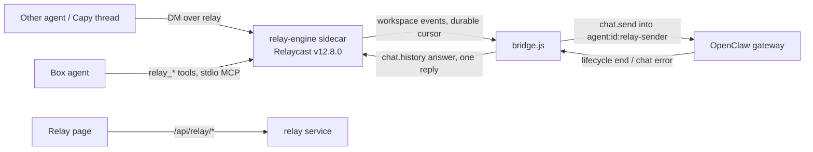

# Agent Relay (self-hosted Relaycast in AlphaClaw)

Status: box side shipped in v0.10.169 (ALPH-63 PR A). The remote side (OAuth MCP endpoint at `/relay/mcp`, Capy-side tools, webhook wake) is PR B.

## Pieces

- **Engine** (`engine-binary.js`, `constants.js`): upstream's standalone binary, one sha256 pin per target, verified before every run (download → verify → rename; a mismatch is `engine_hash_mismatch` and is never run). Built-in sidecar `relay-engine` with a minimal env: `RELAYCAST_INTERNAL_SECRET_FILE`, `RELAYCAST_PUBLIC_WORKSPACE_CREATE=false`, its own `HOME`.
- **Service** (`index.js`): phases `off → idle → downloading → engine_starting → provisioning → ready | failed`, retry with backoff, status for the page and Doctor, exposure check every few minutes.
- **Provisioning** (`provision.js`): one workspace through `/internal/workspaces`, the box agent's token, all in `relay/secrets.json` (0600). A database with its keys missing is `secrets_missing`, never a second workspace. A refused token re-registers; a 409 deletes and re-registers (checked against the real engine: `agent_already_exists` → DELETE 204 → 201, the old token then 401).
- **Bridge** (`bridge.js`, `bridge-store.js`): the per-message state machine in its own node:sqlite database (`relay/bridge.db`).
- **Tools** (`mcp-tools.js`, `mcp-stdio.js`, `mcp-entry.js`): five messaging-only tools; the `mcp.servers.relay` entry is owner-marked `_alphaclawManaged: "relay"` and written inside `ensureGatewayProxyConfig`'s locked writer.

## Invariants (do not regress)

1. Exactly one terminal relay reply per bridged message: the answer, or a coded failure. The bridge skips its post when the agent already replied in the thread during the run. A message's state is final only once the engine has taken its reply; a reply the engine refused (engine restarting) parks the row as `replying` with the reply text, and reconcile retries it for up to 24 h.
2. Events are matched by run id only, never by session key alone; events that arrive before `chat.send` returns are buffered per run (at most 200 runs).
3. A send that was written to the gateway is never sent again. A disconnect or an ambiguous send moves the message to `reconciling`, which reads `sessions.list` (`hasActiveRun`) and `chat.history`. Reconcile waits 2 min after the disconnect, and up to 10 min while OpenClaw reports the session's last run aborted and not yet resumed or tombstoned (`abortedLastRun`, `restartRecoveryStatus`), so a turn that restart recovery resumes is answered with its resumed answer. A session still running is left alone; a finished one is answered from history (read again with OpenClaw's 1000-entry window when the relay message is not in the last 60 rows); a missing answer after the relay message is `run_interrupted`, and a relay message missing from history, or an ambiguous send, is `outcome_unknown`. A message whose metadata cannot be read is read again on the next poll and, after 5 failures, dropped unrun, so the loop guards never fail open.
4. In history, only the next relay message ends a message's turn. OpenClaw's restart recovery inserts its own user row (`[System] Your previous turn was interrupted …`) before the resumed answer; the live test caught the first version stopping there.
5. Relay runs never use `agent:<id>:main`. Self-authored messages and replies carrying `relay_status` are never answered (no ping-pong); a hop count over 4 is refused. The box agent's own `relay_send` and `relay_reply` stamp the hop: one past the highest hop of the relay runs in flight (read from `bridge.db`), and a reply at least its parent's hop + 1, so two agents answering each other reach the limit.
6. No key, token or secret is returned by any API or written to a log or to `openclaw.json`. Message text reaches signed-in humans only; the agent actor's admin API gets metadata.
7. Every `ALPHACLAW_RELAY*` key is deployment environment only.

## Known limits

- The engine has no host flag, so it also listens on non-loopback addresses at its internal port. Every route but `/health` needs a key and anonymous create is off; the page warns. Upstream `--host` is a follow-up.
- The read-only policy for relay requests is an instruction in the injected message plus the audit log, not a sandbox.

## Tests

Hermetic `tests/server/relay-*.test.js` and `routes-relay.test.js`; live `tests/live/relay-bridge.e2e.test.js` (real gateway, real engine, SIGKILL mid-run); container `tests/container/relay-engine-binary.e2e.test.js`; browser `tests/browser/relay-page-smoke.mjs`.
