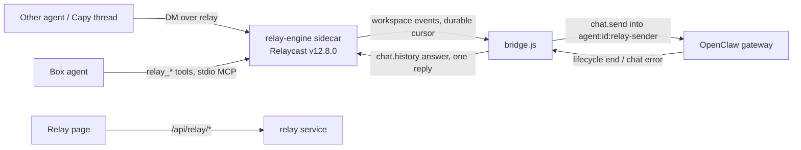

# Agent Relay (self-hosted Relaycast in AlphaClaw)

Status: box side in v0.10.170 (ALPH-63 PR A); remote side (OAuth MCP endpoint `/relay/mcp`, remote tools, thread wakes) in v0.10.171 (PR B).

## Pieces

- **Engine** (`engine-binary.js`, `constants.js`): upstream's standalone binary, one sha256 pin per target, verified before every run (download → verify → rename; a mismatch is `engine_hash_mismatch` and is never run). Built-in sidecar `relay-engine` with a minimal env: `RELAYCAST_INTERNAL_SECRET_FILE`, `RELAYCAST_PUBLIC_WORKSPACE_CREATE=false`, its own `HOME`.
- **Service** (`index.js`): phases `off → idle → downloading → engine_starting → provisioning → ready | failed`, retry with backoff, status for the page and Doctor, exposure check every few minutes.
- **Provisioning** (`provision.js`): one workspace through `/internal/workspaces`, the box agent's token, all in `relay/secrets.json` (0600). A database with its keys missing is `secrets_missing`, never a second workspace. A refused token re-registers; a 409 deletes and re-registers (checked against the real engine: `agent_already_exists` → DELETE 204 → 201, the old token then 401).
- **Bridge** (`bridge.js`, `bridge-store.js`): the per-message state machine in its own node:sqlite database (`relay/bridge.db`).
- **Tools** (`mcp-tools.js`, `mcp-stdio.js`, `mcp-entry.js`): five messaging-only tools; the `mcp.servers.relay` entry is owner-marked `_alphaclawManaged: "relay"` and written inside `ensureGatewayProxyConfig`'s locked writer. Its arguments are `--relay-dir`, `--port` and `--app-port`; OpenClaw starts the server with only a default env, so `relay_send` and `relay_reply` mask their text through AlphaClaw's `POST /relay/internal/mask` (`routes/relay.js`: loopback only, no proxy headers, the relay's internal secret as the bearer, anything else a 404) and fail closed with `masking_unavailable` when it does not answer.

## Invariants (do not regress)

1. Exactly one terminal relay reply per bridged message: the answer, or a coded failure. The bridge skips its post when the agent already replied in the thread during the run. A message's state is final only once the engine has taken its reply; a reply the engine refused (engine restarting) parks the row as `replying` with the reply text, and reconcile retries it for up to 24 h.
2. Events are matched by run id only, never by session key alone; events that arrive before `chat.send` returns are buffered per run (at most 200 runs).
3. A send that was written to the gateway is never sent again. A disconnect or an ambiguous send moves the message to `reconciling`, which reads `sessions.list` (`hasActiveRun`) and `chat.history`. Reconcile waits 2 min after the disconnect, and up to 10 min while OpenClaw reports the session's last run aborted and not yet resumed or tombstoned (`abortedLastRun`, `restartRecoveryStatus`), so a turn that restart recovery resumes is answered with its resumed answer. A session still running is left alone; a finished one is answered from history (read again with OpenClaw's 1000-entry window when the relay message is not in the last 60 rows); a missing answer after the relay message is `run_interrupted`, and a relay message missing from history, or an ambiguous send, is `outcome_unknown`. While `sessions.list` keeps failing, each reconciling message waits 10 min from when it began reconciling or the failures began, whichever is later (or until its give-up time), then gets `outcome_unknown`. A message whose metadata cannot be read is read again on the next poll and, after 5 failures, dropped unrun, so the loop guards never fail open.
4. In history, only the next relay message ends a message's turn. OpenClaw's restart recovery inserts its own user row (`[System] Your previous turn was interrupted …`) before the resumed answer; the live test caught the first version stopping there.
5. Relay runs never use `agent:<id>:main`. Self-authored messages and replies carrying `relay_status` are never answered (no ping-pong); a hop count over 4 is refused. The box agent's own `relay_send` and `relay_reply` stamp the hop: one past the highest hop of the relay runs in flight (read from `bridge.db`), and a reply at least its parent's hop + 1, so two agents answering each other reach the limit.
6. No key, token or secret is returned by any API or written to a log or to `openclaw.json`. Message text reaches signed-in humans only; the agent actor's admin API gets metadata.
7. Every `ALPHACLAW_RELAY*` key is deployment environment only.

8. One finisher per message (ALPH-68). Every path that posts a terminal reply first claims the row with an atomic state move (`dispatched|reconciling → completing`, `replying → completing`, `bridge-store.claim`); a path that loses the claim posts nothing. Reconcile runs single-flight however many triggers ask.
9. The run id is known before the send (ALPH-68, d10). The bridge stores `run_id = 'relay-' + messageId` and tracks it before writing `chat.send` (OpenClaw uses the idempotency key as the run id), so a send that timed out (ambiguous, `outcome_unknown`) still ends through its run's lifecycle end; a run id the gateway answers with that differs replaces it. While a message is reconciling the bridge checks every 5 s, and an ambiguous send whose idle session already holds its answer ends at once instead of after the 2-minute grace (d3); a row a gateway restart moved there keeps the whole grace.
10. OpenClaw's verbose host notices (`🧭 New session: …`, `🧹 Auto-compaction complete…`) are stripped from the start of an answer before masking, so box session ids never reach a peer. The relay masker skips collected values that are plain words (letters only, at most 12): `GOG_KEYRING_PASSWORD` defaults to the product's name and masked it in every reply.

## Conversations (Relay page)

`GET /api/relay/conversations` (`conversations.js`) lists every DM conversation the engine holds, by agent pair, newest first, with its message count, last message, the bridge's last state and, when the box agent takes part, its relay session key; relay sessions on the box whose engine messages retention removed are listed from `sessions.list` as `sessionOnly`. Filters: `agent`, `q` (participant names, the last message and a bounded scan of the newest 1,000 top-level messages), `from`, `to`; paged by `before`. `GET /api/relay/conversations/:id` returns one page of top-level messages (`before` cursor) with every reply in their threads, oldest first, each with its relay status and the bridge's state. The agent actor's manifest ops (`relay.conversations`, `relay.conversation`) drop every text and session key. The page opens a conversation's box session read-only in Chat (`#/chat/<key>`).

## Remote side

- **OAuth** (`oauth-provider.js`, `remote-store.js`, `routes/relay-remote.js`): the MCP SDK's register, authorize, token and revoke handlers over an `OAuthServerProvider` in `relay/remote.db`. The handlers and their rate limiters are built once at route registration and reach the provider through a delegate that opens the store on first use. Metadata URLs come from `ALPHACLAW_SETUP_URL` only. Authorization parks the request until an admin approves it on `/relay/oauth/consent`. Approval needs a consent window the admin opened with **Allow a new connection** in the last 10 minutes, for a request started after it opened, and the one-time code that press returned to the Relay page (one approval per window and per code, humans only, compared with timingSafeStringEqual, kept in memory only and never in the status the agent reads), because the shared Capy callback makes an attacker's registration look exactly like the owner's and the authorize endpoint is public: an attacker's authorize link clicked inside an open window creates a fresh request, and only the code tells it apart (the /ship outside voice found that bypass in the request-time check alone). The consent post is same-origin when `Origin` is the public origin, or absent or `null` with `Sec-Fetch-Site: same-origin` (a real browser sends `null` under a strict referrer policy; the /ship review caught the first version refusing every real consent), plus the CSRF token. Registration is anonymous, so at most 20 registrations wait for consent and a new one evicts the oldest waiting one.
- **Endpoint** `/relay/mcp`: stateless Streamable HTTP, a new MCP server per request, bearer token checked for this resource. One OAuth client is one principal.
- **Bindings** (`remote-tools.js`): `relay_bind` gives a (client, thread id) pair a new random `capy-<12 hex>` agent, registers it on the engine (its token stays in `remote.db`) and returns a capability once. Every call as that agent needs the capability and the same client. A binding past its until date stops waking but is kept, so rebinding still needs the capability. Names are never derived from the thread id or reused: after `relay_unbind`, the owner's Remove or a client revoke, the next bind gets a new agent and a new box session, so no one inherits an earlier conversation, and another connection binding the same thread id gets its own agent. Binds of one (client, thread) run one at a time, and a bind that finishes after its client was revoked or its binding removed is discarded.
- **Wakes** (`wake.js`): the bridge's `onRelayMessage` hook enqueues a durable wake for a message to a bound agent; delivery is https:443 to an allowed host, DNS-resolved and refused if any address is not public, then pinned to that address (SNI and certificate check still use the host name), no redirects, backoff retries (10 s to 1 h, a DNS outage included; only a policy refusal is final), the whole request bounded by a 10 s deadline, 404/410 marks the binding dead. Delivery drops a wake whose binding expired or whose client was revoked. At most one wake per binding is pending; a message that arrives meanwhile is read with `relay_inbox`. The bridge awaits the hook before its event cursor moves past the message, and the remote side opens (and drains the queue) as soon as the relay is ready.

Remote invariants: no token, capability, webhook URL or agent token is returned by any route or written to a log; tokens and capabilities are stored hashed; revoking a client and removing a binding are outside the agent's manifest, and the agent's view of `/api/relay/remote` drops thread ids, client ids, agent names and audit details.

## Known limits

- The engine has no host flag, so it also listens on non-loopback addresses at its internal port. Every route but `/health` needs a key and anonymous create is off; the page warns. Upstream `--host` is a follow-up.
- The read-only policy for relay requests is an instruction in the injected message plus the audit log, not a sandbox.

## Tests

Hermetic `tests/server/relay-*.test.js` and `routes-relay.test.js`; live `tests/live/relay-bridge.e2e.test.js` (real gateway, real engine, SIGKILL mid-run); container `tests/container/relay-engine-binary.e2e.test.js`; browser `tests/browser/relay-page-smoke.mjs`.
