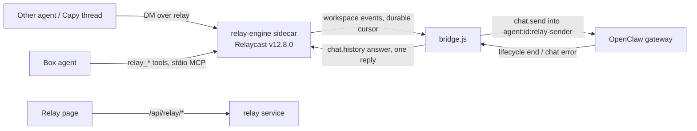

# Agent Relay (self-hosted Relaycast in AlphaClaw)

Status: box side in v0.10.170 (ALPH-63 PR A); remote side (OAuth MCP endpoint `/relay/mcp`, remote tools, thread wakes) in v0.10.171 (PR B).

## Pieces

- **Engine** (`engine-binary.js`, `constants.js`): upstream's standalone binary, one sha256 pin per target, verified before every run (download → verify → rename; a mismatch is `engine_hash_mismatch` and is never run). Built-in sidecar `relay-engine` with a minimal env: `RELAYCAST_INTERNAL_SECRET_FILE`, `RELAYCAST_PUBLIC_WORKSPACE_CREATE=false`, its own `HOME`.
- **Service** (`index.js`): phases `off → idle → downloading → engine_starting → provisioning → ready | failed`, retry with backoff, status for the page and Doctor, exposure check every few minutes.
- **Provisioning** (`provision.js`): one workspace through `/internal/workspaces`, the box agent's token, all in `relay/secrets.json` (0600). A database with its keys missing is `secrets_missing`, never a second workspace. A refused token re-registers; a 409 deletes and re-registers (checked against the real engine: `agent_already_exists` → DELETE 204 → 201, the old token then 401).
- **Bridge** (`bridge.js`, `bridge-store.js`): the per-message state machine in its own node:sqlite database (`relay/bridge.db`).
- **Tools** (`mcp-tools.js`, `mcp-stdio.js`, `mcp-entry.js`): five messaging-only tools; the `mcp.servers.relay` entry is owner-marked `_alphaclawManaged: "relay"` and written inside `ensureGatewayProxyConfig`'s locked writer. Its arguments are `--relay-dir`, `--port` and `--app-port`; OpenClaw starts the server with only a default env, so `relay_send` and `relay_reply` mask their text through AlphaClaw's `POST /relay/internal/mask` (`routes/relay.js`: loopback only, no proxy headers, the relay's internal secret as the bearer, anything else a 404) and fail closed with `masking_unavailable` when it does not answer.

## Invariants (do not regress)

1. Exactly one terminal relay reply per bridged message: the answer, or a coded failure. The bridge skips its post when the agent already replied in the thread during the run. A message's state is final only once the engine has taken its reply; a reply the engine refused (engine restarting) parks the row as `replying` with the reply text, and reconcile retries it for up to 24 h.
2. Events are matched by run id only, never by session key alone; events that arrive before `chat.send` returns are buffered per run (at most 200 runs).
3. A send that was written to the gateway is never sent again. A disconnect or an ambiguous send moves the message to `reconciling`, which reads `sessions.list` (`hasActiveRun`) and `chat.history`. Reconcile waits 2 min after the disconnect, and up to 10 min while OpenClaw reports the session's last run aborted and not yet resumed or tombstoned (`abortedLastRun`, `restartRecoveryStatus`), so a turn that restart recovery resumes is answered with its resumed answer. A session still running is left alone; a finished one is answered from history (read again with OpenClaw's 1000-entry window when the relay message is not in the last 60 rows); a missing answer after the relay message is `run_interrupted`, and a relay message missing from history, or an ambiguous send, is `outcome_unknown`. While `sessions.list` keeps failing, each reconciling message waits 10 min from when it began reconciling or the failures began, whichever is later (or until its give-up time), then gets `outcome_unknown`. A message whose metadata cannot be read is read again on the next poll and, after 5 failures, dropped unrun, so the loop guards never fail open.
4. In history, only the next relay message ends a message's turn. OpenClaw's restart recovery inserts its own user row (`[System] Your previous turn was interrupted …`) before the resumed answer; the live test caught the first version stopping there.
5. Relay runs never use `agent:<id>:main`. Self-authored messages and replies carrying `relay_status` are never answered (no ping-pong); a hop count over 4 is refused. The box agent's own `relay_send` and `relay_reply` stamp the hop: one past the highest hop of the relay runs in flight (read from `bridge.db`), and a reply at least its parent's hop + 1, so two agents answering each other reach the limit.
6. No key, token or secret is returned by any API or written to a log or to `openclaw.json`. Message text reaches signed-in humans only; the agent actor's admin API gets metadata.
7. Every `ALPHACLAW_RELAY*` key is deployment environment only.

8. One finisher per message (ALPH-68). Every path that posts a terminal reply first claims the row with an atomic state move (`dispatched|reconciling → completing`, `replying → completing`, `bridge-store.claim`); a path that loses the claim posts nothing. Reconcile runs single-flight however many triggers ask.
9. The run id is known before the send (ALPH-68, d10). The bridge stores `run_id = 'relay-' + messageId` and tracks it before writing `chat.send` (OpenClaw uses the idempotency key as the run id), so a send that timed out (ambiguous, `outcome_unknown`) still ends through its run's lifecycle end; a run id the gateway answers with that differs replaces it. Nothing ends inside the 2-minute grace and history is not read during it (d3): an ambiguous send still tracked ends at its lifecycle end, and after a disconnect every reconciling row, an ambiguous send included, waits the whole grace from the disconnect, because OpenClaw's restart recovery may not have marked the session resuming yet and history would give the text before a tool call. The early reconcile pass every 5 s does not hold up event polling.
10. OpenClaw's verbose host notices (`🧭 New session: …`, `🧹 Auto-compaction complete…`) are stripped from the start of an answer before masking, so box session ids never reach a peer. The relay masker skips `GOG_KEYRING_PASSWORD` only while it holds its published default (the product's name, which it masked in every reply); every other collected value is masked, plain words included, and so is that value under any other key.
11. Relay sessions are messaging-only by a plugin, not by the prompt (ALPH-71 H-1), except a delegate's (see Delegates). `lib/plugin/relay-guard` is an OpenClaw `before_tool_call` hook, loaded through `plugins.entries["relay-guard"]` (owner-marked `_alphaclawManaged: "relay"` in its config, `relay/guard-entry.js`, written beside the relay MCP entry). In `agent:*:relay-*` sessions it allows only `session_status` (own session, no model change) and `agents_list`, and refuses every other tool by name, including any tool a later OpenClaw adds. A call with no session key or run id is checked against `bridge.db`: while a relay run is in flight it gets the relay policy. An error while checking a relay call denies that call. The bridge dispatches only while the gateway's `plugins.list` reports the plugin `active` (checked after every reconnect, again every 30 s while missing, 5 s while unverified); otherwise messages wait and Doctor shows `relay_guard_missing`.
    No path tool is offered. Through four review rounds of PR #336 the guard admitted `read`, `ls`, `glob` and `grep` inside the agent workspace and logs, and each round found a path OpenClaw opened differently from the one the guard checked: `file:` and `media://` references, `..` through a symlink, filename repairs after the hook (`@`, `~`, `</arg_value>>`, `.docodex`), a look-alike file when the exact name is missing (quotes, NFC/NFD, unicode spaces), then a run `cwd` resolved from `agents.entries` (the guard read only `agents.list`) and `sandbox.workspaceDir` as the coding root in sandbox mode. A path guard has to re-implement OpenClaw's resolution exactly and track it on every pin, so relay peers lose file access instead: they get answers from what the box agent already knows, and anything needing a file goes through the owner. Re-adding a path tool needs a new adversarial table against the pinned tools; the last one is in commit 1de9cd52.
12. The agent never asks the owner itself (the message tool is blocked in relay sessions). The bridge tells the owner through AlphaClaw's notifier (`eventType: "relay"`, ids `relay-approval-<message id>` and `relay-withheld-<message id>`) when an answer names its approval id or the guard denied a tool during the turn, and when a reply was withheld. A notice names the sender, the approval id and the denied tools, never the message text.
13. A message is routed only when its sender is a participant of the conversation it was posted in (engine 12.8.0 accepts a reply from a non-participant). `relay_reply` checks the same before it posts: the parent, read with the workspace key, must be in a conversation the acting agent is part of, and any other parent is `message_not_found`, the same answer as a missing one.
14. Masking is defence in depth, not the boundary: the guard keeps credentials out of reach. The masker collects the relay's own secrets (agent tokens, webhook URLs and their path segments, the admin token, auth-profile credentials) beside the environment, and a reply carrying one in an encoded or spaced-out form is withheld whole (`kRelayWithheldText`).

## Conversations (Relay page)

`GET /api/relay/conversations` (`conversations.js`) lists every DM conversation the engine holds, by agent pair, newest first, with its message count, last message, the bridge's last state and, when the box agent takes part, its relay session key; relay sessions on the box whose engine messages retention removed are listed from `sessions.list` as `sessionOnly`. Filters: `agent`, `q` (participant names, the last message and a bounded scan of the newest 1,000 top-level messages), `from`, `to`; paged by `before`. `GET /api/relay/conversations/:id` returns one page of top-level messages (`before` cursor) with every reply in their threads, oldest first, each with its relay status and the bridge's state. The agent actor's manifest ops (`relay.conversations`, `relay.conversation`) drop every text and session key. The page opens a conversation's box session read-only in Chat (`#/chat/<key>`).

## Brain archive (ALPH-68 PR3)

`brain-archive/` saves every DM conversation the engine holds as gbrain pages, following GBRA-108's conventions (Nov 7) and gbrain 0.60.593's contract (GBRA-295):

- **Where:** slug `relay/<box agent>/<peer>/<conversation id>` (lowercased; a conversation without the box agent uses its two participants in name order), parts `<slug>-part-N`, type `relay-conversation`, frontmatter `trust: external`, `content_origin: peer`, `relay_agent`, `relay_peer`, `conversation_id`, `started_at`, `last_message_at`, `part`, `facts_backstop: false`, in the source `relay` only. The archive checks `gbrain sources list --json` for that source and its `federated: false` (every 10 minutes while it is missing, hourly once ready) and writes nothing otherwise; it never creates or changes the source.
- **What:** the engine's messages, both sides, thread replies included (read strictly: a thread that cannot be read fails the read instead of saving a page without its replies), with timestamps and relay status, every message fenced as quoted data, the box agent's own and its session text included; from the box agent's relay session (`chat.history`, paged), its assistant messages and the names of its tool calls, never arguments or results, and never the session's user rows (the injected envelope). An assistant message equal to a reply already on the page is not repeated.
- **Cleaning (`privacy.js`):** credential URLs (userinfo, signed or token query parameters, matched after percent-decoding) are removed; lines and paragraphs that look like email (headers, addresses, and everything after an email address, header or block in that message), raw meeting notes (markers, timestamped or repeated speaker turns), health or family are replaced by `[withheld: private class]`; then the relay masker (`mask.js`) and the archive's own shapes (private key blocks, `secret = value` assignments). The rendered page is scanned again (shapes, assignments, credential URLs and every collected secret value); a match parks the conversation as `masked_refused` and nothing is written.
- **When (`relay/archive.db`):** a 30 s timer, one tick at a time. A conversation is due when the engine's mark (message count, last message) or its newest bridge row moved, 2 min after its last change and at most 15 min after its first unsaved change; a conversation active in the last day is looked at again hourly (thread replies do not always move the engine mark). An unchanged page (same sha256) is never sent. At most 10 conversations per tick, puts 2 s apart.
- **How (`gbrain.js`):** argv only, through the box's gbrain wrapper (`/usr/local/bin/gbrain`, or the absolute path `ALPHACLAW_RELAY_BRAIN_BIN` names; never a plain `gbrain` on `PATH`: with no wrapper the archive is `gbrain_missing`, shown as Not set up, and runs nothing; the wrapper is resolved again on every availability check, every 10 minutes while unavailable, so one a box's boot scripts write after AlphaClaw starts is picked up). `gbrain put <slug> --source relay [--expected-revision R] --request-id <uuid> --json` with the page on stdin; the rendered page and request id are stored before the put, so a retry of the same bytes reuses the id. Exit 0 is committed (the receipt's revision is kept); 10 is pending: the id is polled with `gbrain write-request --json -- <id>`, never resubmitted, and that page gets no new write until it settles; 3 parks as `gbrain_stopped` until Retry; 75, 124, a timeout or a retryable exit 1 (`queue_capacity`, `lock_busy`, `writer_busy`, …) back off from 1 min doubling to 6 h with the same request id and never park; `revision_required` re-reads the page with `gbrain get` (a page whose `conversation_id` is missing or another conversation's parks as `revision_conflict`): a part this archive.db wrote before (a Retry after a conflict) is replaced with the revision read, and a part it never wrote (archive.db lost or replaced) is kept as found, the entries whose heading it already holds are booked to it, and the rest continue on the next part, so a page the engine's retention outran is never replaced with less; a put that timed out, was killed or hit gbrain's own deadline may still have landed, so its request id is read back with `write-request` before any other write to that page (`not_found` sends it again with the same id), and a read-back that times out keeps the write pending; every gbrain run is its own process group, so a timeout signals the wrapper and gbrain together and a process still holding the pipes after SIGKILL is abandoned instead of awaited; `revision_conflict` parks (Retry drops the stored revision, so the next write re-reads it); any other failure backs off with a new id. Committed pages are queued and committed once per tick with `gbrain git commit-push --path <relay checkout> -m … --json -- <page paths>` (exit 0 or 4 clears them; 75 or a retryable code backs off; 3 holds commits until Retry).
- **Parts only grow:** an entry once assigned to a part stays there. A new entry goes to the open part until the next one would pass 256 KiB, then to a new part. When an entry of the open part disappears from the source (engine retention, a reset or compacted session), that part is closed as last written and new entries start the next part, so a page is never rewritten with less.
- **Status:** `relay.status` → `archive` (phase, code, counts, parked codes, last error, commit state), the Relay page's Brain archive card with **Retry now** (`POST /api/relay/archive/retry`, not in the admin manifest, so humans only), and `det:relay-archive-<code>` Doctor cards for parked conversations and a federated source.

- **Budget:** per peer, the bytes this box adds to its pages on one UTC day (`ALPHACLAW_RELAY_BRAIN_PEER_DAILY_MB`, default 8) and the size of all its saved pages (`ALPHACLAW_RELAY_BRAIN_PEER_TOTAL_MB`, default 512), both deployment env only. Past the daily budget a conversation waits in `backoff` (`peer_budget_daily`) until 00:00 UTC; past the total it parks (`peer_budget_total`), a Doctor card names it, and Retry alone does not write. Nothing is dropped: the conversation stays due and is saved once the budget allows, while the engine still holds it. `archive.overBudget` in `relay.status` names each peer, its code and when it resumes, and the Relay page lists them.
- **Environment and cost:** gbrain runs with an allowlisted environment (PATH, HOME, locale, TMPDIR, XDG, proxy and CA settings, `GBRAIN_*`), never AlphaClaw's provider keys or secrets; gbrain reads its database and provider keys from its own config. That relies on the wrapper behaving as GBRA-108 described it (Nov 7): it runs gbrain as the cron writers' user, with their HOME, and gbrain loads its own env and config from there; AlphaClaw never sets HOME or passes `DATABASE_URL`/`OPENAI_API_KEY`. Every pattern in `privacy.js` is bounded (no unbounded quantifier next to one that can match the same characters), and a text is cut to 64 KiB before it is scanned, so a crafted message costs linear time (CSO ALPH-71: the first secret-assignment pattern was cubic).
- **Who can read the pages:** the relay source is out of default recall, but it is not access control. Anything on the box that can run `gbrain get --source relay` (or `gbrain search --source relay`) reads the archived text, the box agent included: its exec tool can run the gbrain CLI. The admin API keeps relay text human-only; the brain does not.

Archive invariants: 11. The bridge never waits on the archive; the archive only reads the engine, the bridge's store and the session. 12. A write gbrain accepted is never resubmitted, and a retried write reuses its request id only with byte-identical content. 13. Nothing reaches a page that the masker, the private-class filter or the secret scanner would still change; nothing is written outside the `relay` source, and nothing but `gbrain` runs in the brain.

## Remote side

- **OAuth** (`oauth-provider.js`, `remote-store.js`, `routes/relay-remote.js`): the MCP SDK's register, authorize, token and revoke handlers over an `OAuthServerProvider` in `relay/remote.db`. The handlers and their rate limiters are built once at route registration and reach the provider through a delegate that opens the store on first use. Metadata URLs come from `ALPHACLAW_SETUP_URL` only. Authorization parks the request until an admin approves it on `/relay/oauth/consent`. Approval needs a consent window the admin opened with **Allow a new connection** in the last 10 minutes, for a request started after it opened, and the one-time code that press returned to the Relay page (one approval per window and per code, humans only, compared with timingSafeStringEqual, kept in memory only and never in the status the agent reads), because the shared Capy callback makes an attacker's registration look exactly like the owner's and the authorize endpoint is public: an attacker's authorize link clicked inside an open window creates a fresh request, and only the code tells it apart (the /ship outside voice found that bypass in the request-time check alone). The consent post is same-origin when `Origin` is the public origin, or absent or `null` with `Sec-Fetch-Site: same-origin` (a real browser sends `null` under a strict referrer policy; the /ship review caught the first version refusing every real consent), plus the CSRF token. Registration is anonymous, so at most 20 registrations wait for consent and a new one evicts the oldest waiting one. A DCR client registered with `client_secret_post` gets a secret that is stored as its sha256 only; `authenticateClientSecret` checks it with timingSafeStringEqual before the SDK's token and revoke handlers and answers `401 invalid_client` for a wrong or missing one (the SDK's own check compared plaintext with `!==`). A plaintext secret from an earlier version is rehashed when the client is next read. `client_secret_post` stays, so clients that registered with it keep working.
- **Endpoint** `/relay/mcp`: stateless Streamable HTTP, a new MCP server per request, bearer token checked for this resource. One OAuth client is one principal.
- **Bindings** (`remote-tools.js`): `relay_bind` gives a (client, thread id) pair a new random `capy-<12 hex>` agent, registers it on the engine (its token stays in `remote.db`) and returns a capability once. Every call as that agent needs the capability and the same client. A binding past its until date stops waking but is kept, so rebinding still needs the capability. Names are never derived from the thread id or reused: after `relay_unbind`, the owner's Remove or a client revoke, the next bind gets a new agent and a new box session, so no one inherits an earlier conversation, and another connection binding the same thread id gets its own agent. Binds of one client run one at a time, and a bind that finishes after its client was revoked or its binding removed is discarded. One client holds at most `ALPHACLAW_RELAY_MAX_BINDINGS_PER_CLIENT` (default 20) bindings that have not expired; a new one past that is `binding_limit`, renewing an existing one is always allowed. The hourly cap's slot is spent by every `relay_send` and `relay_reply` that reaches the tool, refused ones included, and given back only when AlphaClaw could not reach the engine or mask the text (`engine_unavailable`, `masking_unavailable`), so refused probes cannot run unmetered.
- **Wakes** (`wake.js`): the bridge's `onRelayMessage` hook enqueues a durable wake for a message to a bound agent; delivery is https:443 to an allowed host, DNS-resolved and refused if any address is not public, then pinned to that address (SNI and certificate check still use the host name), no redirects, backoff retries (10 s to 1 h, a DNS outage included; only a policy refusal is final), the whole request bounded by a 10 s deadline, 404/410 marks the binding dead. Delivery drops a wake whose binding expired or whose client was revoked. At most one wake per binding is pending; a message that arrives meanwhile is read with `relay_inbox`. The bridge awaits the hook before its event cursor moves past the message, and the remote side opens (and drains the queue) as soon as the relay is ready.

Remote invariants: no token, capability, webhook URL or agent token is returned by any route or written to a log; tokens and capabilities are stored hashed; revoking a client and removing a binding are outside the agent's manifest, and the agent's view of `/api/relay/remote` drops thread ids, client ids, agent names and audit details.

## Delegates (GST-1982)

A delegate is a Capy thread the owner has chosen to act as them on this box. Its relay messages run with the box agent's working tools instead of the messaging-only policy, because "save this to memory and the brain" from the owner's own thread should not need a second approval from the same owner.

- **Who (`relay-guard/trust.js`, `remote.js`).** A sender is a delegate only when its `capy-*` agent is listed in `ALPHACLAW_RELAY_DELEGATE_AGENTS` (deployment env only, comma-separated, empty by default), its binding is live (not past `until`, not dead) and its OAuth client is consented and not revoked. The list names agents, not clients: every thread of one Capy account binds through the same OAuth client, review subagents and threads that read outside pull requests included, while an agent name is random and only the thread holding its capability can bind it again. After `relay_unbind`, Remove or a revoke the thread gets a new agent, which is not a delegate until the owner lists it. Every other sender, unbound peers and foreign apps included, keeps the messaging-only policy.
- **One lookup for both guards.** The bridge stamps `trust` (and the message's approval) on the `bridge.db` row right before `chat.send`, on every dispatch attempt. `resolveRelayTrust` reads that row for the run (by run id, else the session's newest in-flight row) and re-checks the binding in `remote.db`, both read-only, on every tool call. It also checks the agent against the guard's own copy of the list (`delegateAgents` in the plugin entry, written from the same env key; a missing list means no delegates), so an agent taken off the list is a peer at once, even for a row stamped before. Anything missing or unreadable is the peer tier. Wintermute's own guard can require the same file (passing `delegateAgents`) so both agree on "this is the owner via Capy".
- **What a delegate gets (`relay-guard/policy.js`).** `read`, `write`, `edit`, `ls`, `apply_patch`, `exec`, `process`, `view_image`, `pdf`, `web_search`, `web_fetch`, `structured_output`, `session_status` (own session, no model change), `agents_list`, `sessions_list`, the memory plugin's `memory_search` and `memory_get`, and the deferred-tool wrappers `tool_search`, `tool_describe` and `tool_call` (the tool a wrapper reaches runs through the hook again under its own name). `ALPHACLAW_RELAY_DELEGATE_TOOLS` adds exact names or one MCP server's tools as `<server>__*`; a shorter prefix is ignored, and no entry can unlock a tool on the never list below or the relay's own `relay__*` tools. A test fails when a core name on the list is missing from the pinned OpenClaw's catalog.
- **What it never gets.** Anything not on that list, by name: `message` (except below), `conversations_*`, `sessions_send`, `sessions_spawn`, `sessions_yield`, `sessions_history`, `sessions_search`, `subagents`, `automations`, `cron`, `gateway`, `plugins`, `secrets`, `ask_user` (so a relay sender can never complete a secret drop), `nodes`, `computer`, `screen`, `terminal`, `portal`, `mobile_ui`, `openclaw`, `intent`, `browser`, `skill_workshop`, `personal_instructions`, `github_publish`, every `conversations_*` tool, the relay's own tools and any tool a later OpenClaw adds. This matters because the bridge's gateway client holds `operator.admin`, so OpenClaw offers relay turns every owner-only tool; the guard is what withholds them.
- **Answering the delegate itself.** A delegate's final answer is posted back to its own Capy thread, so handing that thread what it asked for (file contents, a staged export, results) is the owner receiving them, not a send to another person, and needs no approval. The delegate header says so in one line (GST-1975, after a box agent asked for the owner's own line before handing a staged export to the thread that requested it). Sending to anyone else still needs a carried approval naming them.
- **Carried approvals (`approval.js`).** The remote `relay_send` and `relay_reply` take an optional `approval`: the owner's words in Capy, a one-line action, 1 to 10 recipients and the thread code. It rides as `relay_approval` metadata and counts only on a delegate's message. The bridge renders it into the prompt from the stored row, never from the message body. For that message's run only, the guard allows `message` with `send`, `reply` or `sendattachment` when the call names exactly one recipient in `target` and it is a listed one, one send per recipient (spent when the guard admits the call, even if the channel then fails). Any other recipient field is refused, because OpenClaw 2026.10.9 takes the recipient from `to`, `channelId`, `roomId` or `chatId` when `target` is empty, from a channel plugin's own delivery aliases, and ignores `targets` for a send; only the message tool's standard content and media fields are accepted beside it, so `gatewayUrl`, `accountId` (another account of the same channel can be another person behind the same id) and plugin-specific keys are refused too; an approved send goes out on the channel's default account. Recipient ids are compared exactly, case included. A listed `<channel>:<id>` also matches `target: <id>` on that channel; any other listed string (`@lupe`, Discord's `channel:123`) must equal `target` and matches on any channel, so name the channel in the approval to pin it. `threadId` is refused on an approved send, since a thread can be another destination. After the run the owner gets one line naming the approval, the action and the recipients. Purchases are not covered: there is no purchase tool, and spending stays with the owner.
- **Ending it.** Revoke, Remove and `relay_unbind` demote the sender's rows to peer and abort the turn running in its session (`chat.abort` by session, so a turn resumed under a new run id stops too, retried on every pump while the run lasts if the gateway did not take it); an expired or dead binding is caught on the next pump. The guard's per-call liveness check stops the next tool call either way.
- **Seeing it.** `relay_send` and `relay_reply` return `trust` (`delegate` | `peer`), `reason` (`delegate`, `delegates_off`, `agent_not_delegate`, `not_bound`, `binding_expired`, `binding_dead`, `client_revoked`) and `approval` (`recorded` | `ignored` | `none`). The Relay page marks delegate bindings, `relay.status` lists the delegate agents, and Doctor shows one P3 card (`det:relay-delegates`) naming them and any list entry that was ignored.

**Residual risks, stated plainly.** A delegate is owner-equivalent on the box: `exec` runs as the gateway's user, so it can reach the openclaw CLI, config files, `.env` and the relay's own databases, and it can send through a CLI the guard never sees. The withheld tools stop a confused or steered model from taking the easy path; they are not a wall. The real gates are who the owner lists and that a revoke ends the running turn. A carried approval is a receipt of what the thread says the owner approved, not proof. The recipients it has used are kept in the gateway's memory only: if the gateway restarts during that run, the resumed turn can send once more to a recipient it already reached. The owner's after-the-fact line counts only message sends whose result was not an error, through the tool or the `tool_call` wrapper, and names the approval's recipients rather than each one sent to. A delegate turn that writes the gateway config through `exec` is not blocked (a 409 on the admin API while a delegate run is in flight was cut: it would not close this gap and would block the owner's own turns). A real outbound wall would run delegate `exec` under a separate unprivileged uid; that is a follow-up.

## Known limits

- The engine has no host flag, so it also listens on non-loopback addresses at its internal port. Every route but `/health` needs a key and anonymous create is off; the page warns. Upstream `--host` is a follow-up.
- The relay guard is a tool policy inside the gateway, not an OS sandbox: it trusts OpenClaw to run `before_tool_call` for every tool call (core, MCP and `tool_search`), which the live test checks against the pinned OpenClaw.

## Tests

Hermetic `tests/server/relay-*.test.js` and `routes-relay.test.js` (the brain archive in `relay-brain-archive.test.js`, against `tests/fixtures/fake-gbrain.js`, every gbrain exit code); live `tests/live/relay-bridge.e2e.test.js` (real gateway, real engine, SIGKILL mid-run, the brain archive through the fake or, with `OPENCLAW_LIVE_GBRAIN_BIN`, a real gbrain with a scratch brain); container `tests/container/relay-engine-binary.e2e.test.js`; browser `tests/browser/relay-page-smoke.mjs`.
