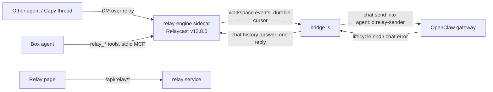

# Agent Relay (self-hosted Relaycast in AlphaClaw)

Status: box side in v0.10.169 (ALPH-63 PR A); remote side (OAuth MCP endpoint `/relay/mcp`, remote tools, thread wakes) in v0.10.170 (PR B).

## Pieces

- **Engine** (`engine-binary.js`, `constants.js`): upstream's standalone binary, one sha256 pin per target, verified before every run (download → verify → rename; a mismatch is `engine_hash_mismatch` and is never run). Built-in sidecar `relay-engine` with a minimal env: `RELAYCAST_INTERNAL_SECRET_FILE`, `RELAYCAST_PUBLIC_WORKSPACE_CREATE=false`, its own `HOME`.
- **Service** (`index.js`): phases `off → idle → downloading → engine_starting → provisioning → ready | failed`, retry with backoff, status for the page and Doctor, exposure check every few minutes.
- **Provisioning** (`provision.js`): one workspace through `/internal/workspaces`, the box agent's token, all in `relay/secrets.json` (0600). A database with its keys missing is `secrets_missing`, never a second workspace. A refused token re-registers; a 409 deletes and re-registers (checked against the real engine: `agent_already_exists` → DELETE 204 → 201, the old token then 401).
- **Bridge** (`bridge.js`, `bridge-store.js`): the per-message state machine in its own node:sqlite database (`relay/bridge.db`).
- **Tools** (`mcp-tools.js`, `mcp-stdio.js`, `mcp-entry.js`): five messaging-only tools; the `mcp.servers.relay` entry is owner-marked `_alphaclawManaged: "relay"` and written inside `ensureGatewayProxyConfig`'s locked writer.

## Invariants (do not regress)

1. Exactly one terminal relay reply per bridged message: the answer, or a coded failure. The bridge skips its post when the agent already replied in the thread during the run.
2. Events are matched by run id only, never by session key alone; events that arrive before `chat.send` returns are buffered per run (at most 200 runs).
3. A send that was written to the gateway is never sent again. A disconnect or an ambiguous send moves the message to `reconciling`, which reads `sessions.list` (`hasActiveRun`) and `chat.history`. A session still running is left alone; a finished one is answered from history; a missing answer is `run_interrupted` (or `outcome_unknown` for an ambiguous send).
4. In history, only the next relay message ends a message's turn. OpenClaw's restart recovery inserts its own user row (`[System] Your previous turn was interrupted …`) before the resumed answer; the live test caught the first version stopping there.
5. Relay runs never use `agent:<id>:main`. Self-authored messages and replies carrying `relay_status` are never answered (no ping-pong); a hop count over 4 is refused.
6. No key, token or secret is returned by any API or written to a log or to `openclaw.json`. Message text reaches signed-in humans only; the agent actor's admin API gets metadata.
7. Every `ALPHACLAW_RELAY*` key is deployment environment only.

## Remote side

- **OAuth** (`oauth-provider.js`, `remote-store.js`, `routes/relay-remote.js`): the MCP SDK's register, authorize, token and revoke handlers over an `OAuthServerProvider` in `relay/remote.db`. The handlers and their rate limiters are built once at route registration and reach the provider through a delegate that opens the store on first use. Metadata URLs come from `ALPHACLAW_SETUP_URL` only. Authorization parks the request until an admin approves it on `/relay/oauth/consent`.
- **Endpoint** `/relay/mcp`: stateless Streamable HTTP, a new MCP server per request, bearer token checked for this resource. One OAuth client is one principal.
- **Bindings** (`remote-tools.js`): `relay_bind` maps a thread id to `capy-<sha256 prefix>`, registers that agent on the engine (its token stays in `remote.db`) and returns a capability once. Every call as that agent needs the capability and the same client. A binding past its until date stops waking but is kept, so rebinding still needs the capability; only the owner (Relay page) or a client revoke frees it.
- **Wakes** (`wake.js`): the bridge's `onRelayMessage` hook enqueues a durable wake for a message to a bound agent; delivery is https:443 to an allowed host, DNS-resolved and refused if any address is not public, then pinned to that address (SNI and certificate check still use the host name), no redirects, backoff retries, 404/410 marks the binding dead.

Remote invariants: no token, capability, webhook URL or agent token is returned by any route or written to a log; tokens and capabilities are stored hashed; revoking a client and removing a binding are outside the agent's manifest.

## Known limits

- The engine has no host flag, so it also listens on non-loopback addresses at its internal port. Every route but `/health` needs a key and anonymous create is off; the page warns. Upstream `--host` is a follow-up.
- The read-only policy for relay requests is an instruction in the injected message plus the audit log, not a sandbox.

## Tests

Hermetic `tests/server/relay-*.test.js` and `routes-relay.test.js`; live `tests/live/relay-bridge.e2e.test.js` (real gateway, real engine, SIGKILL mid-run); container `tests/container/relay-engine-binary.e2e.test.js`; browser `tests/browser/relay-page-smoke.mjs`.
