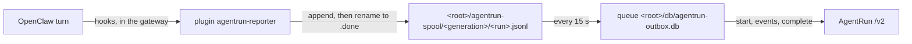

# AgentRun reporter

AlphaClaw can copy each OpenClaw turn into an [AgentRun](https://github.com/Parcha-ai/agentrun) server as an SDK run, so the turns show up in AgentRun's console beside the runs it starts itself. A turn that may run past AgentRun's window is reported when it ends; a shorter one shows up while it runs (see Live runs below). It is off unless `ALPHACLAW_AGENTRUN_URL` is set, and it sends nothing until `ALPHACLAW_AGENTRUN_OPENCLAW_TOKEN` is set too.

By default a reported turn carries **metadata only**: which agent, which kind of session, when, how long, the outcome, the model, token usage, and the name, timing and outcome of each tool call. Prompts, answers, tool inputs and tool outputs stay on the box. The one exception is a cron job you list by id in `ALPHACLAW_AGENTRUN_CONTENT_CRON`: its turns also carry the job's configured message as the input and the assistant's text as the answer. Tool inputs and outputs are never sent, for any session.

## How a turn travels



1. **Capture (inside the gateway).** `lib/plugin/agentrun-reporter` listens to `model_call_started`, `model_call_ended`, `llm_output`, `after_tool_call`, `agent_end`, `gateway_start`, `cron_changed` and `subagent_spawned` (see Cron runs and Subagents below). A run's class is decided by the first hook that carries its trigger and job id (`model_call_started` has neither, so the class it records is provisional, marked `provisional: true`, and is replaced by a second open record). A stopped run reaches `agent_end` as a failure with no error and is reported as `cancelled` (stopped). It appends small JSON lines to one spool file per run, in a directory named for the gateway process (set when the plugin loads; `gateway_start` only creates it, so a turn already running then keeps its file), and renames the file to `.done` when the run ends. OpenClaw 2026.11.4 fires an attempt's `llm_output`, which carries its model and token usage, just after its `agent_end`, so an ended run whose `llm_output` has not come yet keeps its file open until it does; a hook for a run whose file is already closed is ignored, and a new attempt (`model_call_started`) closes an earlier one still waiting. `model_call_ended` records the model, so a turn that never gets an `llm_output` still names it. The server reads a live gateway's open file as finished once its end record is 30 s old. OpenClaw 2026.11.4 can also drop a run's `agent_end` altogether (the gateway logs `agent_end handler from agentrun-reporter failed: Plugin invocation scope is closed` when the run's plugin scope closes before the hook is dispatched), so a live file whose last record is an `llm_output` 30 s old, with no end record, is read as finished too: its status comes from the last reply's stop reason (`error` or `timeout` failed, `aborted` cancelled, otherwise completed), its error says `end not recorded`, and `evidence_complete` is false. Before, such a turn waited until the next gateway restart and was then reported as cancelled. It makes no network or database call, never throws into OpenClaw, and logs at most 10 `capture_error` lines when the disk refuses writes. It writes text into the spool only for a cron session (the server decides later whether that job is listed). An incognito session is not recorded at all.
2. **Queue (AlphaClaw).** Every 15 s `lib/server/agentrun-reporter` turns `.done` files into rows of a SQLite queue (mode 0600), one row per run (`UNIQUE (source, source_run_id)`), and deletes the files. A file whose queue write fails stays for the next tick. A file that cannot be read or converted (a disk error, a failing secret scrub) also stays, and is dropped with a `capture_error` line only after 5 ticks in a row fail. OpenClaw ends each model-fallback attempt with its own `agent_end`, so a later attempt of a run arrives as a second file. With live runs on (the default), a failed attempt waits 30 s for the next one, and every attempt of a run goes into its one row: the run shows every attempt's tools, the summed usage and the last attempt's outcome. A restart-resumed turn with the same run id joins its row only when it starts within those 30 s, which a gateway relaunch rarely allows. A file of a run that already ended (or, with `ALPHACLAW_AGENTRUN_LIVE=off`, any later attempt) is logged as `late_attempt` and not reported. Reading a file twice (a crash before its delete) changes nothing: each run has one row, and a row records which attempt files it already holds (`attempt_files`), so an attempt is never counted twice. The 30 s wait is checked every tick, even when a spool entry could not be read. Spool files left by an earlier gateway process become runs with status `cancelled` and `evidence_complete: false` ("interrupted by gateway restart"). Each spool directory is named `<ms>-<pid>-<start ticks>` for the gateway process that wrote it (`<ms>-<pid>` where `/proc/self/stat` is unreadable), and its open files are read as interrupted only once that process is gone (a pid AlphaClaw cannot judge counts as alive), so the clock never decides which directory is live. The start ticks tell the gateway from a later process that reuses its pid, as a container restart with a kept volume often does. A spool directory or file AlphaClaw cannot read or delete is skipped and logged at most once an hour; it never stops sending. Session keys are replaced by a keyed hash (`<root>/db/agentrun-reporter.salt`), so AgentRun never sees chat ids or phone numbers.
3. **Send.** For each due row the sender makes sure the AgentRun agent exists (one per OpenClaw agent, `openclaw-agent-<id>`; one per recurring cron job, `openclaw-cron-<job>`; one per OpenClaw agent for its one-shot jobs, `openclaw-cron-oneshot-<agent>`; all with `learning: false`), then starts an SDK run, posts the events in batches (at most 100 events and 200 KB each) and completes it. AgentRun titles an SDK run with the first 80 characters of its input, so each run's input opens with what ran, how long it took and how it ended (for example `Telegram group (main) · 24.5s · completed` or `Cron: Morning brief · 1.2s · failed`), then the details; a listed cron job's message follows that line.

## Live runs

A run can show up in AgentRun while it runs, so a long turn is visible before it ends. `ALPHACLAW_AGENTRUN_LIVE=off` turns this off and reports every run when it ends.

- **When a run goes live.** An agent turn goes live once a hook decided its class: the first tool call, `llm_output` or `agent_end` writes an open record without the `provisional` mark. The open record `model_call_started` writes never starts one. A cron run goes live from its `cron_changed` start record (source `openclaw-cron`, the same key as when it ends), and the tools of the turn folded into it stream into the same row. Only a live gateway's runs go live.
- **The gate.** A run goes live only when AgentRun's `GET /capabilities` advertises `features.sdk_runs` (read again at most once an hour), or when the run's timeout is under 50 minutes: its cron job's `payload.timeoutSeconds`, else `agents.defaults.timeoutSeconds` in `openclaw.json`, else OpenClaw's default of 48 hours. Without the capability almost nothing goes live, because AgentRun ends an SDK run an hour after its start.
- **What it sends.** The start's input is the title line (`Telegram DM (main)`, `Cron: Morning brief`) and `Started <ISO time>` on its second line, never a status and never contents, even for a cron job listed in `ALPHACLAW_AGENTRUN_CONTENT_CRON` (an SDK run's input cannot change, so it would say "running" forever). Each 15 s tick, the tools the run called since the last tick go out as one more stored, numbered batch; an earlier batch is never rewritten, so a retry, a crash or a restart resends the same bytes. When the run ends, the rest is stored and sent: the remaining tools, then, for a listed cron job only, its message (`Job message: …`) and the run's text, then the completion with the status, duration, model and usage.
- **Fallback attempts.** A later attempt of the same run id appends to the same row. The completion is sent after an attempt that completed, or 30 s after the last attempt ended with no new one.
- **Abandoned runs.** A live row whose spool file is gone without an end (OpenClaw fires no `agent_end` for some attempts), or whose file is still there with no new record for 30 minutes once the run is past its own timeout plus 5 minutes, is completed as `cancelled`, "ended without a report". Idle time alone never ends a run, because a running tool or a cron script run writes no record until it ends. Rows are abandoned only after a tick that read every spool file.
- **Expired live runs.** A live run that AgentRun still expires keeps its data and is reported once more, as a finished run, when it ends, under `alphaclaw:openclaw:<run>:final` (`alphaclaw:openclaw-cron:<job>:<runAtMs>:final` for a cron run). The expired live run stays in AgentRun as unknown.
- **Cap.** At most 15 live rows are open at once, because each open SDK run holds one AgentRun runner loop that reads its inbox from the store every 100 ms. Past the cap a new run waits and is reported when it ends (`live_cap`). Rollout measures AgentRun's CPU and store latency on the box before this changes.
- **With `features.sdk_runs`.** A live row that sent no batch for 10 minutes sends an empty one, and every OpenClaw start also carries `started_at` (the run's start), `title` (its title line, at most 200 characters) and `labels` (`source:openclaw`, `class:<class>`). A start refused as `input_invalid` for an unknown field (a server without the feature) is rebuilt once without them.

## Cron runs

Every cron run shows up once, whatever it ran: an isolated agent turn, a wake of the main session, or a script.

- **Source.** The plugin's `cron_changed` listener writes a run's `started` and `finished` events to one spool file, `@cron.<job>.<runAtMs>`, which the finish closes. It keeps only the job's id, name, schedule kind, payload kind, session target, wake mode and agent, and the run's status, duration, model, run id and session key; never the summary, the error text or the payload. A removed job leaves `@cronjob.<job>.<ms>.done`.
- **One run, one key.** OpenClaw 2026.11.4 stamps both events with the run's start time (`runAtMs`), so the run is started in AgentRun under `alphaclaw:openclaw-cron:<job>:<runAtMs>`. A finish whose start was lost (a gateway restart in between) is still one run. A start with no finish in a dead gateway's directory is reported `cancelled` ("interrupted by gateway restart"). A start that a later start of the same job replaced never got a finish (OpenClaw sends none for a trigger check that did not fire) and is let go, as is a start in a live gateway's directory that is 24 hours old. A `skipped` run is reported `cancelled` (skipped).
- **The turn it ran.** An isolated job's turn (class `cron`, the same job, in the session the finish names, started inside the run) is folded into the run before anything is sent, so the run shows the turn's tools, model and usage and the turn is not reported again. A main-session or other-session job's turn is folded only when the job's wake mode is `now`, the turn is a heartbeat turn of the job's agent, and it started inside `[runAtMs, runAtMs + durationMs]`; otherwise the run is reported alone and the turn stays a turn of its session. A folded turn of another session keeps that session's class, so it carries no contents whatever `ALPHACLAW_AGENTRUN_CONTENT_CRON` says; a script run carries none either. A settled turn waits while its run is still going, and a finished run waits up to 10 minutes for a turn of its own that is still settling.
- **Names.** A recurring job's agent is named `Cron: <job name>` (secret-scrubbed, at most 120 characters), resolved from the current job list each time a run is sent, so a rename updates the agent once. `ALPHACLAW_AGENTRUN_HIDE_CRON_NAMES` (job ids, or `*` for all) shows `Cron job <first 8 characters of the id>` instead, in run titles too. A job with schedule kind `at` or `deleteAfterRun` runs under its agent's `One-shot jobs (<agent>)`, with the job's name in each run's title (`One-shot: <name>`); that agent is never archived.
- **Removed jobs.** When a recurring job is removed, its agent is archived once no run of it waits in the queue. A run that still arrives for an archived agent unarchives it (`agent_unarchived`) and is sent. A failed archive is logged (`agent_archive_failed`) and retried an hour later.
- **Queue.** The queue database carries a schema version (`PRAGMA user_version`); a queue written by an earlier version gets the new column and table and keeps its waiting rows.

## Subagents

`subagent_spawned` maps a spawned subagent's session to the session that spawned it, in memory (the newest 1,000). The subagent's run names its parent by the parent's session label (`spawned by openclaw:dm:telegram:<hash>`), never its key, and stays metadata only.

## Session classes

| Class | How it is recognised | Contents sent |
| --- | --- | --- |
| `cron` | key `agent:<a>:cron:<job>[:run:<id>]`, trigger `cron` and a matching job id | only when `<job>` is listed in `ALPHACLAW_AGENTRUN_CONTENT_CRON` |
| `dm`, `group` | a channel key with `direct`, or `group`/`channel` | never |
| `main`, `heartbeat` | `agent:<a>:main` | never |
| `relay` | `agent:<a>:relay-<sender>` | never |
| `hook`, `subagent` | `agent:<a>:hook:…`, `agent:<a>:subagent:…` | never |
| `unknown` | anything else, including a cron-shaped key without the cron trigger | never |

Unknown fails closed: a key the reporter does not recognise is reported as metadata only.

## Delivery rules

- **Each turn is reported once.** The start uses the idempotency key `alphaclaw:openclaw:<run>` (`alphaclaw:openclaw-cron:<job>:<runAtMs>` for a cron run), and the stored request bodies are resent byte for byte after any failure or restart, so AgentRun answers a repeated start with the run it already made. Event batches carry sequence numbers, which AgentRun also deduplicates.
- **Outages.** Network errors, 5xx answers, 408 and any 4xx that carries no AgentRun error code (a proxy or a wrong base URL answered, not AgentRun) retry with a backoff that starts at 15 s and doubles up to 10 min. Rows wait in the queue; at most 20,000 unsent rows are kept (the oldest go first, logged as `queue_overflow`), and sent rows are deleted after 7 days.
- **AgentRun's one-hour window.** AgentRun accepts events and the completion only within an hour of the start. A started run that misses it is marked expired and never restarted (`run_expired`); AgentRun records it as unknown. A live run that still expires is reported once more, as a finished run, when it ends (see Live runs).
- **Ended elsewhere.** AgentRun answers `not_continuable` both for a run whose window passed ("This SDK run expired.") and for one that already ended, for example one stopped in its console ("This SDK run has ended."). The second is logged `run_ended_elsewhere`, not `run_expired`, and nothing more of the run is sent.
- **Content permission is checked again at send.** A turn queued with contents is sent only while its cron job is still listed in `ALPHACLAW_AGENTRUN_CONTENT_CRON`. Taking a job off the list (and restarting AlphaClaw) drops its queued contents turns, logged as `content_revoked`: nothing more of them is sent. A turn whose start already reached AgentRun stays open there and expires as unknown. The row is dropped, not rebuilt, because a rebuilt start under the same key would not match one AgentRun may already hold.
- **Token rejected.** A 401 or 403 pauses all sending for an hour and keeps every row (`token_rejected`).
- **Agent refused.** When AgentRun refuses an agent for good (an invalid definition, an id it keeps for another agent, or a start it refuses for the runtime again after a rebuild), that agent's turns are dropped instead of retried, and `agent_refused` is logged once per agent per hour with the number dropped. An edit that lost a race with another edit (`precondition_failed`) is retried.
- **Runtime.** Runs use the SDK runtime in `ALPHACLAW_AGENTRUN_RUNTIME` (default `claude-agent-sdk`, which every AgentRun release accepts). Changing it updates each agent's definition; a queued turn whose start AgentRun refuses for the old runtime is rebuilt for the new one, and dropped as `agent_refused` if AgentRun refuses it again. Runs already started keep their runtime.

## Settings

All are deployment-environment only (never `.env`, never passed to the gateway). The token is masked as a deployment secret.

| Variable | Meaning |
| --- | --- |
| `ALPHACLAW_AGENTRUN_URL` | AgentRun's API base, ending in `/v2`. Setting it turns the reporter on (the plugin is added to `openclaw.json` at the next gateway start). |
| `ALPHACLAW_AGENTRUN_OPENCLAW_TOKEN` | An AgentRun API token for this reporter. Without it turns are captured and queued but not sent (`token_missing`, logged once). |
| `ALPHACLAW_AGENTRUN_RUNTIME` | SDK runtime for the agents and runs, default `claude-agent-sdk`. An invalid value logs `runtime_invalid` and falls back to `claude-agent-sdk`. |
| `ALPHACLAW_AGENTRUN_CONTENT_CRON` | Comma-separated cron job ids whose turns may carry their input and answer. Empty by default. |
| `ALPHACLAW_AGENTRUN_HIDE_CRON_NAMES` | Comma-separated cron job ids (or `*`) whose names AgentRun must not show; their agents and runs say `Cron job <short id>`. Empty by default. |
| `ALPHACLAW_AGENTRUN_LIVE` | `on` (the default) starts runs in AgentRun while they run, when the gate below allows; `off` reports every run when it ends, as before. Any other value logs `live_invalid` and keeps `on`. |

## Known limits

- With `ALPHACLAW_AGENTRUN_LIVE=off`, a run that a fallback model rescued reports its first attempt's outcome and usage.
- A failed attempt waits only 30 s for its successor, so a restart-resumed turn that starts later (the usual case after a gateway relaunch) is not joined to its run.
- A live run whose `agent_end` never came and whose file stays in the spool is closed only after its timeout plus 5 minutes, which is up to 48 hours under OpenClaw's default once AgentRun advertises `features.sdk_runs`.
- The keep-alive batch with `features.sdk_runs` is empty (`events: []`); that a server with the feature accepts it is not yet checked against a real AgentRun.
- Without `features.sdk_runs`, almost every turn is reported when it ends: OpenClaw's default timeout is 48 hours, and only a run whose timeout is under 50 minutes goes live.
- A cron run goes live from its start record, so a trigger check that did not fire (a start with no finish that a later start replaces) shows up as a cancelled run, "ended without a report".
- A trigger check that did not fire leaves a start with no finish; if the gateway dies before the job's next start, that check is reported as an interrupted run.
- A main-session cron job's heartbeat turn that starts after the run finished is reported as a turn of its session, not with the run.
- A run queued before its job's name was hidden still carries the name in its title; the agent's name follows the hide list at once.
- The agent can write its spool directory, so it could add or remove spool files. It can only send text it already holds.

## Log lines

Every line starts `[alphaclaw] agentrun-reporter`; none carries a token, a prompt or an answer.

| Code | Meaning |
| --- | --- |
| `token_missing` | URL set, token not set: capturing, not sending. |
| `token_rejected` | AgentRun refused the token; sending paused for an hour, rows kept. |
| `run_expired` | A started run missed AgentRun's one-hour window; not resent. With `live=1`, a live run expired and is reported again under `:final` when it ends. |
| `row_dropped` | AgentRun refused a row for good (for example invalid input); not retried. |
| `agent_refused` | AgentRun refused an agent for good; its turns are dropped, not retried. Logged once per agent per hour with `count=` turns dropped. Check `ALPHACLAW_AGENTRUN_RUNTIME` and the agent in AgentRun. |
| `queue_overflow` | The queue passed 20,000 unsent rows and dropped the oldest. |
| `send_error` | An unexpected error in a send pass; the next tick tries again. |
| `runtime_invalid` | `ALPHACLAW_AGENTRUN_RUNTIME` is not a runtime name; using `claude-agent-sdk`. |
| `queue_error` | A spool file could not be written to the queue; it is kept and read again next tick. |
| `late_attempt` | An attempt of a run that already ended in the queue (or, with `ALPHACLAW_AGENTRUN_LIVE=off`, any later model-fallback attempt); that attempt is not reported. |
| `capture_error` | In the gateway log: the plugin could not write its spool, so the turn is not reported. In AlphaClaw's log: a spool file could not be read or converted; it is kept for the next tick (`kept for the next tick`) and dropped after 5 failed ticks (`dropped after 5 tries`). A spool directory or file it cannot read or delete is logged at most once an hour (`dir=` or `file=`); sending continues. |
| `agent_unarchived` | A run arrived for a removed cron job's archived agent; the agent was unarchived and the run sent. |
| `agent_archive_failed` | Archiving a removed cron job's agent failed; retried in an hour. `fix=` says what to do if it repeats: archive the agent in AgentRun's console. |
| `live_cap` | 15 live runs were already open, so a new run waits and is reported when it ends. Logged at most once an hour, with `count=` runs held back since the last line. `fix=`: nothing if it is rare; if it repeats, check AgentRun's CPU and store latency on the box before raising the cap. |
| `run_ended_elsewhere` | AgentRun says a run has ended (stopped in its console, or ended by AgentRun) while AlphaClaw was still sending it; nothing more of it is sent. `fix=`: nothing if someone stopped it in the console; otherwise check AgentRun's log for why it ended the run. |
| `live_invalid` | `ALPHACLAW_AGENTRUN_LIVE` is neither `on` nor `off`; live runs stay on. `fix=`: set it to `on` or `off` in the deployment env. |
| `content_revoked` | A queued turn carried contents for a cron job that is no longer listed in `ALPHACLAW_AGENTRUN_CONTENT_CRON`; nothing more of it is sent. |

## Capy reporter

`scripts/capy-agentrun-reporter.mjs` copies finished Capy thread turns into the same AgentRun server. It does not run inside AlphaClaw: it is a one-shot script for a Capy automation (hourly, in a Capy project of its own that alone holds the Capy key), and it uses the same body builder, AgentRun client and sender as the OpenClaw reporter.

```sh
node scripts/capy-agentrun-reporter.mjs --state <path to state.json>
```

Each pass reads every project the key can see, every page of each project's threads (a thread is read again only when its `lastActivityAt` or status changed; list order is never trusted), each changed thread's messages from its saved cursor, and the project's automations and their latest 100 runs. Then it sends every queued turn and exits.

- **A turn** is one user entry and everything after it until the next user entry. It is reported only once it is closed: the next user entry exists, or the thread is `idle`, `failed` or `archived`. A `waiting` or `working` thread's last turn waits for a later pass, and so does the last turn of a thread whose newest entry is later than the `lastActivityAt` the listing showed (it moved while the pass read it). The last turn of a `failed` thread is reported as `failed`, every other turn as `completed`.
- **Agents.** One AgentRun agent per Captain crew, `capy-captain-<captain thread id>`, and one per project for threads in no crew, `capy-project-<project id>`, all with `learning: false`. Private threads (the thread or its project not `org`, or the thread listed) report under one shared agent, `capy-private-threads` named `Capy private threads`, never under a crew. A crew agent's id is stable; its name is `Capy crew: <Captain name>`, resolved at send from this pass's `GET /captains`, only when the Captain is not listed and it and its project are `org`, and only for `thread` and `automation` turns. Otherwise (a listed or private Captain, a Captain in a private project or one the key cannot see, a failed Captain read, or any other class) it is `Capy crew <captain thread id>`. The readable name is never written to the state file. Every pass reads each known crew agent whose name must be its id back from AgentRun (`GET /agents/<id>`) and renames it (`PUT /agents/<id>/definition`) when AgentRun shows any other name, without waiting for that crew's next turn. The cached definition hash never decides this, so a rename whose answer was lost is still caught; a readable name only goes out with a turn. The run's session id is the thread id.
- **Each turn is reported once.** The start key is `alphaclaw:capy:<thread id>:<user entry id>`, and the tool event ids come from that key too. A thread first seen by the reporter reports only turns from the 24 hours before that pass.
- **Credits.** The change in the thread's credit total since the previous report is written in the metadata line of the last turn a pass reports for that thread as an estimate, never as `cost_usd`.
- **State.** One JSON file (mode 0600, written whole and renamed) keeps each thread's cursor and the turns not yet sent, including their stored request bodies. Keep it in the automation's Drive location. Losing it only re-sends recent turns under their old keys: AgentRun answers an identical start with the run it already has, and a start that differs (a renamed thread, a changed credit figure) with `idempotency_mismatch`, which the sender drops (`row_dropped … code=idempotency_mismatch`) without making a second run.
- **Capy rate limits.** A 429 waits the `retry-after` seconds (at most 2 minutes, 5 times per request) and sends the same request again.
- **Retries.** The pass runs hourly, which is past AgentRun's one-hour window for a started run, so a turn that meets a passing failure is retried in the same pass, round after round while any queued turn that already failed once falls due within a minute, at most 5 rounds, each waiting for the earliest such turn. Whether to go on is decided from the turns still waiting, not from the last round's result, so two turns that failed in the same round both get their retry.
- **Exit code.** 0 after a good pass; 1 when Capy refused the key or failed a read, AgentRun refused the token, or a turn has failed to send 6 times (`rows_waiting`); 2 when a setting is missing. A failed read of one project's threads or of one thread's transcript skips only that project or thread, and the pass goes on. After a failed read, queued metadata-only turns are still sent; turns that carry a title or contents are held (see below).

### Capy classes

| Class | When | Sent |
| --- | --- | --- |
| `private` | The thread's or its project's visibility is anything but `org` (a private project limits every thread in it), or the thread id or its Captain's id is in `AGENTRUN_CAPY_PRIVATE_CAPTAINS` | Metadata only, without the title. Wins over `automation`. |
| `automation` | The one turn an automation run started: for a run of a `threadMode: "new"` automation that is `running`, `completed` or `failed`, the first user entry of the thread the run made, when it falls from 2 minutes before to 10 minutes after the run's `startedAt` and has no `sender`. A `single` thread mixes people's messages with runs that no field tells apart, so its turns are `thread`. | The user entry's text, the assistant replies, and one line per tool call (`Tool call: bash (1.2s)`) |
| `thread` | Every other turn | Metadata plus the thread title |

Metadata is the class, thread id, start time, duration, status, number of replies and tool calls, the model and each tool's name. Tool inputs and outputs are never read into a turn, for any class. A thread whose first user entry the reporter never read (it was first seen past its start) has no automation turn, so its turns fail closed to `thread`. Private wins at send too: a queued turn whose thread is now private, or whose thread or crew is now listed, is dropped before sending (`content_revoked`), title and contents alike.

A queued turn that carries a title or contents (`thread` or `automation`) is sent only when the same pass listed every thread of its project without an error, the listing showed its thread as not private (thread and project `org` visibility, and neither the thread nor its crew in `AGENTRUN_CAPY_PRIVATE_CAPTAINS`), and the thread's transcript read did not fail. A thread missing from the listing (for example one that turned private and is no longer visible to the key), a failed or partial listing, or a failed read leaves the turn held in the queue, neither sent nor dropped (`row_held`). A later pass that proves the thread not private sends it; one that shows it private drops it (`content_revoked`). Metadata-only (`private`) turns are never held. A turn whose thread never comes back stays held until `queue_overflow` drops it.

### Capy settings

Set them as the Capy project's environment variables; the key and the token are secrets.

| Variable | Meaning |
| --- | --- |
| `CAPY_REPORTER_API_KEY` | A Capy API key of a `read_only` service user (Settings → API). Required. |
| `AGENTRUN_BASE_URL` | AgentRun's API base, ending in `/v2`. Required. |
| `AGENTRUN_CAPY_REPORTER_TOKEN` | An AgentRun API token for this reporter. Required. |
| `AGENTRUN_CAPY_PRIVATE_CAPTAINS` | Comma-separated thread or Captain ids (`jam_…`, not thread codes) whose threads are always `private`. Empty by default. |
| `AGENTRUN_CAPY_RUNTIME` | SDK runtime for the agents and runs, default `claude-agent-sdk`. |
| `AGENTRUN_CAPY_STATE` | The state file, when `--state` is not given. |

### Capy log lines

The script logs with the same `[alphaclaw] agentrun-reporter` prefix and `source=capy` on the sender's lines (`token_rejected`, `row_dropped`, `run_expired`, `agent_refused`, `send_error`). Its own codes:

| Code | Meaning |
| --- | --- |
| `config_missing` | A required setting is not set; names the setting, never a value. Nothing is read or sent; exit 2. |
| `capy_rejected` | Capy answered 401 or 403; check `CAPY_REPORTER_API_KEY` and the service user's project access. |
| `capy_error` | Another Capy read failed. `op=captains` means the Captain list failed, so every crew is named by id this pass. `op=project` or `op=thread` names the project or thread id and the HTTP status (or `network`) and skips only that project or thread this pass; `op=read` means the project list itself failed. The next pass reads again from the saved cursors. |
| `state_reset` | The state file could not be read; the pass starts empty and re-sends under the old keys. |
| `private_unmatched` | An entry of `AGENTRUN_CAPY_PRIVATE_CAPTAINS` matches no thread or Captain id the key can see (for example a thread code instead of its `jam_` id); it protects nothing. |
| `content_revoked` | Queued turns whose thread became private before they were sent; dropped, not sent. |
| `agent_rename_error` | A crew agent could not be read back or renamed to its id; the pass exits 1 and the next pass tries again. |
| `row_held` | Queued turns that carry a title or contents whose thread this pass did not prove not private (missing from the listing, a failed or partial listing, or a failed read); kept unsent for a later pass. |
| `rows_waiting` | Turns that have failed to send 6 or more times (in-pass retries count); check `AGENTRUN_BASE_URL`. |
| `queue_overflow` | More than 20,000 unsent turns; the oldest were dropped. |
| `runtime_invalid` | `AGENTRUN_CAPY_RUNTIME` is not a runtime name; using `claude-agent-sdk`. |
| `capy_pass` | One summary line per pass: threads read, turns queued, sent, retried, dropped, expired, still waiting. |
