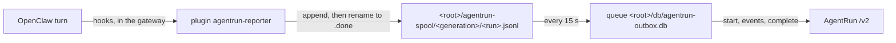

# AgentRun reporter

AlphaClaw can copy each finished OpenClaw turn into an [AgentRun](https://github.com/Parcha-ai/agentrun) server as an SDK run, so the turns show up in AgentRun's console beside the runs it starts itself. It is off unless `ALPHACLAW_AGENTRUN_URL` is set, and it sends nothing until `ALPHACLAW_AGENTRUN_OPENCLAW_TOKEN` is set too.

By default a reported turn carries **metadata only**: which agent, which kind of session, when, how long, the outcome, the model, token usage, and the name, timing and outcome of each tool call. Prompts, answers, tool inputs and tool outputs stay on the box. The one exception is a cron job you list by id in `ALPHACLAW_AGENTRUN_CONTENT_CRON`: its turns also carry the job's configured message as the input and the assistant's text as the answer. Tool inputs and outputs are never sent, for any session.

## How a turn travels



1. **Capture (inside the gateway).** `lib/plugin/agentrun-reporter` listens to `model_call_started`, `llm_output`, `after_tool_call`, `agent_end` and `gateway_start`. A run's class is decided by the first hook that carries its trigger and job id (`model_call_started` has neither, so the class it records is provisional and is replaced by a second open record). A stopped run reaches `agent_end` as a failure with no error and is reported as `cancelled` (stopped). It appends small JSON lines to one spool file per run, in a directory named for the gateway process (set when the plugin loads; `gateway_start` only creates it, so a turn already running then keeps its file), and renames the file to `.done` when the run ends. It makes no network or database call, never throws into OpenClaw, and logs at most 10 `capture_error` lines when the disk refuses writes. It writes text into the spool only for a cron session (the server decides later whether that job is listed). An incognito session is not recorded at all.
2. **Queue (AlphaClaw).** Every 15 s `lib/server/agentrun-reporter` turns `.done` files into rows of a SQLite queue (mode 0600), one row per run (`UNIQUE (source, source_run_id)`), and deletes the files. A file whose queue write fails stays for the next tick. A file that cannot be read or converted (a disk error, a failing secret scrub) also stays, and is dropped with a `capture_error` line only after 5 ticks in a row fail. OpenClaw ends each model-fallback attempt with its own `agent_end`, so a later attempt of a run arrives as a second file. The run is reported as its first attempt: a later attempt's file is logged as `late_attempt` and not reported, so a run that a fallback model rescued shows the first attempt's outcome and usage (a known limit). Reading a file twice (a crash before its delete) changes nothing, because each run has one row. Spool files left by an earlier gateway process become runs with status `cancelled` and `evidence_complete: false` ("interrupted by gateway restart"). Each spool directory is named `<ms>-<pid>-<start ticks>` for the gateway process that wrote it (`<ms>-<pid>` where `/proc/self/stat` is unreadable), and its open files are read as interrupted only once that process is gone (a pid AlphaClaw cannot judge counts as alive), so the clock never decides which directory is live. The start ticks tell the gateway from a later process that reuses its pid, as a container restart with a kept volume often does. A spool directory or file AlphaClaw cannot read or delete is skipped and logged at most once an hour; it never stops sending. Session keys are replaced by a keyed hash (`<root>/db/agentrun-reporter.salt`), so AgentRun never sees chat ids or phone numbers.
3. **Send.** For each due row the sender makes sure the AgentRun agent exists (one per OpenClaw agent, `openclaw-agent-<id>`, and one per cron job, `openclaw-cron-<job>`, all with `learning: false`), then starts an SDK run, posts the events in batches (at most 100 events and 200 KB each) and completes it.

## Session classes

| Class | How it is recognised | Contents sent |
| --- | --- | --- |
| `cron` | key `agent:<a>:cron:<job>[:run:<id>]`, trigger `cron` and a matching job id | only when `<job>` is listed in `ALPHACLAW_AGENTRUN_CONTENT_CRON` |
| `dm`, `group` | a channel key with `direct`, or `group`/`channel` | never |
| `main`, `heartbeat` | `agent:<a>:main` | never |
| `relay` | `agent:<a>:relay-<sender>` | never |
| `hook`, `subagent` | `agent:<a>:hook:…`, `agent:<a>:subagent:…` | never |
| `unknown` | anything else, including a cron-shaped key without the cron trigger | never |

Unknown fails closed: a key the reporter does not recognise is reported as metadata only.

## Delivery rules

- **Each turn is reported once.** The start uses the idempotency key `alphaclaw:openclaw:<run>`, and the stored request bodies are resent byte for byte after any failure or restart, so AgentRun answers a repeated start with the run it already made. Event batches carry sequence numbers, which AgentRun also deduplicates.
- **Outages.** Network errors and 5xx answers retry with a backoff that starts at 15 s and doubles up to 10 min. Rows wait in the queue; at most 20,000 unsent rows are kept (the oldest go first, logged as `queue_overflow`), and sent rows are deleted after 7 days.
- **AgentRun's one-hour window.** AgentRun accepts events and the completion only within an hour of the start. A started run that misses it is marked expired and never restarted (`run_expired`); AgentRun records it as unknown.
- **Content permission is checked again at send.** A turn queued with contents is sent only while its cron job is still listed in `ALPHACLAW_AGENTRUN_CONTENT_CRON`. Taking a job off the list (and restarting AlphaClaw) drops its queued contents turns, logged as `content_revoked`: nothing more of them is sent. A turn whose start already reached AgentRun stays open there and expires as unknown. The row is dropped, not rebuilt, because a rebuilt start under the same key would not match one AgentRun may already hold.
- **Token rejected.** A 401 or 403 pauses all sending for an hour and keeps every row (`token_rejected`).
- **Agent refused.** When AgentRun refuses an agent for good (an invalid definition, an id it keeps for another agent, or a start it refuses for the runtime again after a rebuild), that agent's turns are dropped instead of retried, and `agent_refused` is logged once per agent per hour with the number dropped. An edit that lost a race with another edit (`precondition_failed`) is retried.
- **Runtime.** Runs use the SDK runtime in `ALPHACLAW_AGENTRUN_RUNTIME` (default `claude-agent-sdk`, which every AgentRun release accepts). Changing it updates each agent's definition; a queued turn whose start AgentRun refuses for the old runtime is rebuilt for the new one, and dropped as `agent_refused` if AgentRun refuses it again. Runs already started keep their runtime.

## Settings

All are deployment-environment only (never `.env`, never passed to the gateway). The token is masked as a deployment secret.

| Variable | Meaning |
| --- | --- |
| `ALPHACLAW_AGENTRUN_URL` | AgentRun's API base, ending in `/v2`. Setting it turns the reporter on (the plugin is added to `openclaw.json` at the next gateway start). |
| `ALPHACLAW_AGENTRUN_OPENCLAW_TOKEN` | An AgentRun API token for this reporter. Without it turns are captured and queued but not sent (`token_missing`, logged once). |
| `ALPHACLAW_AGENTRUN_RUNTIME` | SDK runtime for the agents and runs, default `claude-agent-sdk`. An invalid value logs `runtime_invalid` and falls back to `claude-agent-sdk`. |
| `ALPHACLAW_AGENTRUN_CONTENT_CRON` | Comma-separated cron job ids whose turns may carry their input and answer. Empty by default. |

## Known limits

- A run that a fallback model rescued reports its first attempt's outcome and usage.
- Each cron job gets its own AgentRun agent, and one-shot jobs leave agents behind that the reporter never removes. Archive them in AgentRun if they pile up.
- The agent can write its spool directory, so it could add or remove spool files. It can only send text it already holds.

## Log lines

Every line starts `[alphaclaw] agentrun-reporter`; none carries a token, a prompt or an answer.

| Code | Meaning |
| --- | --- |
| `token_missing` | URL set, token not set: capturing, not sending. |
| `token_rejected` | AgentRun refused the token; sending paused for an hour, rows kept. |
| `run_expired` | A started run missed AgentRun's one-hour window; not resent. |
| `row_dropped` | AgentRun refused a row for good (for example invalid input); not retried. |
| `agent_refused` | AgentRun refused an agent for good; its turns are dropped, not retried. Logged once per agent per hour with `count=` turns dropped. Check `ALPHACLAW_AGENTRUN_RUNTIME` and the agent in AgentRun. |
| `queue_overflow` | The queue passed 20,000 unsent rows and dropped the oldest. |
| `send_error` | An unexpected error in a send pass; the next tick tries again. |
| `runtime_invalid` | `ALPHACLAW_AGENTRUN_RUNTIME` is not a runtime name; using `claude-agent-sdk`. |
| `queue_error` | A spool file could not be written to the queue; it is kept and read again next tick. |
| `late_attempt` | A later model-fallback attempt of a run that is already queued or sent; that attempt is not reported. |
| `capture_error` | In the gateway log: the plugin could not write its spool, so the turn is not reported. In AlphaClaw's log: a spool file could not be read or converted; it is kept for the next tick (`kept for the next tick`) and dropped after 5 failed ticks (`dropped after 5 tries`). A spool directory or file it cannot read or delete is logged at most once an hour (`dir=` or `file=`); sending continues. |
| `run_exists` | AgentRun already has a run under a turn's start key with a different start (a source that rebuilt the turn, such as the Capy reporter after a lost state file); booked as sent, no second run. |
| `content_revoked` | A queued turn carried contents for a cron job that is no longer listed in `ALPHACLAW_AGENTRUN_CONTENT_CRON`; nothing more of it is sent. |

## Capy reporter

`scripts/capy-agentrun-reporter.mjs` copies finished Capy thread turns into the same AgentRun server. It does not run inside AlphaClaw: it is a one-shot script for a Capy automation (hourly, in a Capy project of its own that alone holds the Capy key), and it uses the same body builder, AgentRun client and sender as the OpenClaw reporter.

```sh
node scripts/capy-agentrun-reporter.mjs --state <path to state.json>
```

Each pass reads every project the key can see, every page of each project's threads (a thread is read again only when its `lastActivityAt` or status changed; list order is never trusted), each changed thread's messages from its saved cursor, and the project's automations and their latest 100 runs. Then it sends every queued turn and exits.

- **A turn** is one user entry and everything after it until the next user entry. It is reported only once it is closed: the next user entry exists, or the thread is `idle`, `failed` or `archived`. A `waiting` or `working` thread's last turn waits for a later pass, and so does the last turn of a thread whose newest entry is later than the `lastActivityAt` the listing showed (it moved while the pass read it). The last turn of a `failed` thread is reported as `failed`, every other turn as `completed`.
- **Agents.** One AgentRun agent per Captain crew, `capy-captain-<captain thread id>`, and one per project for threads in no crew, `capy-project-<project id>`, all with `learning: false`. The run's session id is the thread id.
- **Each turn is reported once.** The start key is `alphaclaw:capy:<thread id>:<user entry id>`, and the tool event ids come from that key too. A thread first seen by the reporter reports only turns from the 24 hours before that pass.
- **Credits.** The change in the thread's credit total since the previous report is written in the metadata line of the last turn a pass reports for that thread as an estimate, never as `cost_usd`.
- **State.** One JSON file (mode 0600, written whole and renamed) keeps each thread's cursor and the turns not yet sent, including their stored request bodies. Keep it in the automation's Drive location. Losing it only re-sends recent turns under their old keys: AgentRun answers an identical start with the run it already has, and a start that differs (a renamed thread, a changed credit figure) with `idempotency_mismatch`, which the sender books as `run_exists` without making a second run.
- **Capy rate limits.** A 429 waits the `retry-after` seconds (at most 2 minutes, 5 times per request) and sends the same request again.
- **Retries.** The pass runs hourly, which is past AgentRun's one-hour window for a started run, so a turn that meets a passing failure is retried in the same pass, round after round (at most 5 rounds, each waiting at most a minute for the earliest retry), until a round moves nothing. A single turn is retried even when no other turn moved.
- **Exit code.** 0 after a good pass; 1 when Capy refused the key or failed a read, AgentRun refused the token, or a turn has failed to send 6 times (`rows_waiting`); 2 when a setting is missing. A failed read of one project's threads or of one thread's transcript skips only that project or thread, and the pass goes on. After a failed read, queued metadata-only turns are still sent; turns that carry a title or contents are held (see below).

### Capy classes

| Class | When | Sent |
| --- | --- | --- |
| `private` | The thread's visibility is `private` or missing, or the thread id or its Captain's id is in `AGENTRUN_CAPY_PRIVATE_CAPTAINS` | Metadata only, without the title. Wins over `automation`. |
| `automation` | The one turn an automation run started: for a run that is `running`, `completed` or `failed`, the first user entry from 2 minutes before to 10 minutes after its `startedAt`, with no `sender` | The user entry's text, the assistant replies, and one line per tool call (`Tool call: bash (1.2s)`) |
| `thread` | Every other turn | Metadata plus the thread title |

Metadata is the class, thread id, start time, duration, status, number of replies and tool calls, the model and each tool's name. Tool inputs and outputs are never read into a turn, for any class. An automation run whose turn may lie before the part of the transcript a pass read is not matched, so that turn fails closed to `thread`. Private wins at send too: a queued turn whose thread is now private, or whose thread or crew is now listed, is dropped before sending (`content_revoked`), title and contents alike.

A queued turn that carries a title or contents (`thread` or `automation`) is sent only when the same pass listed every thread of its project without an error, the listing showed its thread as not private (`org` visibility, and neither the thread nor its crew in `AGENTRUN_CAPY_PRIVATE_CAPTAINS`), and the thread's transcript read did not fail. A thread missing from the listing (for example one that turned private and is no longer visible to the key), a failed or partial listing, or a failed read leaves the turn held in the queue, neither sent nor dropped (`row_held`). A later pass that proves the thread not private sends it; one that shows it private drops it (`content_revoked`). Metadata-only (`private`) turns are never held. A turn whose thread never comes back stays held until `queue_overflow` drops it.

### Capy settings

Set them as the Capy project's environment variables; the key and the token are secrets.

| Variable | Meaning |
| --- | --- |
| `CAPY_REPORTER_API_KEY` | A Capy API key of a `read_only` service user (Settings → API). Required. |
| `AGENTRUN_BASE_URL` | AgentRun's API base, ending in `/v2`. Required. |
| `AGENTRUN_CAPY_REPORTER_TOKEN` | An AgentRun API token for this reporter. Required. |
| `AGENTRUN_CAPY_PRIVATE_CAPTAINS` | Comma-separated thread or Captain ids (`jam_…`, not thread codes) whose threads are always `private`. Empty by default. |
| `AGENTRUN_CAPY_RUNTIME` | SDK runtime for the agents and runs, default `claude-agent-sdk`. |
| `AGENTRUN_CAPY_STATE` | The state file, when `--state` is not given. |

### Capy log lines

The script logs with the same `[alphaclaw] agentrun-reporter` prefix and `source=capy` on the sender's lines (`token_rejected`, `row_dropped`, `run_expired`, `agent_refused`, `run_exists`, `send_error`). Its own codes:

| Code | Meaning |
| --- | --- |
| `config_missing` | A required setting is not set; names the setting, never a value. Nothing is read or sent; exit 2. |
| `capy_rejected` | Capy answered 401 or 403; check `CAPY_REPORTER_API_KEY` and the service user's project access. |
| `capy_error` | Another Capy read failed. `op=project` or `op=thread` names the project or thread id and the HTTP status (or `network`) and skips only that project or thread this pass; `op=read` means the project list itself failed. The next pass reads again from the saved cursors. |
| `state_reset` | The state file could not be read; the pass starts empty and re-sends under the old keys. |
| `private_unmatched` | An entry of `AGENTRUN_CAPY_PRIVATE_CAPTAINS` matches no thread or Captain id the key can see (for example a thread code instead of its `jam_` id); it protects nothing. |
| `content_revoked` | Queued turns whose thread became private before they were sent; dropped, not sent. |
| `row_held` | Queued turns that carry a title or contents whose thread this pass did not prove not private (missing from the listing, a failed or partial listing, or a failed read); kept unsent for a later pass. |
| `rows_waiting` | Turns that have failed to send 6 or more times (in-pass retries count); check `AGENTRUN_BASE_URL`. |
| `queue_overflow` | More than 20,000 unsent turns; the oldest were dropped. |
| `runtime_invalid` | `AGENTRUN_CAPY_RUNTIME` is not a runtime name; using `claude-agent-sdk`. |
| `capy_pass` | One summary line per pass: threads read, turns queued, sent, retried, dropped, expired, still waiting. |
