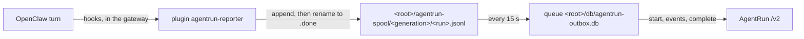

# AgentRun reporter

AlphaClaw can copy each finished OpenClaw turn into an [AgentRun](https://github.com/Parcha-ai/agentrun) server as an SDK run, so the turns show up in AgentRun's console beside the runs it starts itself. It is off unless `ALPHACLAW_AGENTRUN_URL` is set, and it sends nothing until `ALPHACLAW_AGENTRUN_OPENCLAW_TOKEN` is set too.

By default a reported turn carries **metadata only**: which agent, which kind of session, when, how long, the outcome, the model, token usage, and the name, timing and outcome of each tool call. Prompts, answers, tool inputs and tool outputs stay on the box. The one exception is a cron job you list by id in `ALPHACLAW_AGENTRUN_CONTENT_CRON`: its turns also carry the job's configured message as the input and the assistant's text as the answer. Tool inputs and outputs are never sent, for any session.

## How a turn travels

1. **Capture (inside the gateway).** `lib/plugin/agentrun-reporter` listens to `model_call_started`, `llm_output`, `after_tool_call`, `agent_end` and `gateway_start`. A run's class is decided by the first hook that carries its trigger and job id (`model_call_started` has neither, so the class it records is provisional and is replaced by a second open record). A stopped run reaches `agent_end` as a failure with no error and is reported as `cancelled` (stopped). It appends small JSON lines to one spool file per run, in a directory named for the gateway process (set when the plugin loads; `gateway_start` only creates it, so a turn already running then keeps its file), and renames the file to `.done` when the run ends. It makes no network or database call, never throws into OpenClaw, and logs at most 10 `capture_error` lines when the disk refuses writes. It writes text into the spool only for a cron session (the server decides later whether that job is listed). An incognito session is not recorded at all.
2. **Queue (AlphaClaw).** Every 15 s `lib/server/agentrun-reporter` turns `.done` files into rows of a SQLite queue (mode 0600), one row per run (`UNIQUE (source, source_run_id)`), and deletes the files. A file whose queue write fails stays for the next tick. A file that cannot be read or converted (a disk error, a failing secret scrub) also stays, and is dropped with a `capture_error` line only after 5 ticks in a row fail. OpenClaw ends each model-fallback attempt with its own `agent_end`, so a later attempt of a run arrives as a second file. The run is reported as its first attempt: a later attempt's file is logged as `late_attempt` and not reported, so a run that a fallback model rescued shows the first attempt's outcome and usage (a known limit). Reading a file twice (a crash before its delete) changes nothing, because each run has one row. Spool files left by an earlier gateway process become runs with status `cancelled` and `evidence_complete: false` ("interrupted by gateway restart"). Session keys are replaced by a keyed hash (`<root>/db/agentrun-reporter.salt`), so AgentRun never sees chat ids or phone numbers.
3. **Send.** For each due row the sender makes sure the AgentRun agent exists (one per OpenClaw agent, `openclaw-agent-<id>`, and one per cron job, `openclaw-cron-<job>`, all with `learning: false`), then starts an SDK run, posts the events in batches (at most 100 events and 200 KB each) and completes it.

## Session classes

| Class | How it is recognised | Contents sent |
| --- | --- | --- |
| `cron` | key `agent:<a>:cron:<job>[:run:<id>]`, trigger `cron` and a matching job id | only when `<job>` is listed in `ALPHACLAW_AGENTRUN_CONTENT_CRON` |
| `dm`, `group` | a channel key with `direct`, or `group`/`channel` | never |
| `main`, `heartbeat` | `agent:<a>:main` | never |
| `relay` | `agent:<a>:relay-<sender>` | never |
| `hook`, `subagent` | `agent:<a>:hook:…`, `agent:<a>:subagent:…` | never |
| `unknown` | anything else, including a cron-shaped key without the cron trigger | never |

Unknown fails closed: a key the reporter does not recognise is reported as metadata only.

## Delivery rules

- **Each turn is reported once.** The start uses the idempotency key `alphaclaw:openclaw:<run>`, and the stored request bodies are resent byte for byte after any failure or restart, so AgentRun answers a repeated start with the run it already made. Event batches carry sequence numbers, which AgentRun also deduplicates.
- **Outages.** Network errors and 5xx answers retry with a backoff that starts at 15 s and doubles up to 10 min. Rows wait in the queue; at most 20,000 unsent rows are kept (the oldest go first, logged as `queue_overflow`), and sent rows are deleted after 7 days.
- **AgentRun's one-hour window.** AgentRun accepts events and the completion only within an hour of the start. A started run that misses it is marked expired and never restarted (`run_expired`); AgentRun records it as unknown.
- **Token rejected.** A 401 or 403 pauses all sending for an hour and keeps every row (`token_rejected`).
- **Agent refused.** When AgentRun refuses an agent for good (an invalid definition, an id it keeps for another agent, or a start it refuses for the runtime again after a rebuild), that agent's turns are dropped instead of retried, and `agent_refused` is logged once per agent per hour with the number dropped. An edit that lost a race with another edit (`precondition_failed`) is retried.
- **Runtime.** Runs use the SDK runtime in `ALPHACLAW_AGENTRUN_RUNTIME` (default `claude-agent-sdk`, which every AgentRun release accepts). Changing it updates each agent's definition; a queued turn whose start AgentRun refuses for the old runtime is rebuilt for the new one, and dropped as `agent_refused` if AgentRun refuses it again. Runs already started keep their runtime.

## Settings

All are deployment-environment only (never `.env`, never passed to the gateway). The token is masked as a deployment secret.

| Variable | Meaning |
| --- | --- |
| `ALPHACLAW_AGENTRUN_URL` | AgentRun's API base, ending in `/v2`. Setting it turns the reporter on (the plugin is added to `openclaw.json` at the next gateway start). |
| `ALPHACLAW_AGENTRUN_OPENCLAW_TOKEN` | An AgentRun API token for this reporter. Without it turns are captured and queued but not sent (`token_missing`, logged once). |
| `ALPHACLAW_AGENTRUN_RUNTIME` | SDK runtime for the agents and runs, default `claude-agent-sdk`. An invalid value logs `runtime_invalid` and falls back to `claude-agent-sdk`. |
| `ALPHACLAW_AGENTRUN_CONTENT_CRON` | Comma-separated cron job ids whose turns may carry their input and answer. Empty by default. |

## Log lines

Every line starts `[alphaclaw] agentrun-reporter`; none carries a token, a prompt or an answer.

| Code | Meaning |
| --- | --- |
| `token_missing` | URL set, token not set: capturing, not sending. |
| `token_rejected` | AgentRun refused the token; sending paused for an hour, rows kept. |
| `run_expired` | A started run missed AgentRun's one-hour window; not resent. |
| `row_dropped` | AgentRun refused a row for good (for example invalid input); not retried. |
| `agent_refused` | AgentRun refused an agent for good; its turns are dropped, not retried. Logged once per agent per hour with `count=` turns dropped. Check `ALPHACLAW_AGENTRUN_RUNTIME` and the agent in AgentRun. |
| `queue_overflow` | The queue passed 20,000 unsent rows and dropped the oldest. |
| `send_error` | An unexpected error in a send pass; the next tick tries again. |
| `runtime_invalid` | `ALPHACLAW_AGENTRUN_RUNTIME` is not a runtime name; using `claude-agent-sdk`. |
| `queue_error` | A spool file could not be written to the queue; it is kept and read again next tick. |
| `late_attempt` | A later model-fallback attempt of a run that is already queued or sent; that attempt is not reported. |
| `capture_error` | In the gateway log: the plugin could not write its spool, so the turn is not reported. In AlphaClaw's log: a spool file could not be read or converted; it is kept for the next tick (`kept for the next tick`) and dropped after 5 failed ticks (`dropped after 5 tries`). |
