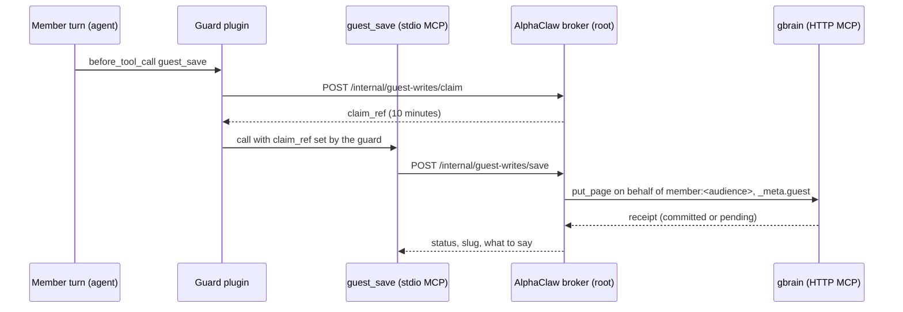

# Guest notes

- **What it does.** When someone other than the owner asks the agent in a group chat to write something down, AlphaClaw saves it in the owner's brain as an outside guest's note. Member turns still can't write to the workspace or the brain directly, and every read of a guest note tells the agent where it came from.
- **Why it's safe.** The note goes into its own gbrain source (`guests`), written only by AlphaClaw's root broker, on behalf of that group's audience member, readable by the owner and that group only. The warning comes from gbrain's own records of who wrote the row, never from page text, so a guest can't write their way out of it.
- **What you need.** A gbrain release that advertises `guest_marker_v1`, the box's guard plugin writing claims, and a broker OAuth client. Until gbrain advertises the marker, the Groups page can't turn a group on.

The full contract between AlphaClaw, the guard plugin and gbrain is the interface spec the three parts were built against (org drive `handoffs/guest-writes/interface.md`, with gbrain's side in `gbrain-plan-diffs.md`). This page covers AlphaClaw's half.

## The flow

## Pieces

- `lib/server/guest-writes/`: the broker.
  - `index.js`: claims, saves, retention, status and the per-group setting.
  - `store.js`: `guest-writes/broker.db` (0600). Claims are stored by the sha256 of their ref; saves by their idempotency key.
  - `render.js`: slugs (`guests/<group_slug>/<member_slug>/<date>-<title>[-n]`), the page, request ids.
  - `gbrain-client.js`: MCP over HTTP with the broker's own OAuth client (`client_credentials`).
  - `files.js`: file pickup from the member's scratch folder and the kept copy.
  - `mcp-stdio.js`, `mcp-entry.js`: the `guest_save` tool and its `mcp.servers.guest_notes` entry.
- `lib/server/routes/guest-writes.js`: the internal claim and save routes, `GET /api/guest-notes`, `PUT /api/guest-notes/groups/:groupKey` (humans only).
- `lib/cli/guest-notes.js`: `alphaclaw guest-notes sweep [--apply]`, the owner's host-side cleanup.
- The Groups page's Guest notes section (`lib/public/js/components/groups-tab/guest-notes.js`).

## Files on the box

| Path (under AlphaClaw's root) | Mode | What it holds |
|---|---|---|
| `guest-writes/internal-secret` | 0600 root | the bearer for the internal routes; on the guard's credential list |
| `guest-writes/broker-client.json` | 0600 root | `{ mcp_url, token_url, client_id, client_secret, owner_member }`; on the guard's credential list. The `guest_save` tool exists only while this file does |
| `guest-writes/broker.db` | 0600 root | claims and saves |
| `guest-files/<group_slug>/<member_slug>/` | 0700 dirs, 0600 files | files saved with `kind: file` |

The setting lives in `alphaclaw.json`: `guestNotes.groups["<channel>:<chat id>"].enabled` (off by default), optional `dailyCap` and `liveCap`, `guestNotes.scratchRoot` (where the guard keeps each member's `<member_slug>/tmp`; unset means file saves are refused) and `guestNotes.retentionDays` (default 90).

## Invariants

1. **The internal routes answer like no route** unless the caller is on loopback, sent no `x-forwarded-for`, `forwarded` or `x-real-ip`, and carries the internal secret (compared timing-safe).
2. **Identity comes from the claim only.** The guard computes `group_slug` and `member_slug` with a key only it holds and sends the member's uid; the broker format-checks them and never stores the sender id. A claim lives 10 minutes and is spent only by an accepted save. The shared fallback uid (10097) never gets a claim.
3. **Every gbrain call acts for the page's audience member** (`X-Gbrain-On-Behalf-Of: member:<id>`): writes, reads, reconciliation and retention deletes. `readable_by` names the owner and that member, never the broker, so an unbound call reads nothing. `get_brain_identity` is the one call without it.
4. **Writes are create-only.** No `expected_revision`, no `force`. A taken slug moves to `-n` with a new request id; a busy gbrain is retried with the same request id; an answer never received is read back by request id (`get_write_request`) before anything is sent again. An accepted write is never resubmitted.
5. **Who the guest is travels as request metadata** (`_meta.guest = { sender_label, group }`), never as page text the model could forge. Frontmatter is for people only.
6. **No guest note without the warning.** Saves answer `guest_saves_unavailable` and the Groups page can't turn a group on until `get_brain_identity` lists `guest_marker_v1`.
7. **Files are picked up from one open descriptor**: `O_NOFOLLOW | O_NONBLOCK`, then a regular file, owned by the claim's uid, one link, the inode the `lstat` saw, within the cap, and a kernel path (`/proc/self/fd`) inside the member's scratch folder.
8. **Retention never deletes a kept note.** The sweep reads each expired page first and skips one whose `guest.promoted` is set (gbrain also refuses the delete, `guest_page_promoted`). A member who left the broker's `may_act_for` can't be reached any more: the save is marked orphaned, and `alphaclaw guest-notes sweep --apply` deletes it through the box's own gbrain CLI.
9. **Nothing the member wrote is logged.** Log lines carry slugs and gbrain codes only.

## Limits

20 saves a day and 200 kept per member per group, 64 KiB per note, 10 MiB per file, 90 days' retention (the restore window is 72 h, after which the kept file is removed).

## Not covered here

The guard's claim hook, the member-turn refusals and the per-member scratch folders belong to the box's guard plugin. gbrain's source rules, the warning on every read path and promotion belong to gbrain.
